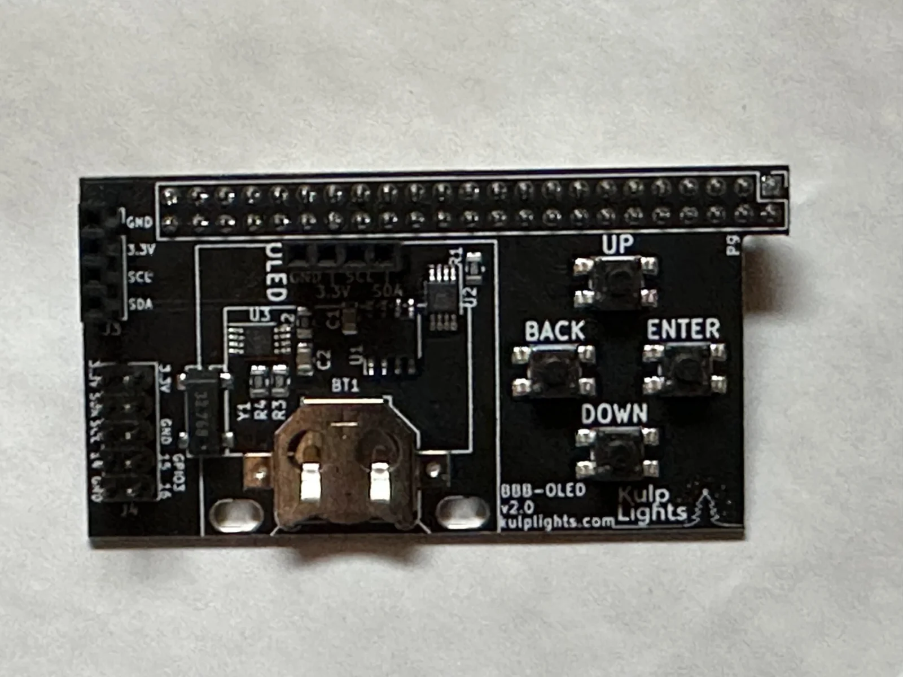
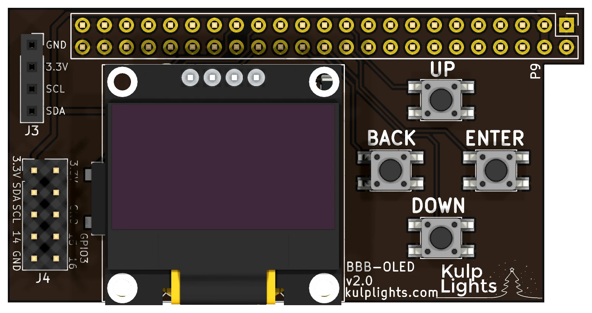

# BBB-OLED

A small add-on for a plain BeagleBone Black running FPP: an OLED status display, four menu buttons, a
real-time clock and a temperature sensor. It has **no outputs** of its own.

{ .board loading=lazy }

<small>BBB-OLED (v2.0), shown without its display, which covers the clock battery.</small>

This page describes revision **v2.0** (printed on the board as `BBB-OLED v2.0`).

Use it on a BeagleBone that drives its lights over the network or USB, or plays the show as a
player or master: it gives the BeagleBone the same display, menus and test buttons as the Kulp
controllers. It plugs onto the BeagleBone's **P9** header only.

!!! warning "Not with an output cape"
    The BBB-OLED uses pins on the P9 header that the BeagleBone Black output capes also use. Fit it to
    a BeagleBone **without** another cape.

## Specifications

| | BBB-OLED |
|---|---|
| Display | 128×64 OLED, blue/yellow, fitted |
| Buttons | Up / Down / Back / Enter |
| Real-time clock | yes, CR1220 cell included |
| Temperature sensor | yes |
| Headers | 1×4 I²C socket; 2×5 I²C and GPIO header |
| Outputs | none |
| Power | from the BeagleBone |
| Size | 66.6 × 34.0 mm (2.62 × 1.34 in), no mounting holes |
| Requires | BeagleBone Black or compatible (see [BeagleBone Black](../hardware/beaglebone-black.md#which-beaglebones-work)), FPP 9.5 or later |

## Board map

{ .board loading=lazy }

### Fitting it

1. **Disconnect power** from the BeagleBone.
2. Line the BBB-OLED's socket up with the **P9** header: the end marked `P9` goes at the BeagleBone's
   Ethernet end, with the board lying over the BeagleBone.
3. Press it down evenly until it is fully seated. It has no mounting holes; the header holds it.

The BBB-OLED takes its power from the BeagleBone. Power the BeagleBone from its barrel jack or USB
as usual.

### Buttons

The four buttons are in a diamond at the right: **UP** at the top, **BACK** at the left, **ENTER**
at the right and **DOWN** at the bottom. **DOWN** also works as **Test** on the status page. See
[Controls & display](../hardware/controls.md).

### Clock

The real-time clock keeps time with no network. Its CR1220 cell sits under the display: unplug the
display to change it. See [Clock](../hardware/network-usb-rtc.md#real-time-clock-rtc).

### Headers

| Header | Marking | Details |
|---|---|---|
| I²C socket | `J3`: `GND 3.3V SCL SDA` | 1×4 socket at the top left, on the I²C bus, for an extra I²C sensor or device. |
| GPIO / I²C | `J4`: `3.3V SDA SCL 14 GND`, `3.3V GND GPIO3 15 16` | 2×5 header below it, laid out like the first ten pins of a Raspberry Pi header: 3.3 V, GND, the I²C bus and three BeagleBone GPIOs (**GPIO3_14**, **GPIO3_15** and **GPIO3_16**, on P9-31, P9-29 and P9-30). Unlike a Pi, it has **3.3 V only, no 5 V**: some Pi I²C add-ons work if they run on 3.3 V. |

The GPIO pins are **3.3 V only**: use them for buttons or switches to ground in FPP's *GPIO Inputs*.

## FPP setup

When FPP detects the BBB-OLED it sets up the display, the buttons, the clock and the temperature
sensor automatically.

## Board revisions

| Revision | Changes |
|---|---|
| **v1.0** | No real-time clock. |
| **v2.0** | Adds the clock and its battery. |
