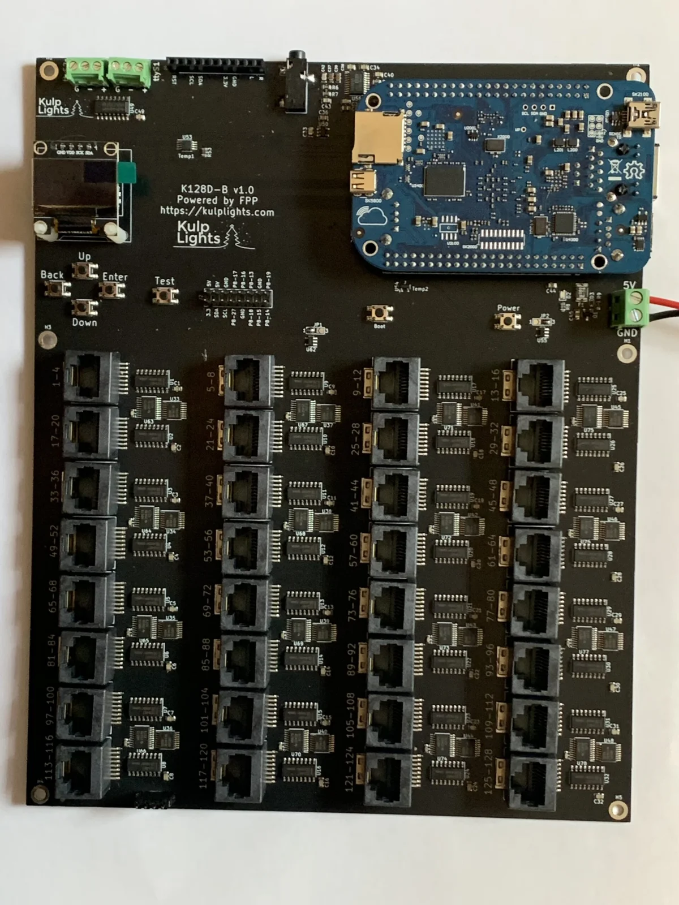
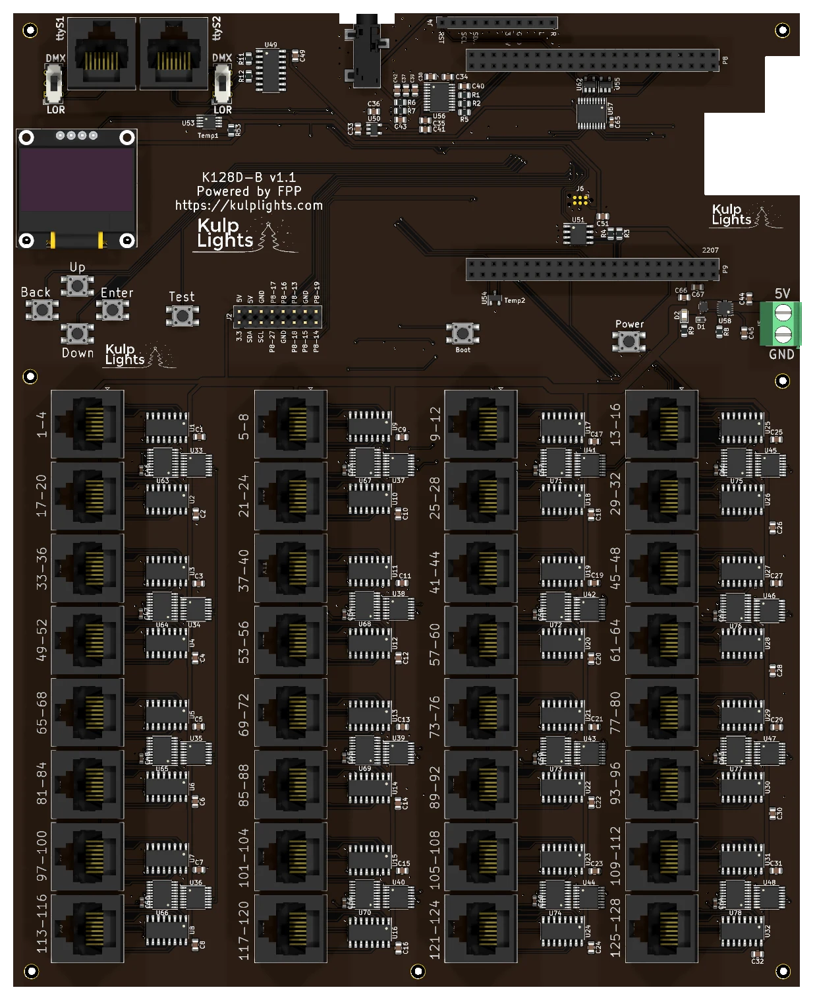

# K128D-B

One hundred and twenty-eight pixel strings from thirty-two differential ports, for driving
differential receivers, plus two DMX/LOR outputs, built-in audio and an FM transmitter socket. It
has no local pixel ports.

{ .board loading=lazy }

<small>An early K128D-B (v1.0) with a BeagleBone fitted upside down. The current v1.1 has RJ45
jacks for the DMX outputs; the [board map](#board-map) below shows it.</small>

This page describes revision **v1.1** (printed on the board as `K128D-B v1.1`). See
[Board revisions](#board-revisions) for v1.0.

!!! warning "How the K128D-B differs from the other boards"
    - **It needs a BeagleBone Black** (or a compatible BeagleBone), which plugs in **upside down**
      on top of the cape. See [BeagleBone Black](../hardware/beaglebone-black.md).
    - **Differential ports only.** Every string goes out over an RJ45 to a
      [differential receiver](../hardware/differential.md), which powers the pixels. There are no
      pixel plugs on the board.
    - **5 V only.** The board takes a regulated 5 V supply for the controller alone.
    - **About 80,000 pixels in all.** The BeagleBone's processor, not the ports, sets the limit.
    - The differential ports are **send-only**: smart receivers work in v1, v2 or V4 mode. Falcon
      V5 receivers work in V4 mode, without status reports.

## Specifications

| | K128D-B |
|---|---|
| Local pixel ports | none |
| Differential ports | 32 × RJ45 = **128 strings** (1–128), send-only |
| Pixel capacity | up to 800 per string at 40 fps; about **80,000 in total** |
| Power input | **5 V DC only**, 2-pin 5.08 mm screw terminal (controller only) |
| DMX / serial | 2, RS-485 transmit, on RJ45 jacks with a DMX/LOR switch (`ttyS1`, `ttyS2`) |
| Audio | built-in stereo DAC, 3.5 mm line out, FM transmitter socket |
| GPIO header | 2×8: 3.3 V, 5 V, GND, I²C and 8 BeagleBone pins |
| Ethernet & USB | the BeagleBone's own |
| Display & buttons | 128×64 OLED, Up / Down / Back / Enter / Test, Boot, Power |
| Real-time clock | yes, CR1220 backup cell |
| Temperature sensors | 2 (`Temp1`, `Temp2`) |
| Size | 182.0 × 225.0 mm (7.17 × 8.86 in), 7 mounting holes, 3.2 mm |
| FPP output | BBShiftString |
| Requires | BeagleBone Black or compatible, FPP 9.5 or later |

## Board map

{ .board loading=lazy }

The BeagleBone mounts upside down over the two long headers at the top right, with its Ethernet
jack over the notch in the right-hand edge.

### Power

The power terminal is on the right-hand edge, below the BeagleBone, marked **5V** (upper screw) and
**GND** (lower screw). It powers the BeagleBone and all of the logic, including the thirty-two
differential driver chips. The receivers power the pixels from their own supplies. Use a regulated
5 V supply rated **at least 4 A**. The LED beside the terminal lights when the board has power. FPP
shows no input voltage reading on this board.

!!! danger "5 V only"
    Use a regulated **5 V** supply, and check that 5 V goes to the upper screw before you switch
    on. Don't connect 12 V or 24 V.

### Differential ports

The thirty-two jacks fill the lower part of the board in 8 rows of 4. They are **vertical** jacks:
the cables plug in from above. Each carries four strings, numbered as printed beside it, **across
each row** and then down:

| | | | | |
|---|---|---|---|---|
| **Row 1** (top) | `1-4` | `5-8` | `9-12` | `13-16` |
| **Row 2** | `17-20` | `21-24` | `25-28` | `29-32` |
| **Row 3** | `33-36` | `37-40` | `41-44` | `45-48` |
| **Row 4** | `49-52` | `53-56` | `57-60` | `61-64` |
| **Row 5** | `65-68` | `69-72` | `73-76` | `77-80` |
| **Row 6** | `81-84` | `85-88` | `89-92` | `93-96` |
| **Row 7** | `97-100` | `101-104` | `105-108` | `109-112` |
| **Row 8** (bottom) | `113-116` | `117-120` | `121-124` | `125-128` |

The ports are send-only, with the standard four-strings-per-RJ45 pinout. Any standard differential
receiver works, and smart receivers work in **v1, v2 or V4** mode; with v2 you can chain up to six
receivers on a port. Falcon V5 receivers also work, set to V4, but they can't send status back. See
[Differential ports](../hardware/differential.md).

### Pixel capacity

Each string can drive up to **800 pixels at 40 fps**, or 1600 at 20 fps. All the strings are sent
together, so the longest string sets the frame rate for the whole board.

The whole board tops out at **about 80,000 pixels**, because the BeagleBone's single processor
prepares every pixel for every frame. Spread them across the ports however you like. Using the
built-in audio takes some of that processor time, so the limit is a little lower when FPP plays
audio from the board.

### DMX / LOR

The two serial outputs are RJ45 jacks at the top-left corner: `ttyS1` on the left and `ttyS2` on
the right. Each has a small slide switch beside it:

| Switch | RJ45 pins | Use |
|---|---|---|
| **DMX** (up) | Data + on pin 1, Data − on pin 2, ground on 7 and 8 | DMX over RJ45, Renard, Pixelnet |
| **LOR** (down) | Data + on pin 4, Data − on pin 5, ground on 7 and 8 | Light-O-Rama networks: plug straight into LOR controllers |

The outputs are transmit-only. FPP calls them `ttyS1` and `ttyS2`. See
[DMX / serial](../hardware/dmx.md).

### Audio and FM transmitter

The board has a built-in **PCM5102A** stereo DAC. Its **3.5 mm line-out jack** is in the notch on
the top edge, and the **FM transmitter socket** (`RST` … `L R`) is beside it, for an optional
Si4713 module. See [Audio](../hardware/audio.md).

### GPIO header

The 2×8 header beside the **Test** button brings out power, the I²C bus and eight BeagleBone
pins, for extra buttons, switches or I²C sensors:

| Pin | Signal | Pin | Signal |
|---|---|---|---|
| 1 | 3.3 V | 2 | 5 V |
| 3 | SDA | 4 | 5 V |
| 5 | SCL | 6 | GND |
| 7 | P8-27 | 8 | P8-17 |
| 9 | GND | 10 | P8-16 |
| 11 | P8-18 | 12 | P8-13 |
| 13 | P8-15 | 14 | GND |
| 15 | P8-14 | 16 | P8-19 |

Pin 1 is at the bottom left; the signal names are printed above and below the pins. Use the pins in
FPP's *GPIO Inputs*, under their BeagleBone names. They connect straight to the BeagleBone, so they
are **3.3 V only**: wire buttons to switch a pin to GND and use the pull-up mode.

### Buttons

| Button | Details |
|---|---|
| `Up` `Down` `Back` `Enter` | the menu buttons, at the left below the OLED. [Controls & display](../hardware/controls.md) |
| `Test` | to the right of the menu buttons. [Test button](../hardware/controls.md#test-button) |
| `Boot` | below the BeagleBone. Hold it at power-on to boot an older BeagleBone from its SD card; see [Booting from the SD card](../hardware/beaglebone-black.md#booting-from-the-sd-card). Pressing it while the board is running briefly glitches strings 65–72. |
| `Power` | left of the power terminal. Shuts down or restarts the BeagleBone; see [Power button](../hardware/beaglebone-black.md#power-button). |

### Other connectors

| Connector | Marking | Details |
|---|---|---|
| OLED | `GND VDD SCK SDA` | top left. [Controls & display](../hardware/controls.md) |
| RTC battery | coin-cell holder **under the OLED** | unplug the OLED to change the cell. [Clock](../hardware/network-usb-rtc.md#real-time-clock-rtc) |

## FPP setup

When FPP detects the K128D-B it sets itself up automatically. It enables the **K128D-B**
pixel-string layout (FPP's **BBShiftString** output, with all 128 strings at 100 pixels each), the
built-in audio, the temperature sensors, the FM transmitter plugin's settings, and two disabled DMX
outputs on `ttyS1` and `ttyS2`. Set the pixel counts and start channels from xLights or the FPP
*Pixel Strings* page. See [Configuring outputs](../software/outputs.md).

## Board revisions

| Revision | Changes |
|---|---|
| **v1.0** | The two DMX outputs are **3-pin pluggable terminals** (`G - +`), with no DMX/LOR switch, and the differential jacks are surface-mount parts. |
| **v1.1** | DMX outputs on RJ45 jacks with DMX/LOR switches, sturdier through-hole differential jacks, and an electronic fuse on the power input. |

## Dimensions & mounting

- **182.0 × 225.0 mm** (7.17 × 8.86 in), 7 plated mounting holes, 3.2 mm, for **M3** (or #4)
  screws and standoffs.
- Use standoffs at least 6 mm (¼ in) tall, so nothing on the underside touches the enclosure.
