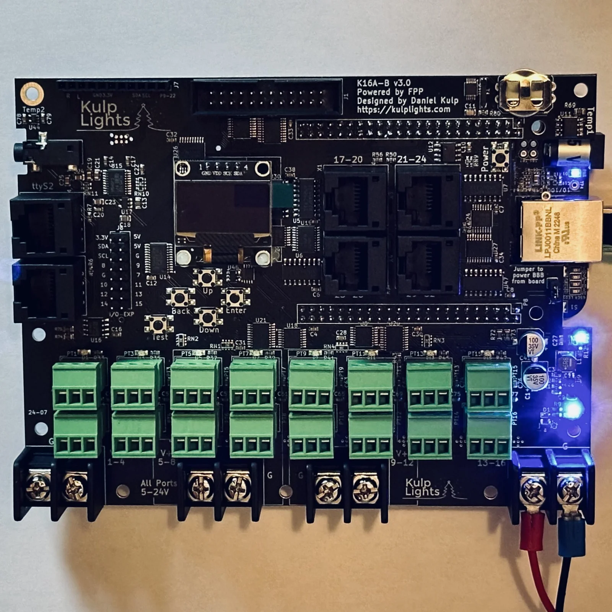
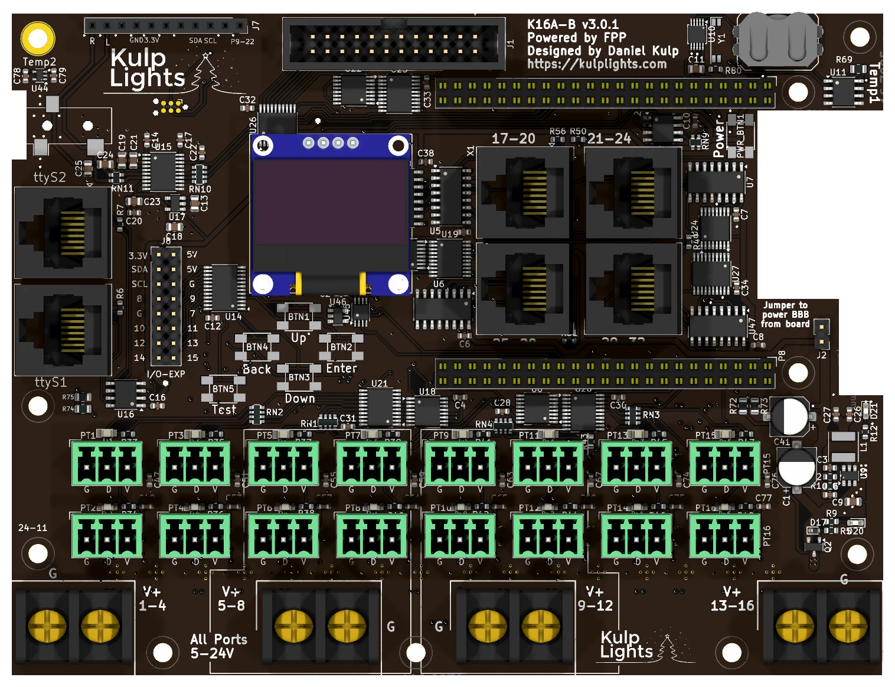

# K16A-B

The K16A-B was a BeagleBone Black pixel controller: 16 pixel ports, 4 differential ports and an
expansion port, for 48 strings in all, plus audio and two DMX outputs.

{ .board loading=lazy }

<small>K16A-B v3.0, powered, with a BeagleBone Black fitted.</small>

!!! note "Retired"
    The K16A-B is no longer sold. This page is for the many boards still in use. Its successors
    are the PocketBeagle 2 [K16](k16.md), [K16-Pro](k16-pro.md) and [K16-Max](k16-max.md).

The K16A-B went through **three generations**. They share the layout, connectors and FPP setup, but
differ in power and port protection, so check which one you have. The revision is printed on the
board, under the name (`K16A-B v3.0.1`).

| Generation | Revisions | Made | Power terminals | Port protection |
|---|---|---|---|---|
| **v1** | v1.0.0 – v1.2 | 2020–2022 | 2 | 5 A mini-blade fuses |
| **v2** | v2.0, v2.1 | 2023–2024 | 2 | eFuses, about 5.2 A |
| **v3** | v3.0, v3.0.1 | 2024–2025 | **4** | eFuses, about 6 A |

!!! warning "How the K16A-B differs from the PocketBeagle 2 boards"
    - **It needs a BeagleBone Black** (or a compatible BeagleBone). See
      [BeagleBone Black](../hardware/beaglebone-black.md).
    - **The power terminals don't all have the same polarity.** Check the markings on each one.
    - **Only one terminal runs the controller**: the right-hand one.

## Specifications

| | v1 | v2 | v3 |
|---|---|---|---|
| Local pixel ports | 16, 3-pin 3.5 mm pluggable | 16 | 16 |
| Port protection | 5 A mini-blade fuse per port | eFuse per port, about 5.2 A, latching | eFuse per port, about 6 A, latching |
| Power switching & current readings | — | per port | per port |
| Power terminals | 2 (ports 1–8, 9–16) | 2 (ports 1–8, 9–16) | 4 (one per 4 ports) |
| Voltage | **5 or 12 V**, 12 V max | **5–18 V** | **5–24 V** |
| Differential ports | 4 × RJ45 = 16 strings (17–32), send-only | 4 × RJ45, two-way on the first pair | 4 × RJ45, two-way on the first pair |
| Falcon V5 receivers | V4 mode | yes, with an updated cape EEPROM | yes |
| Expansion port | 40-pin, F16v3-style, strings 33–48 | 24-pin, F16v4-style, strings 33–48 | 24-pin, F16v4-style |
| DMX / serial | 2, on 3-pin terminals | 2, on RJ45 jacks | 2, on RJ45 jacks |
| Audio | stereo DAC, 3.5 mm line out, FM transmitter socket | same | same |
| Display & buttons | 128×64 OLED, Up / Down / Back / Enter / Test, Power | same | same |
| Real-time clock | yes, CR1220 cell | yes | yes |
| FPP output | BBB48String | BBShiftString | BBShiftString |
| Size | 150.0 × 113.9 mm (5.90 × 4.48 in) | same | same, 10 mounting holes |

All three need a BeagleBone Black or compatible and run on FPP 9.5 or later.

## Board map

{ .board loading=lazy }

<small>v3.0.1. The v1 and v2 boards have the same layout above the pixel ports; below them they
have two power terminals with the fuses (v1) between them.</small>

The BeagleBone sits underneath the board, with its Ethernet jack in the notch in the right-hand
edge.

### Power

=== "v3"

    Four terminals along the bottom edge, one per bank of four ports. **The polarity alternates**
    from one terminal to the next:

    | Terminal | Marking | Left screw | Right screw | Powers |
    |---|---|---|---|---|
    | 1st (left) | `V+ 1-4` | **G** | **V+** | ports 1–4 |
    | 2nd | `V+ 5-8` | **V+** | **G** | ports 5–8 |
    | 3rd | `V+ 9-12` | **G** | **V+** | ports 9–12 |
    | 4th (right) | `V+ 13-16` | **V+** | **G** | ports 13–16, **and the BeagleBone and all the logic** |

    - **The board won't start without power on the right-hand `V+ 13-16` terminal**, even with the
      others powered.
    - Each bank can run its own voltage, **5–24 V**, so 5, 12 and 24 V pixels can share the board on
      different banks.
    - FPP shows the four voltages as **VIN1**–**VIN4**. Two blue LEDs on the right-hand edge show
      that the right-hand terminal has power and that the 5 V supply is running.
    - Only the controller's own supply (the right-hand terminal) is protected against a reversed
      supply. A reversed supply on any terminal can damage that bank's ports.

=== "v2"

    Two terminals along the bottom edge:

    | Terminal | Left screw | Right screw | Powers |
    |---|---|---|---|
    | left | **G** | **V+** | ports 1–8 |
    | right | **V+** | **G** | ports 9–16, **and the BeagleBone and all the logic** |

    - **The board won't start without power on the right-hand terminal.**
    - Each terminal can run its own voltage, **5–18 V**. Don't use 24 V supplies.
    - FPP shows the two voltages as **VIN1** and **VIN2**.
    - The controller's own supply is protected against a reversed supply; the pixel ports aren't.

=== "v1"

    Two terminals along the bottom edge, with the fuses between them:

    | Terminal | Left screw | Right screw | Powers |
    |---|---|---|---|
    | left | **G** | **V+** | ports 1–8 |
    | right | **V+** | **G** | ports 9–16, **and the BeagleBone and all the logic** |

    - **5 V or 12 V only, 12 V maximum.** Don't use 24 V supplies.
    - The 3-pin **Input Voltage Select** jumper must match the
      supply on the right-hand terminal: **5V** for a 5 V supply, **12V** for 12 V.
    - **The board won't start without power on the right-hand terminal.**
    - FPP shows the two voltages as **VIN1** and **VIN2**.
    - The pixel ports aren't protected against a reversed supply. Check the polarity of each
      terminal before you power up.

See [Power](../hardware/power.md) for supply sizing and safety.

#### Powering the BeagleBone: the "power BBB" jumper

The jumper marked **Jumper to power BBB from board**, on the right-hand side, connects the board's
5 V supply to the BeagleBone. It is fitted at the factory; leave it fitted. With it removed, the
BeagleBone needs its own supply in its barrel jack. **Never fit the jumper and plug a supply into
the BeagleBone's barrel jack at the same time.**

### Pixel ports

The sixteen pixel ports are in two rows across the lower part of the board:

| | | | | | | | | |
|---|---|---|---|---|---|---|---|---|
| **Top row** | PT1 | PT3 | PT5 | PT7 | PT9 | PT11 | PT13 | PT15 |
| **Bottom row** | PT2 | PT4 | PT6 | PT8 | PT10 | PT12 | PT14 | PT16 |

Each port is **G D V** (ground, data, +V), as printed beneath it. PT1 is FPP port 1, and so on. On
v1 boards the bottom row is offset half a step to the right. Each port can drive up to 800 pixels at
40 fps. See [Pixel outputs](../hardware/pixel-outputs.md).

=== "v2 and v3: eFuses"

    Every port has its own eFuse, which trips at about **6 A** (v3) or **5.2 A** (v2) and latches
    off. FPP reads every port's current and switches each port on and off as needed. When an eFuse
    trips, FPP marks the port with a red icon on **Status/Control → Port Status**; click it to turn
    the port back on once the fault is fixed. The LED by each port lights when the port has power.
    See [Current monitoring](../software/current-monitoring.md).

=== "v1: fuses"

    Each port has its own **5 A mini-blade fuse**, in a row along the bottom edge. The LED by each
    fuse lights when the fuse is good and the bank has power. See
    [Power → Fuses](../hardware/power.md#mini-blade-fuses-k16-k32-and-the-pro-boards).

### Differential ports

The four jacks are in a 2 × 2 block in the upper middle of the board, numbered across the top row
and then the bottom row:

| | left | right |
|---|---|---|
| **Top** | `17-20` | `21-24` |
| **Bottom** | `25-28` | `29-32` |

Each jack carries four strings, with the standard pinout. See
[Differential ports](../hardware/differential.md).

- **v1:** send-only. Smart receivers work in v1, v2 or V4 mode; Falcon V5 receivers work set to V4,
  without status reports.
- **v2 and v3:** the first pair of each jack is **two-way**, so Falcon V5 receivers can report back.
  On **v2**, that needs a cape EEPROM from April 2024 or later: update it under *Help → About → Cape
  Info* (see [Updating](../software/updating.md)). v3 boards have it already.

### Expansion port (strings 33–48)

=== "v2 and v3"

    The 24-pin, 2×12 shrouded header on the top edge carries **16 more pixel strings**, for a Falcon
    F16v4-style expansion board, which turns them into pixel ports with their own power. The pinout
    is the same as the [K8-PB's](k8-pb.md#expansion-port-strings-2136): GND on pins 1, 2 and 22,
    +5 V on 3 and 4, and strings 33–48 on pins 5–20 in order (string 33 on pin 5, 34 on pin 6, and
    so on). Pin 1 is at the right-hand end, on the outer (board-edge) row.

    The lines are driven at 5 V by the board's shift registers, so they **can't** be used as GPIO
    inputs.

=== "v1"

    The 40-pin, 2×20 header on the top edge carries **16 more pixel strings**, for a Falcon F16v3
    expansion board. The pinout is the same as the [K8-B's](k8-b.md#expansion-port-strings-2136),
    with strings 33–48 in place of 21–36. The lines come straight from the BeagleBone at **3.3 V**:
    always go through an expansion board.

### DMX

=== "v2 and v3"

    Two RJ45 jacks on the left-hand edge: **`ttyS2` above `ttyS1`**. Each is wired for DMX over RJ45:

    | RJ45 pin | Signal | DMX XLR pin |
    |---|---|---|
    | 1 | Data + | 3 |
    | 2 | Data − | 2 |
    | 7, 8 | Ground | 1 |

    There is no LOR setting: use an adapter for LOR, Renard or Pixelnet. See
    [DMX / serial](../hardware/dmx.md).

=== "v1"

    Two 3-pin pluggable terminals on the left-hand edge: **`ttyS1` above `ttyS2`** (the other way
    round from v2 and v3). From top to bottom each is **Data +**, **Data −**, **Ground**. Wire them
    to XLR pins 3, 2 and 1. See [DMX / serial](../hardware/dmx.md).

The outputs are transmit-only. FPP sets up a disabled DMX output on each.

### Audio and FM transmitter

The built-in **PCM5102A** stereo DAC drives the **3.5 mm line-out jack** at the top-left corner. The
11-pin **FM transmitter socket** along the top edge (`R L GND 3.3V SDA SCL P9-22`) takes the optional
[Si4713 FM transmitter](https://kulplights.com/product/fm-transmitter-si4713/). See
[Audio](../hardware/audio.md).

### Other connectors

| Connector | Marking | Details |
|---|---|---|
| OLED | `GND VDD SCK SDA` | [Controls & display](../hardware/controls.md) |
| Buttons | `Up` `Down` `Back` `Enter`, `Test` | the menu buttons in a diamond below the OLED, with **Test** to their lower left. [Controls & display](../hardware/controls.md) |
| Power button | `Power` | upper right. Shuts down or restarts the BeagleBone; see [Power button](../hardware/beaglebone-black.md#power-button). There is no Boot button: use the BeagleBone's own. |
| GPIO / I²C | `I/O-EXP` | 2×8 header left of the OLED: 3.3 V, 5 V, GND, the I²C bus and **nine spare lines on the button I/O expander**, numbered `7`–`15` on the board. FPP lists them in *GPIO Inputs* as `pca9675-7` to `pca9675-15`. They are 3.3 V, pull up weakly and can only sink current: use them for switches to ground. |
| RTC battery | coin-cell holder, top right | [Clock](../hardware/network-usb-rtc.md#real-time-clock-rtc) |

## FPP setup

When FPP detects the K16A-B it sets itself up from the board's EEPROM: the **K16A-B** pixel-string
layout (100 pixels on each local port), the built-in audio, the sensors, the FM transmitter plugin's
settings, and two disabled DMX outputs on `ttyS1` and `ttyS2`. v1 boards use FPP's **BBB48String**
output; v2 and v3 use **BBShiftString**. Set the pixel counts and start channels from xLights or the
FPP *Pixel Strings* page. See [Configuring outputs](../software/outputs.md).

## Board revisions

| Revision | Changes |
|---|---|
| **v1.0.0** | First release: 2 terminals, mini-blade fuses, Input Voltage Select jumper, 40-pin expansion header, DMX on 3-pin terminals. |
| **v1.0.1** | Over-voltage and over-current protection on the controller's supply. |
| **v1.1** | Different clock, temperature and regulator chips, as parts shortages allowed. |
| **v1.2** | Reverse-polarity protection on the controller's supply. |
| **v2.0** | eFuses with per-port switching and current readings, shift-register outputs, 24-pin expansion header, DMX on RJ45 jacks, two-way differential ports. |
| **v2.1** | A wiring fix on the `17-20` jack. |
| **v3.0**, **v3.0.1** | Four power terminals (one per bank of four), 6 A eFuses, 5–24 V, four voltage readings, three more mounting holes. |

## Dimensions & mounting

- **149.99 × 113.86 mm** (5.90 × 4.48 in), plated 3.2 mm mounting holes for **M3** (or #4) screws:
  7 on v1 and v2, 10 on v3.
- The BeagleBone hangs underneath the board, so the standoffs must be tall enough to clear it and
  its connectors.
- A printable mount for v3 boards is on
  [Printables](https://www.printables.com/model/1026545-kulp-k16-a-b-v3-mount).
