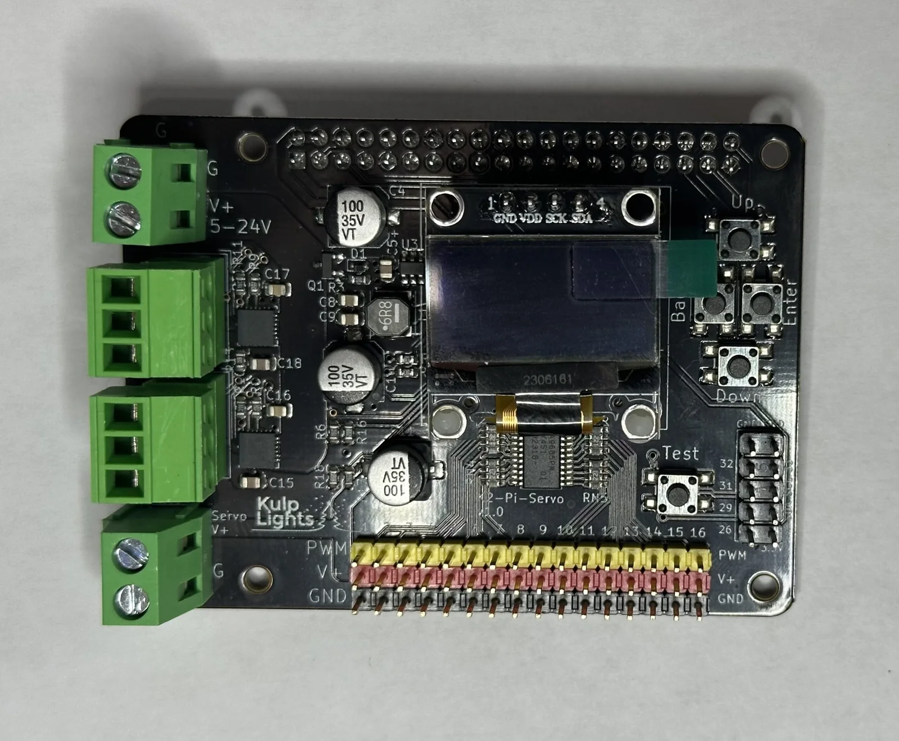
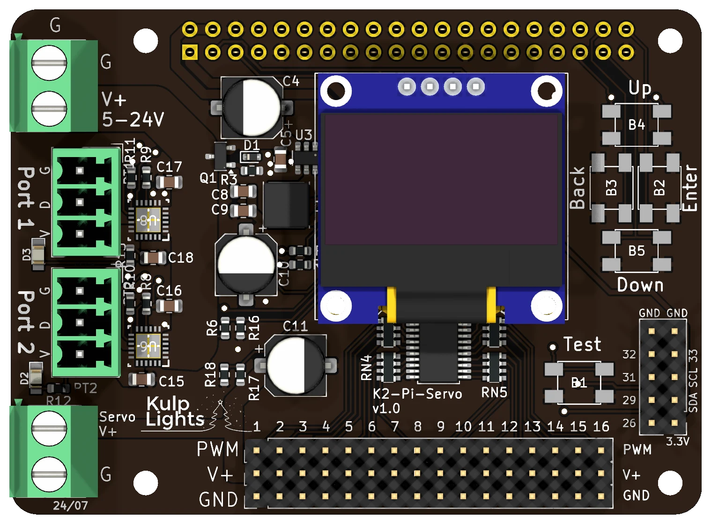

# K2-Pi-Servo

Two eFused pixel ports and **16 servo outputs** on a Raspberry Pi hat, for props that move as well
as light up.

{ .board loading=lazy }

<small>K2-Pi-Servo (v1.0).</small>

This page describes revision **v1.0** (printed on the board as `K2-Pi-Servo v1.0`), the only
revision.

!!! warning "How the K2-Pi-Servo differs from the other boards"
    - **It needs a Raspberry Pi** 3 B+, 4 or 5. See [Raspberry Pi](../hardware/raspberry-pi.md).
    - **Two power terminals:** one (5–24 V) for the Pi and the two pixel ports, and a separate one
      for the servos. **The two terminals have their screws in the opposite order.**
    - **No differential ports, DMX or real-time clock.**

## Specifications

| | K2-Pi-Servo |
|---|---|
| Local pixel ports | 2 (`Port 1`, `Port 2`), 3-pin 3.5 mm pluggable, plugs included |
| Port protection | eFuse per port, about 6 A, latching |
| Power switching | per port (FPP-controlled) |
| Current monitoring | both ports |
| Pixels per string | up to 1600; about 800 at 40 fps |
| Servo outputs | 16, standard 3-pin servo headers (signal, V+, GND) |
| Power inputs | **pixels & Pi:** 5–24 V DC. **Servos:** separate terminal, typically 5–6 V. |
| DMX / serial | none |
| Audio | the Pi's own |
| Ethernet & USB | the Pi's own |
| Display & buttons | 128×64 OLED, Up / Down / Back / Enter / Test |
| Real-time clock | none |
| Temperature sensor | yes |
| Size | 76.4 × 56.0 mm (3.01 × 2.20 in), 4 mounting holes, 2.7 mm |
| FPP output | DPIPixels (pixels), Servos (PCA9685) |
| Requires | Raspberry Pi 3 B+, 4 or 5, FPP 10 or later |

## Board map

{ .board loading=lazy }

The Pi sits under the board, with its USB and Ethernet ports sticking out past the right-hand edge.
The terminals and pixel ports overhang the other end of the Pi.

### Power terminals

There are **two** power terminals on the left-hand edge:

| Terminal | Marking | Screws, top to bottom | Powers |
|---|---|---|---|
| **Pixel / Pi** (top left) | `G`, `V+ 5-24V` | **G**, then **V+** | the Pi, the board's logic and both pixel ports |
| **Servo** (bottom left) | `Servo V+`, `G` | **V+**, then **G** | the 16 servos' V+ pins only |

!!! danger "The two terminals are wired in opposite order"
    On the top terminal **G** is the upper screw; on the servo terminal **V+** is the upper screw.
    Check each one against the markings before you power up.

**Pixel / Pi terminal:**

- The pixels run at the supply voltage, so both strings must match it: 5, 12 or 24 V.
- With a **5 V** supply, turn its output up to about **5.3 V** so the Pi gets a full 5 V; see
  [Raspberry Pi → Powering](../hardware/raspberry-pi.md#powering).
- The Pi and the logic are protected against a reversed supply, but **the pixel ports aren't**.
- FPP shows its voltage as **VIN Pixel**.

**Servo terminal:**

- Connect a supply that matches your servos, typically **5–6 V**, sized for all the servos moving at
  once. The Pi and the pixels don't need it.
- It goes straight to the servo headers, with **no fuse and no reverse-polarity protection**. A
  reversed supply reaches every servo.
- FPP shows its voltage as **VIN Servo**.

### Pixel ports

The two pixel ports are on the left-hand edge between the terminals: **Port 1** above **Port 2**.
Each is **G D V** from top to bottom (ground, data, +V). Each string can have up to **1600
pixels**; see [Raspberry Pi → Pixel outputs](../hardware/raspberry-pi.md#pixel-outputs-on-a-pi).

Each port has its own eFuse, which trips at about **6 A** and **latches off**, and FPP reads both
ports' current. When an eFuse trips, FPP marks the port with a red icon on **Status/Control → Port
Status**; click it to turn the port back on once the fault is fixed. The green LED beside each port
lights when the port has power. See [Current monitoring](../software/current-monitoring.md).

### Servo outputs

The 16 servo outputs are three rows of pins along the bottom edge, numbered **1** to **16** from left
to right. Each column is one servo:

| Row | Marking | Servo wire |
|---|---|---|
| top (yellow) | `PWM` | signal (yellow, orange or white) |
| middle (red) | `V+` | power (red) |
| bottom (black) | `GND` | ground (black or brown) |

Plug each servo in with its signal wire towards the top of the board. The signal is 5 V.

Set the servos up in FPP under *Input/Output Setup → Channel Outputs → **Servos***. For each output
you set its start channel, its **minimum and maximum pulse width** (500–2500 µs; the default
1000–2000 µs suits most servos), and what it does when its channel is zero (hold, go to the minimum,
maximum or centre, or stop). The **frequency** (50 Hz by default) applies to all 16. The **Servo
Position** command moves a servo from a playlist, a button or a schedule. The outputs can also dim
small LEDs instead of driving servos.

### Other connectors

| Connector | Marking | Details |
|---|---|---|
| OLED | `GND VDD SCK SDA` | [Controls & display](../hardware/controls.md) |
| Buttons | `Up` `Down` `Back` `Enter`, `Test` | the menu buttons in a cross at the right, with **Test** below them. [Controls & display](../hardware/controls.md) |
| GPIO / I²C | `GND GND`, `3.3V SDA SCL`, `26 29 31 32 33` | 2×5 header, bottom right: ground, 3.3 V, the I²C bus (for an add-on clock or sensor) and five Pi GPIO pins, numbered by their Pi header pin. Use them in FPP's *GPIO Inputs*. **3.3 V only**: wire buttons to switch a pin to GND. |

The board has **no real-time clock**: set up NTP under *Settings → Time*, or add an I²C clock module
on the GPIO / I²C header.

## FPP setup

When FPP detects the K2-Pi-Servo it sets itself up automatically. It enables the **K2-Pi-Servo**
pixel-string layout (FPP's **DPIPixels** output, with 100 pixels on each port), the **Servos** output,
and the voltage, current and temperature sensors. Set the pixel counts and start channels from
xLights or the FPP *Pixel Strings* page. See [Configuring outputs](../software/outputs.md).

## Dimensions & mounting

- **76.43 × 56.00 mm** (3.01 × 2.20 in), 4 holes, 2.7 mm, for **M2.5** screws. They line up with
  the Pi's mounting holes: fix the board to the Pi with M2.5 standoffs, nylon or metal.
- The board is a little longer than the Pi: the terminals and pixel ports overhang the end opposite
  the Pi's USB ports.
