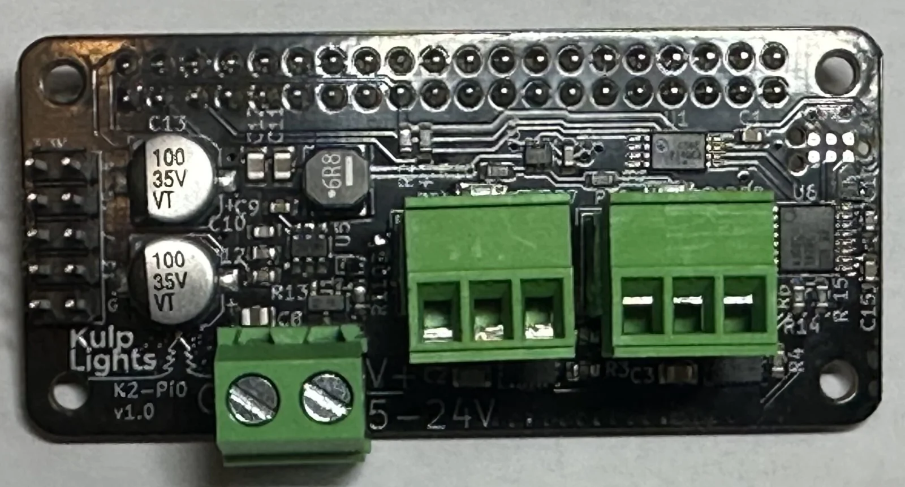
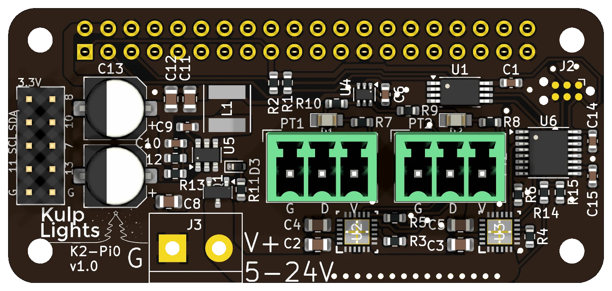

# K2-Pi0

The smallest controller: two eFused pixel ports with current monitoring, on a hat the size of a
Raspberry Pi Zero.

{ .board loading=lazy }

<small>K2-Pi0 (v1.0).</small>

This page describes revision **v1.0** (printed on the board as `K2-Pi0 v1.0`), the only revision.

!!! warning "How the K2-Pi0 differs from the other boards"
    - **It's made for a Raspberry Pi Zero 2 W.** See [Raspberry Pi](../hardware/raspberry-pi.md)
      and [Fitting it to a Pi](#fitting-it-to-a-pi).
    - **No Ethernet:** the Pi Zero 2 W has Wi-Fi only.
    - **No display or buttons, no DMX and no real-time clock.** Set it up and control it from FPP's
      web page.

## Specifications

| | K2-Pi0 |
|---|---|
| Local pixel ports | 2 (PT1, PT2), 3-pin 3.5 mm pluggable, plugs included |
| Port protection | eFuse per port, about 6 A, latching |
| Power switching | per port (FPP-controlled) |
| Current monitoring | both ports |
| Pixels per string | up to 1600; about 800 at 40 fps |
| Power input | 1 terminal, **5–24 V DC**, powers the Pi and both ports |
| DMX / serial | none |
| Network | the Pi's Wi-Fi |
| Display & buttons | none |
| Real-time clock | none |
| Size | 65 × 30 mm (2.56 × 1.18 in), 4 mounting holes, 2.7 mm |
| FPP output | DPIPixels |
| Requires | Raspberry Pi Zero 2 W (see below for other Pis), FPP 10 or later |

## Board map

{ .board loading=lazy }

### Power terminal

The power terminal is at the bottom left, marked **G** (left screw) and **V+ 5-24V** (right screw).
It powers the Pi and both pixel ports. FPP shows its voltage as **VIN**.

- The pixels run at the supply voltage, so both strings must match it: 5, 12 or 24 V.
- With a **5 V** supply, turn its output up to about **5.3 V** so the Pi gets a full 5 V; see
  [Raspberry Pi → Powering](../hardware/raspberry-pi.md#powering).
- The Pi is protected against a reversed supply, but **the pixel ports aren't**. Check the polarity
  before you power up.
- **Don't plug a supply into the Pi's own USB power socket** while the K2-Pi0 is powered.

### Pixel ports

The two pixel ports, **PT1** (left) and **PT2** (right), are in the middle of the board. Each is
**G D V** (ground, data, +V), as printed beneath it. Each string can have up to **1600 pixels**; see
[Raspberry Pi → Pixel outputs](../hardware/raspberry-pi.md#pixel-outputs-on-a-pi).

Each port has its own eFuse, which trips at about **6 A** and **latches off**, and FPP reads both
ports' current. When an eFuse trips, FPP marks the port with a red icon on **Status/Control → Port
Status**; click it to turn the port back on once the fault is fixed. The green LED beside each port
lights when the port has power. See [Current monitoring](../software/current-monitoring.md).

### GPIO / I²C header

The 2×5 header at the left-hand end brings out 3.3 V, ground, the I²C bus and five Pi GPIO pins,
numbered on the board by their Pi header pin: **7, 8, 10, 11 and 13**. Use them in FPP's *GPIO
Inputs* for buttons or switches to ground, or add an I²C display or clock module. They are **3.3 V
only**.

## Fitting it to a Pi

On a **Pi Zero 2 W** (or Zero W), the K2-Pi0's four holes line up with the Pi's: fix them together
with M2.5 standoffs.

It also works on the bigger Pis (3 B+, 4, 5), but there its holes don't line up with anything. The
board is held only by the GPIO header, so make sure it **can't tip or press down onto the Pi**,
where it could short something out. Support it with something insulating, and keep it clear of the
Pi's components.

## FPP setup

When FPP detects the K2-Pi0 it sets itself up automatically. It enables the **K2-Pi0** pixel-string
layout (FPP's **DPIPixels** output, with 100 pixels on each port) and the voltage and current
sensors. Set the pixel counts and start channels from xLights or the FPP *Pixel Strings* page. See
[Configuring outputs](../software/outputs.md).

For the first setup, connect to FPP's [Wi-Fi hotspot](../software/first-boot.md#no-ethernet-use-the-wi-fi-hotspot)
and join the Pi to your Wi-Fi network. Because the board has no clock, set up NTP under *Settings →
Time* so schedules run at the right time.

## Dimensions & mounting

- **65 × 30 mm** (2.56 × 1.18 in), 4 holes, 2.7 mm, for **M2.5** screws, on the Pi Zero's hole
  pattern.
