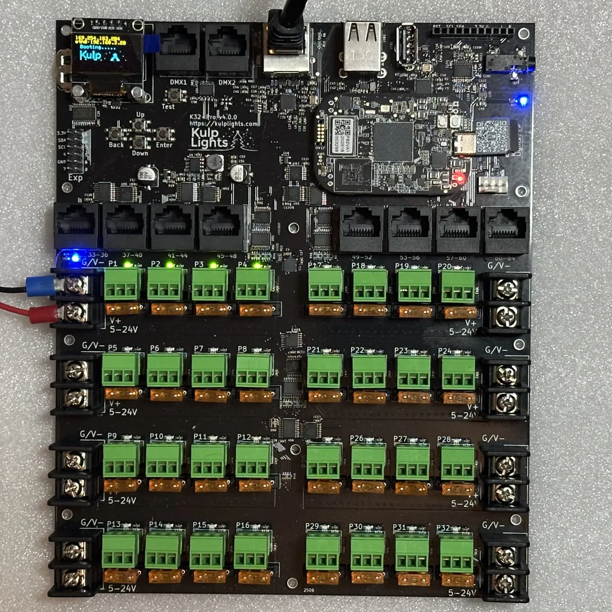
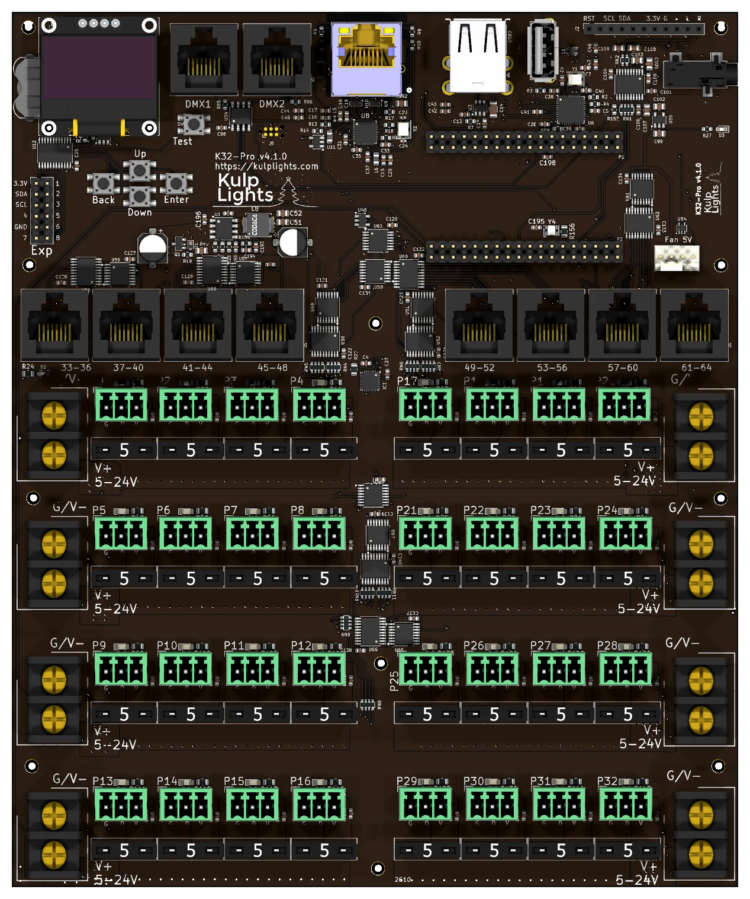

# K32-Pro

32 fused pixel ports, 8 two-way differential ports, audio and 2 DMX.

{ .board loading=lazy }

<small>K32-Pro with a PocketBeagle 2 fitted. Photos may show an earlier board revision.</small>

This page describes revision **v4.1.0** (printed on the board as `K32-Pro v4.1.0`). Differences in earlier revisions are listed under [Board revisions](#board-revisions).

## Specifications

| | K32-Pro |
|---|---|
| Local pixel ports | 32 (P1–P32), 3-pin 3.5 mm pluggable, plugs included |
| Port protection | 5 A mini-blade fuse per port |
| Power switching | per bank of 4, FPP-controlled (v4.1 and later) |
| Current monitoring | from Falcon V5 receivers only |
| Differential ports | 8 × RJ45 = 32 strings (33–64), two-way (pair 1/2) |
| Total strings | 64 |
| Power inputs | 8 terminals rated 30 A, 5–24 V DC, one bank of 4 ports each |
| DMX / serial | 2 (`DMX1`, `DMX2`), RS-485 transmit |
| Audio | PCM5102A DAC, 3.5 mm line out, FM transmitter socket |
| Ethernet | 1 × Gigabit (USB-attached) |
| USB-A | 3 |
| Display & buttons | 128×64 OLED, Up / Down / Enter / Back / Test |
| Real-time clock | yes, CR1220 backup cell |
| Fan header | 5 V 4-pin PWM, temperature-controlled; speed monitoring on v4.1 and later |
| Expansion header | 2×6: I²C + 8 GPIO (Exp.1–Exp.8) |
| Size | 168.6 × 202.8 mm (6.64 × 7.98 in), 11 mounting holes, 3.0 mm |
| Requires | PocketBeagle 2 (not PocketBeagle 1), FPP 9.0 or later |

## Board map

{ .board loading=lazy }

### Power terminals

The four terminals down the **left** edge feed the left half of the board, and the
four down the **right** edge feed the right half. FPP's VIN numbers don't follow
reading order:

| Terminal | Position | Feeds | FPP reading | Also powers the controller? |
|---|---|---|---|---|
| **V1** | left, row 1 (top) | P1–P4 | VIN1 | **yes** |
| **V2** | left, row 2 | P5–P8 | VIN2 | no |
| **V5** | left, row 3 | P9–P12 | VIN5 | no |
| **V6** | left, row 4 | P13–P16 | VIN6 | no |
| **V3** | right, row 1 (top) | P17–P20 | VIN3 | no |
| **V4** | right, row 2 | P21–P24 | VIN4 | no |
| **V7** | right, row 3 | P25–P28 | VIN7 | no |
| **V8** | right, row 4 | P29–P32 | VIN8 | no |

The blue LED beside **V1** lights when it has power. **V1 must be powered for the controller to boot.**

See [Power](../hardware/power.md) for supply sizing, wire size and safety.

### Pixel ports

The 32 pixel ports are in four rows of eight, four ports on each side:

| | Left half | Right half |
|---|---|---|
| **Row 1** | P1–P4 | P17–P20 |
| **Row 2** | P5–P8 | P21–P24 |
| **Row 3** | P9–P12 | P25–P28 |
| **Row 4** | P13–P16 | P29–P32 |

Each port is **G D V** (ground, data, +V), as printed beside it. See [Pixel outputs](../hardware/pixel-outputs.md).

### Fuses

Every local port has a **5 A mini-blade fuse** next to it. If a port's green LED is dark while
the rest of its bank is lit, check that port's fuse first. **Never fit a fuse larger
than 5 A.** See [Power → Fuses](../hardware/power.md#mini-blade-fuses-k16-k32-and-the-pro-boards).

### Bank switching

Each bank of four ports has an electronic power switch that FPP controls, so FPP can turn
pixel power off when nothing is playing. See [Power → Bank switching](../hardware/power.md#bank-switching-pro-boards).

Bank switching was added in **v4.1**. On a v4.0 board every bank is on whenever it has
power. See [Board revisions](#board-revisions).

### Differential ports

`33-36` · `37-40` · `41-44` · `45-48` · `49-52` · `53-56` · `57-60` · `61-64`

Each jack carries four strings, numbered as printed above it. They are **two-way**: Falcon V5 smart receivers report their eFuse status and current back over pair 1/2. Other receivers work as send-only.
See [Differential ports](../hardware/differential.md).

!!! note
    The last differential jack is printed **60-64** on the board. It carries strings **61–64**.

### Other connectors

| Connector | Marking | Details |
|---|---|---|
| Ethernet | (RJ45 with LEDs) | [Network](../hardware/network-usb-rtc.md#ethernet) |
| DMX | `DMX1`, `DMX2` | [DMX / serial](../hardware/dmx.md) |
| USB-A | — | 3 ports, [USB](../hardware/network-usb-rtc.md#usb-ports) |
| OLED | `GND 3.3V SCL SDA` | [Controls & display](../hardware/controls.md) |
| Audio out | 3.5 mm jack | [Audio](../hardware/audio.md) |
| FM transmitter | `RST SCL SDA 3.3V G L R` | [Audio](../hardware/audio.md#fm-transmitter-socket) |
| Fan | `Fan 5V` | [Fan](../hardware/expansion.md#fan) |
| Expansion | `Exp` | [Expansion header](../hardware/expansion.md) |
| RTC battery | coin-cell holder | [Clock](../hardware/network-usb-rtc.md#real-time-clock-rtc) |

## FPP setup

When FPP detects the K32-Pro it sets itself up automatically. It enables the
**K32-Pro** pixel-string layout, the sensors (input voltages, temperature), the audio output
and a disabled DMX output. Out of the box each local port is set to 50 WS2811 pixels at 50 % brightness.
Set the real counts and start channels from xLights or the FPP *Pixel Strings* page.
See [Configuring outputs](../software/outputs.md).

## Board revisions

The revision is printed on the board next to the model name. FPP also shows it as the
**Hardware Version** under *Help → About → Cape Info*.

| Revision | Changes |
|---|---|
| **v4.0** | Fused ports; banks are always on when powered. Fan speed control. |
| **v4.1** | Adds **bank switching** (FPP turns each bank of 4 on and off) and **fan speed monitoring**. |

## Dimensions & mounting

- **168.55 × 202.75 mm** (6.64 × 7.98 in), 11 plated mounting holes, 3.0 mm, for **M2.5** (or #4) screws and standoffs.
- The mounting holes are connected to ground.
- Use nylon or metal standoffs at least 6 mm (¼ in) tall, so nothing on the underside touches the
  enclosure.
- Mounting drawing: [PDF](https://kulplights.com/wp-content/uploads/2025/05/K32-Max.pdf) · [SVG](https://kulplights.com/wp-content/uploads/2025/05/K32-Max.svg). It is shared by the K32, K32-Pro and K32-Max, which have the same outline and holes.
- A 3D-printable mount is on [Thingiverse](https://www.thingiverse.com/thing:7065715).
