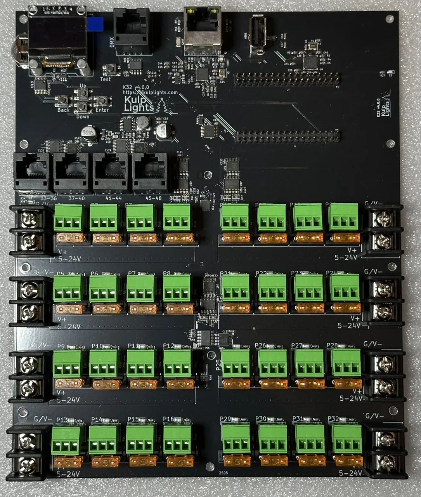
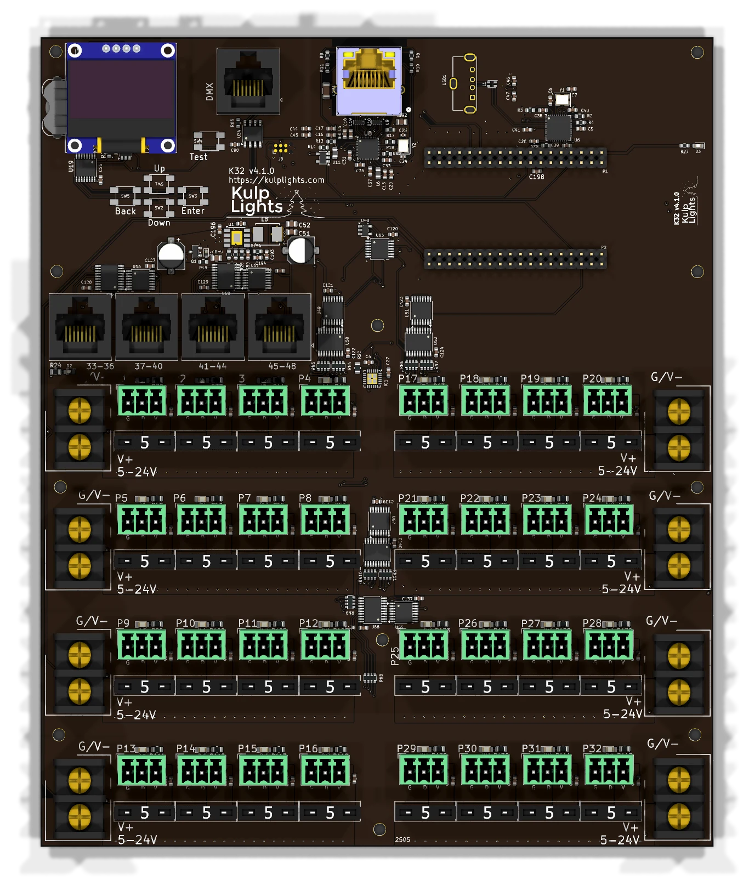

# K32

32 fused pixel ports, 4 differential ports and DMX.

{ .board loading=lazy }

<small>K32, shown without a PocketBeagle 2. Photos may show an earlier board revision.</small>

This page describes revision **v4.1.0** (printed on the board as `K32 v4.1.0`).

## Specifications

| | K32 |
|---|---|
| Local pixel ports | 32 (P1–P32), 3-pin 3.5 mm pluggable, plugs included |
| Port protection | 5 A mini-blade fuse per port |
| Power switching | — |
| Current monitoring | — |
| Differential ports | 4 × RJ45 = 16 strings (33–48), send-only |
| Total strings | 48 |
| Power inputs | 8 terminals rated 30 A, 5–24 V DC, one bank of 4 ports each |
| DMX / serial | 1 (`DMX`), RS-485 transmit |
| Audio | none (use a USB sound card) |
| Ethernet | 1 × Gigabit (USB-attached) |
| USB-A | 1 (via the included extension cable) |
| Display & buttons | 128×64 OLED, Up / Down / Enter / Back / Test |
| Real-time clock | yes, CR1220 backup cell |
| Fan header | — |
| Expansion header | — |
| Size | 168.6 × 202.8 mm (6.64 × 7.98 in), 11 mounting holes, 3.0 mm |
| Requires | PocketBeagle 2 (not PocketBeagle 1), FPP 9.0 or later |

## Board map

{ .board loading=lazy }

### Power terminals

The four terminals down the **left** edge feed the left half of the board, and the
four down the **right** edge feed the right half. FPP's VIN numbers don't follow
reading order:

| Terminal | Position | Feeds | FPP reading | Also powers the controller? |
|---|---|---|---|---|
| **V1** | left, row 1 (top) | P1–P4 | VIN1 | **yes** |
| **V2** | left, row 2 | P5–P8 | VIN2 | no |
| **V5** | left, row 3 | P9–P12 | VIN5 | no |
| **V6** | left, row 4 | P13–P16 | VIN6 | no |
| **V3** | right, row 1 (top) | P17–P20 | VIN3 | no |
| **V4** | right, row 2 | P21–P24 | VIN4 | no |
| **V7** | right, row 3 | P25–P28 | VIN7 | no |
| **V8** | right, row 4 | P29–P32 | VIN8 | no |

The blue LED beside **V1** lights when it has power. **V1 must be powered for the controller to boot.**

See [Power](../hardware/power.md) for supply sizing, wire size and safety.

### Pixel ports

The 32 pixel ports are in four rows of eight, four ports on each side:

| | Left half | Right half |
|---|---|---|
| **Row 1** | P1–P4 | P17–P20 |
| **Row 2** | P5–P8 | P21–P24 |
| **Row 3** | P9–P12 | P25–P28 |
| **Row 4** | P13–P16 | P29–P32 |

Each port is **G D V** (ground, data, +V), as printed beside it. See [Pixel outputs](../hardware/pixel-outputs.md).

### Fuses

Every local port has a **5 A mini-blade fuse** next to it. If a port's green LED is dark while
the rest of its bank is lit, check that port's fuse first. **Never fit a fuse larger
than 5 A.** See [Power → Fuses](../hardware/power.md#mini-blade-fuses-k16-k32-and-the-pro-boards).

### Differential ports

`33-36` · `37-40` · `41-44` · `45-48`

Each jack carries four strings, numbered as printed above it. They are **send-only**. Any standard receiver works, but receivers cannot report back.
See [Differential ports](../hardware/differential.md).

### Other connectors

| Connector | Marking | Details |
|---|---|---|
| Ethernet | (RJ45 with LEDs) | [Network](../hardware/network-usb-rtc.md#ethernet) |
| DMX | `DMX` | [DMX / serial](../hardware/dmx.md) |
| USB-A | — | 1 port (use the included USB extension cable), [USB](../hardware/network-usb-rtc.md#usb-ports) |
| OLED | `GND 3.3V SCL SDA` | [Controls & display](../hardware/controls.md) |
| RTC battery | coin-cell holder | [Clock](../hardware/network-usb-rtc.md#real-time-clock-rtc) |

## FPP setup

When FPP detects the K32 it sets itself up automatically. It enables the
**K32** pixel-string layout, the sensors (input voltages, temperature)
and a disabled DMX output. Out of the box each local port is set to 50 WS2811 pixels at 50 % brightness.
Set the real counts and start channels from xLights or the FPP *Pixel Strings* page.
See [Configuring outputs](../software/outputs.md).

## Dimensions & mounting

- **168.55 × 202.75 mm** (6.64 × 7.98 in), 11 plated mounting holes, 3.0 mm, for **M2.5** (or #4) screws and standoffs.
- The mounting holes are connected to ground.
- Use nylon or metal standoffs at least 6 mm (¼ in) tall, so nothing on the underside touches the
  enclosure.
- Mounting drawing: [PDF](https://kulplights.com/wp-content/uploads/2025/05/K32-Max.pdf) · [SVG](https://kulplights.com/wp-content/uploads/2025/05/K32-Max.svg). It is shared by the K32, K32-Pro and K32-Max, which have the same outline and holes.
- A 3D-printable mount is on [Thingiverse](https://www.thingiverse.com/thing:7065715).
