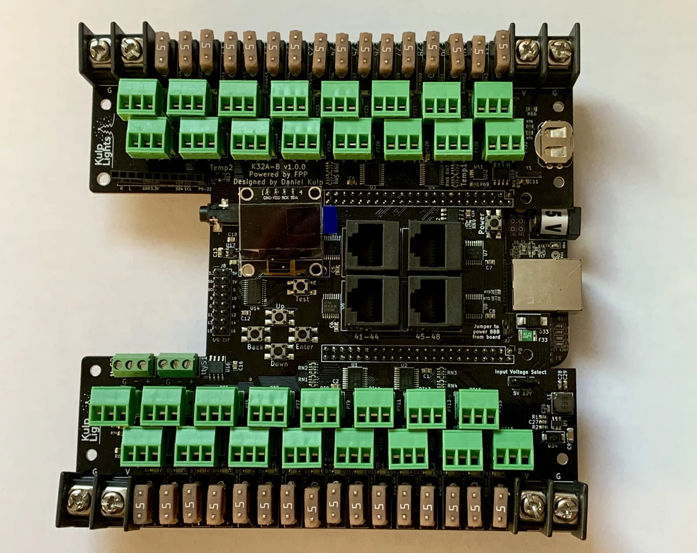
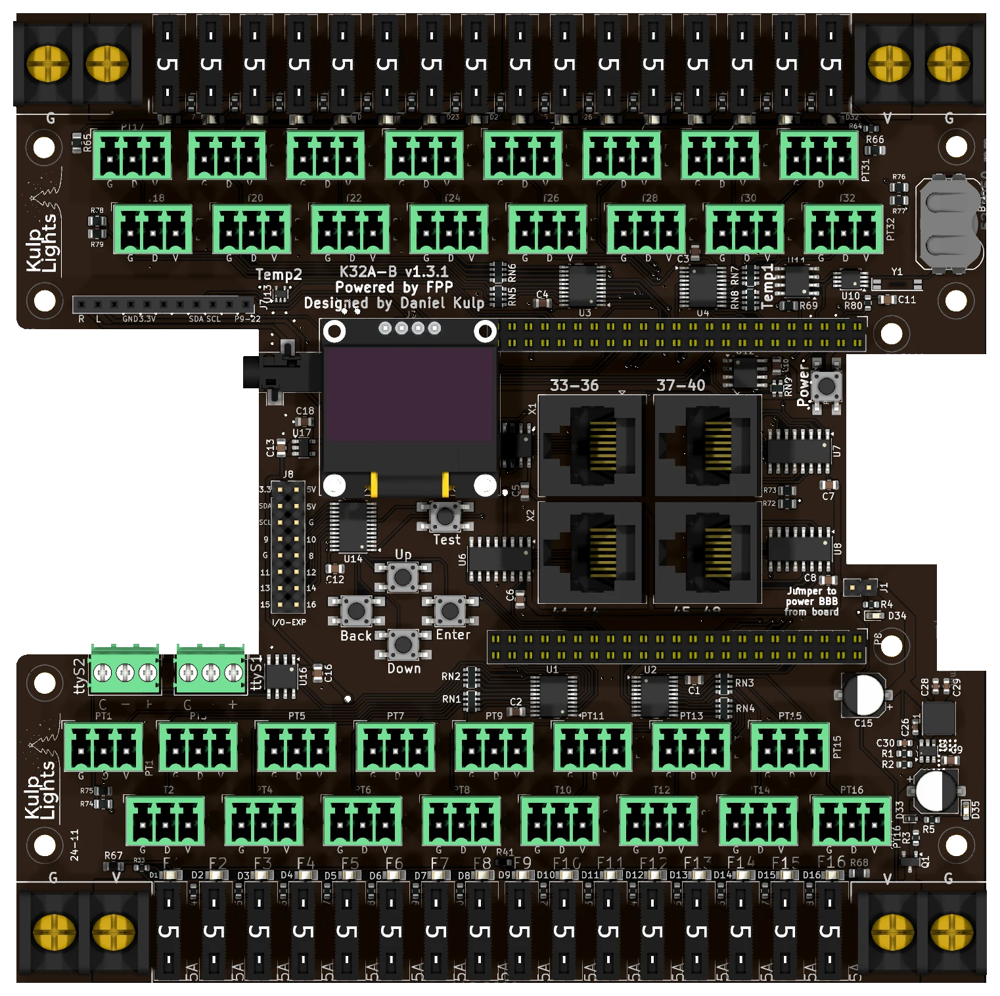

# K32A-B

The K32A-B was a BeagleBone Black pixel controller: 32 fused pixel ports and 4 differential ports,
for 48 strings in all, plus audio and two DMX outputs.

{ .board loading=lazy }

<small>An early K32A-B (v1.0.0) with a BeagleBone Black fitted underneath. The current board differs
in small details; the [board map](#board-map) below shows it.</small>

!!! note "Retired"
    The K32A-B is no longer sold. This page is for the many boards still in use. Its successors are
    the PocketBeagle 2 [K32](k32.md), [K32-Pro](k32-pro.md) and [K32-Max](k32-max.md).

This page describes revision **v1.3.1** (printed on the board as `K32A-B v1.3.1`), and notes where
earlier boards differ. See [Board revisions](#board-revisions).

!!! warning "How the K32A-B differs from the PocketBeagle 2 boards"
    - **It needs a BeagleBone Black** (or a compatible BeagleBone). See
      [BeagleBone Black](../hardware/beaglebone-black.md).
    - **Four power terminals, one per bank of eight ports.** Only the **bottom-right** one runs the
      controller.
    - **Boards before v1.3 have an Input Voltage Select jumper** and take 5 or 12 V only.
    - The differential ports are **send-only**: smart receivers work in v1, v2 or V4 mode.

## Specifications

| | K32A-B |
|---|---|
| Local pixel ports | 32 (PT1–PT32), 3-pin 3.5 mm pluggable |
| Port protection | 5 A mini-blade fuse per port, with a fuse-OK LED |
| Differential ports | 4 × RJ45 = 16 strings (33–48), send-only |
| Total strings | 48 |
| Power terminals | 4, one per bank of 8 ports |
| Voltage | **v1.3 and later:** 5–18 V. **Earlier:** 5 or 12 V, 12 V max. |
| DMX / serial | 2, RS-485 transmit, on 3-pin pluggable terminals (`ttyS1`, `ttyS2`) |
| Audio | stereo DAC, 3.5 mm line out, FM transmitter socket |
| Expansion port | none |
| Display & buttons | 128×64 OLED, Up / Down / Back / Enter / Test, Power |
| Real-time clock | yes, CR1220 backup cell |
| Temperature sensors | 2 (`Temp1`, `Temp2`) |
| Size | 149.9 × 149.9 mm (5.90 × 5.90 in), 9 mounting holes, 3.2 mm |
| FPP output | BBB48String |
| Requires | BeagleBone Black or compatible, FPP 9.5 or later |

## Board map

{ .board loading=lazy }

The BeagleBone sits underneath the middle of the board, with its Ethernet jack in the notch in the
right-hand edge.

### Power

Four terminals, one in each corner. Each powers one bank of eight ports through their fuses. On
every terminal **G is the outer screw**, nearer the corner, and **V+ the inner one**.

| Terminal | Marking | Powers |
|---|---|---|
| bottom left | `G` `V` | ports 1–8 |
| bottom right | `V` `G` | ports 9–16, **and the BeagleBone and all the logic** |
| top left | `G` `V` | ports 17–24 |
| top right | `V` `G` | ports 25–32 |

- **The board won't start without power on the bottom-right terminal**, even with the others
  powered.
- Each bank can run its own voltage, so 5 and 12 V pixels can share the board on different banks.
- **v1.3 and later:** 5–18 V on any terminal. Don't use 24 V supplies.
- **Before v1.3:** 5 or 12 V only, 12 V maximum. The 3-pin **Input Voltage Select** jumper, at the
  lower right, must match the supply on the bottom-right terminal: **5V** for 5 V, **12V** for 12 V.
- FPP shows the four voltages as **VIN1** (ports 1–8), **VIN2** (9–16), **VIN3** (17–24) and
  **VIN4** (25–32).
- On v1.3.1 two blue LEDs on the right-hand side show that the bottom-right terminal has power and
  that the 5 V supply is running.
- The terminals are rated 30 A. Use 10 or 12 AWG wire for heavily loaded banks.

!!! danger "Check polarity before you power up"
    The pixel ports aren't protected against a reversed supply: it goes straight through the fuses
    to that bank's ports and any pixels connected. From v1.3 the controller itself is protected.

See [Power](../hardware/power.md) for supply sizing and safety.

#### Powering the BeagleBone: the "power BBB" jumper

The jumper marked **Jumper to power BBB from board**, on the right-hand side above the BeagleBone's
Ethernet jack, connects the board's 5 V supply to the BeagleBone. It is fitted at the factory; leave
it fitted. With it removed, the BeagleBone needs its own supply in its barrel jack. **Never fit the
jumper and plug a supply into the BeagleBone's barrel jack at the same time.**

### Pixel ports and fuses

The ports are in two blocks of sixteen, with the fuses along the outer edges. In each block the two
rows are offset half a step:

| Row | Ports, left to right |
|---|---|
| top block, outer row | PT17 · PT19 · PT21 · PT23 · PT25 · PT27 · PT29 · PT31 |
| top block, inner row | PT18 · PT20 · PT22 · PT24 · PT26 · PT28 · PT30 · PT32 |
| bottom block, inner row | PT1 · PT3 · PT5 · PT7 · PT9 · PT11 · PT13 · PT15 |
| bottom block, outer row | PT2 · PT4 · PT6 · PT8 · PT10 · PT12 · PT14 · PT16 |

Each port is **G D V** (ground, data, +V), as printed beneath it. PT1 is FPP port 1, and so on. Each
port can drive up to 800 pixels at 40 fps. See [Pixel outputs](../hardware/pixel-outputs.md).

Each port has its own **5 A mini-blade fuse**: F1–F16 along the bottom edge and F17–F32 along the top,
left to right. The LED beside each fuse lights when the fuse is good and the bank has power. See
[Power → Fuses](../hardware/power.md#mini-blade-fuses-k16-k32-and-the-pro-boards).

### Differential ports

The four jacks are in a 2 × 2 block in the middle of the board:

| | left | right |
|---|---|---|
| **Top** | `33-36` | `37-40` |
| **Bottom** | `41-44` | `45-48` |

Each jack carries four strings, with the standard pinout. The ports are send-only. Any standard
differential receiver works, and smart receivers work in **v1, v2 or V4** mode. Falcon V5 receivers
also work, set to V4, but they can't send status back. See
[Differential ports](../hardware/differential.md).

### DMX

The two DMX outputs are 3-pin pluggable terminals at the left, just above the bottom block of pixel
ports: **`ttyS2` on the left, `ttyS1` on the right**. Each is marked **`G − +`**, left to right:

| `G` | `−` | `+` |
|---|---|---|
| Ground (XLR pin 1) | Data − (XLR pin 2) | Data + (XLR pin 3) |

The outputs are transmit-only and can also drive Renard, LOR or Pixelnet through a suitable adapter.
FPP sets up a disabled DMX output on each. See [DMX / serial](../hardware/dmx.md).

### Audio and FM transmitter

The built-in **PCM5102A** stereo DAC drives the **3.5 mm line-out jack**, which opens into the notch
in the left-hand edge. The 11-pin **FM transmitter socket** below the top block of ports
(`R L GND 3.3V SDA SCL P9-22`) takes the optional
[Si4713 FM transmitter](https://kulplights.com/product/fm-transmitter-si4713/). See
[Audio](../hardware/audio.md).

### Other connectors

| Connector | Marking | Details |
|---|---|---|
| OLED | `GND VDD SCK SDA` | [Controls & display](../hardware/controls.md) |
| Buttons | `Up` `Down` `Back` `Enter`, `Test` | the menu buttons in a cross below the OLED, with **Test** above them to the right. [Controls & display](../hardware/controls.md) |
| Power button | `Power` | right-hand side, above the Ethernet notch. Shuts down or restarts the BeagleBone; see [Power button](../hardware/beaglebone-black.md#power-button). There is no Boot button: use the BeagleBone's own. |
| GPIO / I²C | `I/O-EXP` | 2×8 header left of the buttons: 3.3 V, 5 V, GND, the I²C bus and **nine spare lines on the button I/O expander**, numbered `8`–`16` on the board. FPP lists them in *GPIO Inputs* as `pca9675-7` to `pca9675-15` (one lower than the board's numbers). They are 3.3 V, pull up weakly and can only sink current: use them for switches to ground. |
| RTC battery | coin-cell holder, top right | [Clock](../hardware/network-usb-rtc.md#real-time-clock-rtc) |

## FPP setup

When FPP detects the K32A-B it sets itself up from the board's EEPROM: the **K32A-B** pixel-string
layout (FPP's **BBB48String** output, with 100 pixels on each local port and none on the
differential ports), the built-in audio, the voltage and temperature sensors, the FM transmitter
plugin's settings, and two disabled DMX outputs on `ttyS1` and `ttyS2`. Set the pixel counts and
start channels from xLights or the FPP *Pixel Strings* page. See
[Configuring outputs](../software/outputs.md).

## Board revisions

| Revision | Changes |
|---|---|
| **v1.0.0** | First release. **Input Voltage Select** jumper (5V / 12V). |
| **v1.1.0**, **v1.1.1** | Over-voltage and over-current protection on the controller's supply. |
| **v1.2** | Different regulator, clock and temperature chips, as parts shortages allowed. Still has the Input Voltage Select jumper. |
| **v1.3** | Input Voltage Select jumper removed: a fixed 5 V regulator with reverse-polarity protection, 5–18 V. |
| **v1.3.1** | Adds the two blue power LEDs. |

## Dimensions & mounting

- **149.86 × 149.86 mm** (5.90 × 5.90 in), 9 plated mounting holes, 3.2 mm, for **M3** (or #4)
  screws.
- The BeagleBone hangs underneath the board, so the standoffs must be tall enough to clear it and
  its connectors.
