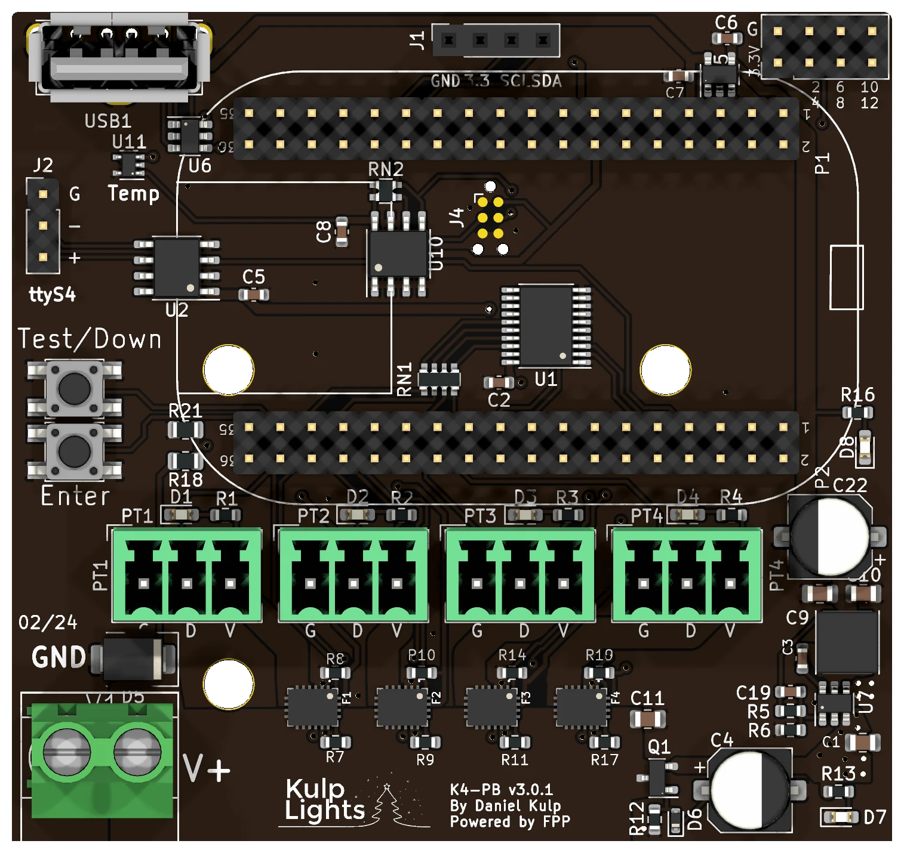

# K4-PB

The smallest pixel controller: 4 eFused pixel ports with per-port current monitoring and a DMX
header, on a 71 × 67 mm board that fits a small TA-200 enclosure.

This page describes revision **v3.0.1** (printed on the board as `K4-PB v3.0.1`). The K4-PB works
with **both** the PocketBeagle 2 and the original PocketBeagle 1, and nothing blocks the SD card
slot.

<!-- TODO(Dan): photo (the page uses the KiCad render until then). -->

!!! warning "How the K4-PB differs from the K8, K16 and K32 boards"
    - **No Ethernet on the board.** Plug a **USB Ethernet adapter** or an FPP-supported
      **USB Wi-Fi adapter** into its USB-A port. You need one of them to set it up. A "nano" or
      "mini" Wi-Fi adapter fits inside a TA-200 enclosure.
    - **One power terminal, 5 or 12 V.** It powers the controller and all four ports, so all of
      them run at the same voltage. **18 V is the absolute maximum; don't use 24 V supplies.**
    - **No differential ports and no expansion port.** It drives only its four local ports.
    - **DMX is a 3-pin header**, not an RJ45 jack.
    - **No real-time clock.** The board gets the time from the network (NTP).
    - **Not protected against a reversed supply.** Check the polarity before you power up.

## Specifications

| | K4-PB |
|---|---|
| Local pixel ports | 4 (PT1–PT4), 3-pin 3.5 mm pluggable, plugs included |
| Port protection | eFuse per port, about 5.2 A, latching |
| Power switching | per port (FPP-controlled) |
| Current monitoring | every port |
| Differential ports | none |
| Total strings | 4 |
| Power input | 1 terminal, **5 or 12 V DC** (18 V maximum), powers the controller and all 4 ports |
| DMX / serial | 1, RS-485 transmit, 3-pin 2.54 mm header (`ttyS4`) |
| GPIO header | 2×4, **unpopulated**: 3.3 V, GND and six PocketBeagle pins (P1-2 to P1-12) |
| Audio | none built in. Use a USB sound card. |
| Ethernet | **none.** Use a USB Ethernet or Wi-Fi adapter. |
| USB-A | 1 |
| Display & buttons | 128×64 OLED, Test-Down / Enter |
| Real-time clock | none |
| Temperature sensor | yes |
| Size | 71.1 × 67.1 mm (2.80 × 2.64 in), 3 mounting holes, 4.0 mm |
| FPP output | BBB48String |
| Requires | PocketBeagle 2 (FPP 9.5 or later recommended; any 9.x works) or PocketBeagle 1 |

## Board map

{ .board loading=lazy }

### Power terminal

The power terminal is at the bottom left: **GND** on the left screw, **V+** on the right. It powers
the PocketBeagle, the USB port and all of the logic, and all four pixel ports. FPP shows its
voltage as **VIN**.

- Every port shares this supply, so **all four strings must be the same voltage**: 5 V or 12 V
  pixels.
- **18 V is the maximum.** A 24 V supply will damage the board.
- Two blue LEDs on the right-hand edge show that the board has power and that its internal 5 V
  supply is running.

!!! danger "Check polarity before you power up"
    The K4-PB is **not protected against a reversed supply**. The controller's own logic is
    protected, but a supply wired backwards drives the input surge-protection diode, which is
    likely to burn out. It usually fails as a short, and the board then won't power up until it is
    repaired.

### Pixel ports

The four pixel ports are in a row across the middle of the board, **PT1** on the left to **PT4**
on the right. Each is **G D V** (ground, data, +V), as printed beneath it. PT1 is FPP port 1, and
so on. See [Pixel outputs](../hardware/pixel-outputs.md).

### eFuses and current monitoring

Every port has its own eFuse, which trips at about **5.2 A** and **latches off**. FPP reads every
port's current and turns each port on and off as needed. When an eFuse trips, FPP marks the port
with a red icon on **Status/Control → Port Status**; click it to turn the port back on once the
fault is fixed. See [Current monitoring](../software/current-monitoring.md).

### DMX

DMX is on the 3-pin, 2.54 mm header on the left edge, marked `ttyS4`:

| Pin | Marking | Signal | DMX XLR pin |
|---|---|---|---|
| top | `G` | Ground | 1 |
| middle | `-` | Data − | 2 |
| bottom | `+` | Data + | 3 |

Make up a cable from a 3-pin socket to an XLR or RJ45 DMX connector, wired as above. The output
is transmit-only and can also drive Renard, LOR or Pixelnet through a suitable adapter. FPP calls
the port `ttyS4`. See [DMX / serial](../hardware/dmx.md).

!!! note "DMX on a PocketBeagle 2 with an older EEPROM"
    On a PocketBeagle 2, FPP finds this DMX port through a mapping in the cape EEPROM, added in
    EEPROM **3.0.1** (February 2025). On a board programmed before then, a DMX output on `ttyS4`
    goes to the wrong serial port and nothing comes out. Fix it by updating the cape EEPROM under
    *Help → About → Cape Info* (see [Updating](../software/updating.md)), or set the DMX output's
    port to **`ttyS5`** instead. On a PocketBeagle 1, `ttyS4` always works.

### GPIO header

The 2×4 header position at the top right is **not fitted**: solder in a 2×4, 2.54 mm pin header
if you want to use it. It brings out **3.3 V**, **GND** and six PocketBeagle pins, numbered
on the board: **P1-2, P1-4, P1-6, P1-8, P1-10, P1-12**. Use them in FPP's *GPIO Inputs* for
buttons or switches to ground. They connect straight to the PocketBeagle, so they are **3.3 V
only**; never connect 5 V or anything higher.

### Other connectors

| Connector | Marking | Details |
|---|---|---|
| USB-A | — | 1 port, top left, for the network adapter. [USB](../hardware/network-usb-rtc.md#usb-ports) |
| OLED | `GND 3.3 SCL SDA` | [Controls & display](../hardware/controls.md) |
| Buttons | `Test/Down` `Enter` | Down and Test share one button. [Controls & display](../hardware/controls.md#test-button) |

## FPP setup

When FPP detects the K4-PB it sets itself up automatically. It enables the **K4-PB** pixel-string
layout (FPP's **BBB48String** output), with each port set to 100 WS2811 pixels at 50 % brightness,
the voltage, current and temperature sensors, and a disabled DMX output on `ttyS4`. Set the pixel
counts and start channels from xLights or the FPP *Pixel Strings* page. See
[Configuring outputs](../software/outputs.md).

For the first setup, plug in a USB Ethernet adapter and connect it to your network, or use a USB
Wi-Fi adapter and FPP's [Wi-Fi hotspot](../software/first-boot.md#no-ethernet-use-the-wi-fi-hotspot).
Because the board has no clock, set up NTP under *Settings → Time* so schedules run at the right
time.

## Dimensions & mounting

- **71.12 × 67.06 mm** (2.80 × 2.64 in), 3 mounting holes, 4.0 mm, for **M3** or **M3.5** (or #6)
  screws.
- Designed to fit a **TA-200** enclosure.
- Use standoffs at least 6 mm (¼ in) tall, so nothing on the underside touches the enclosure.
