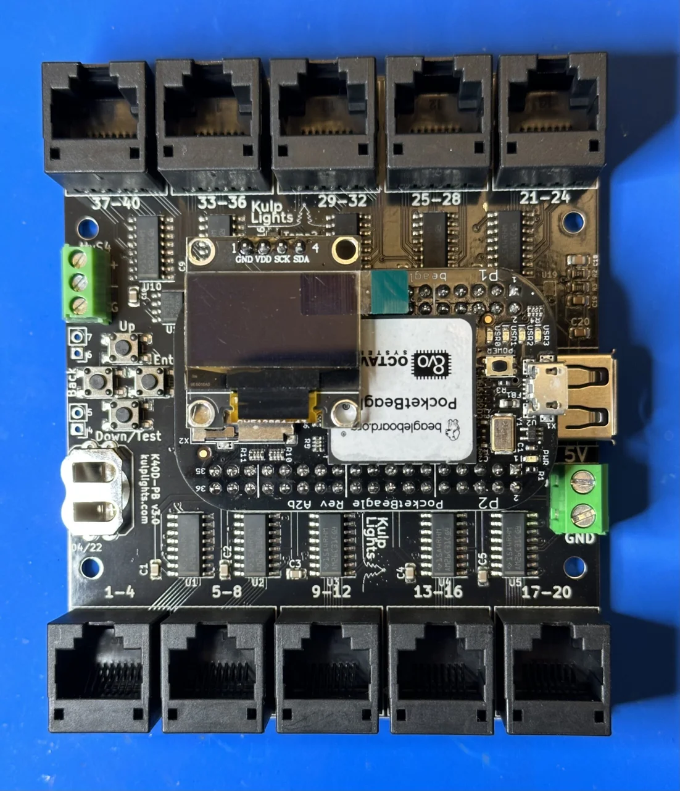
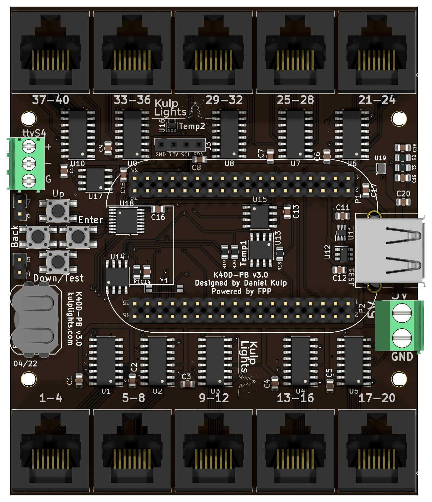

# K40D-PB

Forty pixel strings from ten differential ports, for driving differential receivers. It has no
local pixel ports.

{ .board loading=lazy }

<small>K40D-PB (v3.0) shown with an original PocketBeagle (PocketBeagle 1) fitted.</small>

This page describes revision **v3.0** (printed on the board as `K40D-PB v3.0`). Designed for the
original PocketBeagle, it works with **both** the PocketBeagle 2 and the PocketBeagle 1.

!!! warning "How the K40D-PB differs from the other boards"
    - **Differential ports only.** Every string goes out over an RJ45 to a
      [differential receiver](../hardware/differential.md), which powers the pixels. There are no
      pixel plugs on the board.
    - **5 V only.** The board takes a regulated 5 V supply for the controller alone. Use one rated
      **4–5 A**: the ten differential driver chips draw quite a bit.
    - **No Ethernet on the board.** Plug a **USB Ethernet adapter** or an FPP-supported
      **USB Wi-Fi adapter** into its USB-A port. You need one of them to set it up.
    - **The USB-A port covers the PocketBeagle 2's SD card slot.** Either use a **PocketBeagle 2
      Industrial**, which runs FPP from its built-in eMMC, or fit the
      [PB2 microSD extender](https://kulplights.com/product/microsd-extension-card/), which clears
      the USB port.
    - **DMX is a 3-pin pluggable terminal**, not an RJ45 jack.

!!! danger "Never connect the PocketBeagle's USB port to a computer"
    Don't power or set up the K40D-PB through the PocketBeagle's own USB port (USB tethering).
    It can **permanently damage** the K40D-PB. Power it only from its 5 V terminal, and set it up
    over a USB network adapter.

## Specifications

| | K40D-PB |
|---|---|
| Local pixel ports | none |
| Differential ports | 10 × RJ45 = **40 strings** (1–40), send-only |
| Power input | **5 V DC only**, 2-pin 5.08 mm screw terminal (controller only) |
| DMX / serial | 1, RS-485 transmit, 3-pin 3.5 mm pluggable terminal (`ttyS4`) |
| Audio | none built in. Use a USB sound card. |
| Ethernet | **none.** Use a USB Ethernet or Wi-Fi adapter. |
| USB-A | 1 |
| Display & buttons | 128×64 OLED, Up / Down-Test / Enter / Back |
| Real-time clock | yes, CR1220 backup cell |
| Temperature sensors | 2 (`Temp1`, `Temp2`) |
| Size | 82.55 × 98.93 mm (3.25 × 3.89 in), 4 mounting holes, 3.0 mm |
| FPP output | BBB48String |
| Requires | PocketBeagle 2 (FPP 9.5 or later) or PocketBeagle 1 |

## Board map

{ .board loading=lazy }

### Power

The power terminal is on the right-hand edge, marked **5V** (upper screw) and **GND** (lower screw).
It powers only the PocketBeagle, the USB port and the board's logic, including the ten differential
driver chips, which draw quite a bit. Use a regulated 5 V supply rated **4–5 A**. The receivers power
the pixels from their own supplies. FPP shows no input voltage reading on this board.

!!! danger "5 V only"
    Use a regulated **5 V** supply. Don't connect 12 V or 24 V to the K40D-PB.

### Differential ports

Each jack carries four strings, numbered as printed beside it:

| | | | | | |
|---|---|---|---|---|---|
| **Top row**, left to right | `37-40` | `33-36` | `29-32` | `25-28` | `21-24` |
| **Bottom row**, left to right | `1-4` | `5-8` | `9-12` | `13-16` | `17-20` |

The ports are send-only, with the standard four-strings-per-RJ45 pinout. Any standard differential
receiver works, and smart receivers work in **v1, v2 or V4** mode (FPP drives this board with its
**BBB48String** output, which has no V5). Each string can drive up to 800 pixels at 40 fps. See
[Differential ports](../hardware/differential.md).

### DMX

DMX is on the 3-pin, 3.5 mm pluggable terminal at the top of the left edge, marked `ttyS4`:

| Pin | Marking | Signal | DMX XLR pin |
|---|---|---|---|
| top | `+` | Data + | 3 |
| middle | `-` | Data − | 2 |
| bottom | `G` | Ground | 1 |

Wire it to an XLR or RJ45 DMX connector as above. The output is transmit-only and can also drive
Renard, LOR or Pixelnet through a suitable adapter. FPP calls the port `ttyS4`. See
[DMX / serial](../hardware/dmx.md).

!!! note "DMX on a PocketBeagle 2 with an older EEPROM"
    On a PocketBeagle 2, FPP finds this DMX port through a mapping in the cape EEPROM, added in
    EEPROM **3.0.1** (February 2025). On a board programmed before then, a DMX output on `ttyS4`
    goes to the wrong serial port and nothing comes out. Fix it by updating the cape EEPROM under
    *Help → About → Cape Info* (see [Updating](../software/updating.md)), or set the DMX output's
    port to **`ttyS5`** instead. On a PocketBeagle 1, `ttyS4` always works.

### Other connectors

| Connector | Marking | Details |
|---|---|---|
| USB-A | — | 1 port, right-hand edge, for the network adapter. It sits over the PocketBeagle 2's SD card slot. [USB](../hardware/network-usb-rtc.md#usb-ports) |
| OLED | `GND 3.3V SCL SDA` | top centre. [Controls & display](../hardware/controls.md) |
| Buttons | `Up` `Back` `Enter` `Down/Test` | Down and Test share one button. [Controls & display](../hardware/controls.md#test-button) |
| GPIO | `4 5`, `6 7` | two 2-pin header positions on the left edge, **unpopulated** (solder in pins to use them). They are four spare lines on the button I/O expander, which FPP lists as `Exp.4`–`Exp.7` on a PocketBeagle 2 (`pca9674-4` to `pca9674-7` on a PocketBeagle 1). Like the [Exp header](../hardware/expansion.md) lines they are 3.3 V, pull up weakly and can only sink current: use them for switches to ground. |
| RTC battery | coin-cell holder, bottom left | [Clock](../hardware/network-usb-rtc.md#real-time-clock-rtc) |

## FPP setup

When FPP detects the K40D-PB it sets itself up automatically. It enables the **K40D-PB**
pixel-string layout (FPP's **BBB48String** output, with all 40 strings at 50 pixels each), the
temperature sensors, and a disabled DMX output on `ttyS4`. Set the pixel counts and start channels
from xLights or the FPP *Pixel Strings* page. See [Configuring outputs](../software/outputs.md).

For the first setup, plug in a USB Ethernet adapter and connect it to your network, or use a USB
Wi-Fi adapter and FPP's [Wi-Fi hotspot](../software/first-boot.md#no-ethernet-use-the-wi-fi-hotspot).

## Dimensions & mounting

- **82.55 × 98.93 mm** (3.25 × 3.89 in), 4 mounting holes, 3.0 mm, for **M2.5** (or #4) screws and
  standoffs.
- Use standoffs at least 6 mm (¼ in) tall, so nothing on the underside touches the enclosure.
