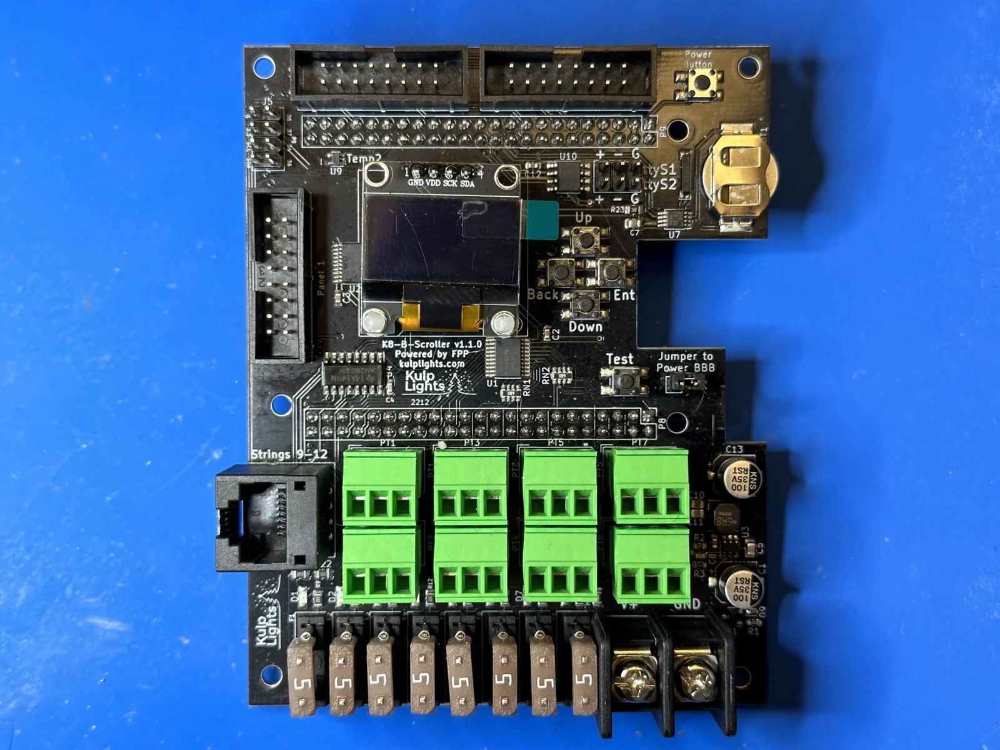
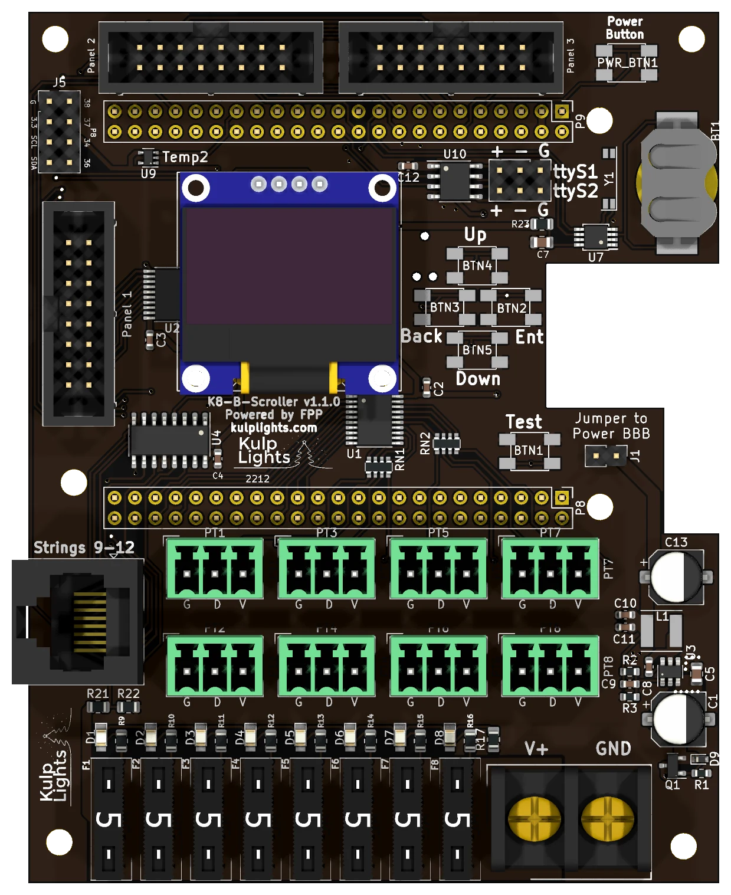

# K8-B-Scroller

Pixels and LED panels from one BeagleBone Black: 8 fused pixel ports, a differential port for
4 more strings, and 3 HUB75 outputs for LED panels.

{ .board loading=lazy }

<small>K8-B-Scroller (v1.1.0), shown without a BeagleBone fitted.</small>

This page describes revision **v1.1.0** (printed on the board as `K8-B-Scroller v1.1.0`). See
[Board revisions](#board-revisions) for the earlier v1.0.

!!! warning "How the K8-B-Scroller differs from the other boards"
    - **It needs a BeagleBone Black** (or a compatible BeagleBone). See
      [BeagleBone Black](../hardware/beaglebone-black.md).
    - **One power terminal, 5–18 V.** It powers the controller and all eight pixel ports, so all
      of them run at the same voltage. **Don't use 24 V supplies.** The panels need their own 5 V
      supply.
    - **Mini-blade fuses**, not eFuses: no per-port switching or current readings.
    - **Two DMX outputs on a 6-pin header**, not RJ45 jacks.
    - The differential port is **send-only**: smart receivers work in v1, v2 or V4 mode. Falcon
      V5 receivers work in V4 mode, without status reports.

## Specifications

| | K8-B-Scroller |
|---|---|
| Local pixel ports | 8 (PT1–PT8), 3-pin 3.5 mm pluggable, plugs included |
| Port protection | 5 A mini-blade fuse per port, with a fuse-OK LED |
| Differential ports | 1 × RJ45 = 4 strings (9–12), send-only |
| LED panel outputs | 3 × HUB75 (`Panel 1`–`Panel 3`), with E line |
| Power input | 1 terminal, **5–18 V DC**, powers the controller and all 8 pixel ports |
| DMX / serial | 2, RS-485 transmit, on a 2×3 header (`ttyS1`, `ttyS2`) |
| Audio | none built in. Use a USB sound card. |
| Ethernet & USB | the BeagleBone's own |
| Display & buttons | 128×64 OLED, Up / Down / Back / Enter / Test, Power |
| Real-time clock | yes, CR1220 backup cell |
| Temperature sensor | yes |
| Size | 86.4 × 108.9 mm (3.40 × 4.29 in), 7 mounting holes, 3.2 mm |
| FPP output | BBB48String (pixels), LED Panels (panels) |
| Requires | BeagleBone Black or compatible, FPP 9.5 or later |

## Board map

{ .board loading=lazy }

The BeagleBone sits under the upper part of the board, with its Ethernet jack in the notch in the
right-hand edge.

### Power terminal

The power terminal is at the bottom right, marked **V+** (left screw) and **GND** (right screw). It
powers the BeagleBone and all of the logic, and every pixel port. FPP shows its voltage as **VIN**.

- Because every pixel port shares this supply, **all eight local strings must be the same
  voltage**: 5 V or 12 V pixels. To mix voltages, put the other strings on a differential
  receiver, which powers its strings from its own supply.
- **18 V is the maximum.** A 24 V supply will damage the board.
- **The panels are not powered through the board.** Run each panel's power from your 5 V panel
  supply.

!!! danger "Check polarity before you power up"
    **V+ is the left screw.** The BeagleBone and the controller's logic are protected against a
    reversed supply, but **the pixel ports aren't**: a reversed supply goes straight through the
    fuses to every port and to any pixels connected.

See [Power](../hardware/power.md) for supply sizing and safety.

### Powering the BeagleBone: the "Power BBB" jumper

The jumper marked **Jumper to Power BBB**, to the right of the **Test** button, connects the
board's 5 V regulator to the BeagleBone. It is fitted at the factory, and the BeagleBone then runs
from the power terminal. Leave it fitted.

With the jumper removed, the BeagleBone isn't powered by the cape, and needs its own 5 V supply in
its barrel jack. That isn't recommended. **Never fit the jumper and plug a supply into the
BeagleBone's barrel jack at the same time.**

### Pixel ports and fuses

The eight pixel ports are in two rows above the fuses:

| | | | | |
|---|---|---|---|---|
| **Top row** | PT1 | PT3 | PT5 | PT7 |
| **Bottom row** | PT2 | PT4 | PT6 | PT8 |

Each port is **G D V** (ground, data, +V), as printed beneath it. PT1 is FPP port 1, and so on.
See [Pixel outputs](../hardware/pixel-outputs.md).

Each port has its own **5 A mini-blade fuse**, in a row along the bottom edge: **F1** on the left
for PT1, to **F8** for PT8. The small LED above each fuse **lights when the fuse is good** and the
board has power. An unlit LED means a blown or missing fuse.

### Differential port

The RJ45 jack on the left-hand edge, marked `Strings 9-12`, carries strings 9–12. It is send-only.
Any standard differential receiver works, and smart receivers work in **v1, v2 or V4** mode (FPP
drives this board with its **BBB48String** output). Falcon V5 receivers also work, set to V4, but
they can't send status back. See [Differential ports](../hardware/differential.md).

### Panel outputs

The three HUB75 outputs are marked **Panel 1** (on the left-hand edge) and **Panel 2** and
**Panel 3** (along the top edge, left to right). Each is a standard **HUB75** connector:

| Pin | Signal | Pin | Signal |
|---|---|---|---|
| 1 | R1 | 2 | G1 |
| 3 | B1 | 4 | GND |
| 5 | R2 | 6 | G2 |
| 7 | B2 | 8 | E |
| 9 | A | 10 | B |
| 11 | C | 12 | D |
| 13 | CLK | 14 | LAT |
| 15 | OE | 16 | GND |

- The **E** line is wired, so 1/32-scan panels (such as 64×64) work.
- Use the ribbon cables that come with your panels. The red stripe goes to pin 1 (marked on the
  header's shroud).
- Each output drives up to about **5 P5 (64×32)** or **10 P10 (32×16)** panels: 15 P5 or 30 P10
  panels in all. The refresh rate depends on the longest chain, so spread the panels evenly.

### DMX

The two DMX outputs share one 2×3 header, left of the battery holder, marked `ttyS1` (top row) and
`ttyS2` (bottom row):

| Row | `+` (left) | `-` (middle) | `G` (right) |
|---|---|---|---|
| top: `ttyS1` | Data + | Data − | Ground |
| bottom: `ttyS2` | Data + | Data − | Ground |

Wire **+** to XLR pin 3, **−** to pin 2 and **G** to pin 1 (or to an RJ45 DMX connector). The
outputs are transmit-only and can also drive Renard, LOR or Pixelnet through a suitable adapter.
See [DMX / serial](../hardware/dmx.md).

### Other connectors

| Connector | Marking | Details |
|---|---|---|
| OLED | `GND VDD SCK SDA` | [Controls & display](../hardware/controls.md) |
| Buttons | `Up` `Down` `Back` `Ent`, `Test` | the four menu buttons, with a separate **Test** button below them. [Controls & display](../hardware/controls.md) |
| Power button | `Power Button` | top right corner. Shuts down or restarts the BeagleBone; see [Power button](../hardware/beaglebone-black.md#power-button). |
| GPIO / I²C | `G 3.3 SCL SDA`, `P8 38 37 34 36` | 2×4 header, top left corner: 3.3 V, GND, the I²C bus and four BeagleBone pins (P8-34, P8-36, P8-37, P8-38), for extra I²C sensors or buttons to ground. **3.3 V only.** |
| RTC battery | coin-cell holder, right edge | [Clock](../hardware/network-usb-rtc.md#real-time-clock-rtc) |

## FPP setup

When FPP detects the K8-B-Scroller it sets itself up automatically:

- The **K8-B-Scroller** pixel-string layout (FPP's **BBB48String** output), with 12 strings of
  100 pixels.
- An **LED Panels** output with one 64×32 panel on Panel 1.
- The voltage and temperature sensors, and two disabled DMX outputs on `ttyS1` and `ttyS2`.

Both outputs start at channel 1, so **set the start channels** so the strings and the panels don't
overlap. Set the panel size, layout and
colour depth under *Input/Output Setup → Channel Outputs → LED Panels*; see
[LED panel matrices](https://manual.falconplayer.com/054-channel-outputs/#led-panel-matrices) in the
FPP manual. For the pixel strings see [Configuring outputs](../software/outputs.md).

## Board revisions

| Revision | Changes |
|---|---|
| **v1.0** | Two power terminals: **Pixel Power** for the pixel ports, and a separate **BBB 5V** terminal for a 5 V supply that powers the BeagleBone. |
| **v1.1** | One power terminal for everything, with a 5 V regulator on the board and the **Power BBB** jumper. |

## Dimensions & mounting

- **86.36 × 108.86 mm** (3.40 × 4.29 in), 7 plated mounting holes, 3.2 mm, for **M3** (or #4)
  screws and standoffs.
- The BeagleBone hangs underneath the board, so the standoffs in the corner holes must be tall
  enough to clear it and its connectors.
