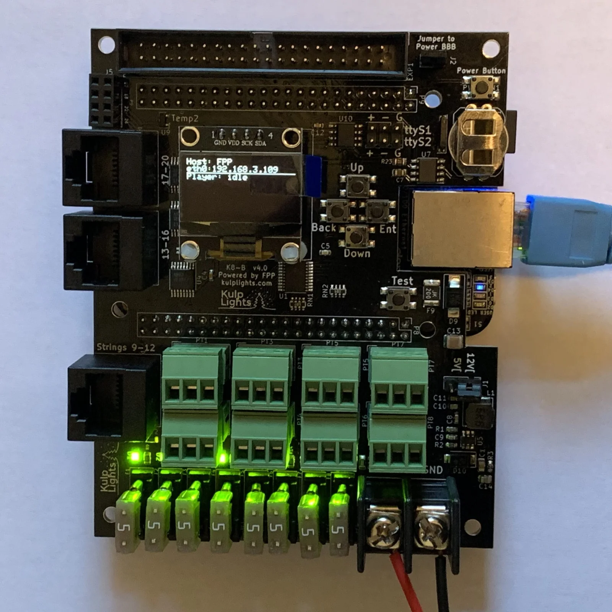
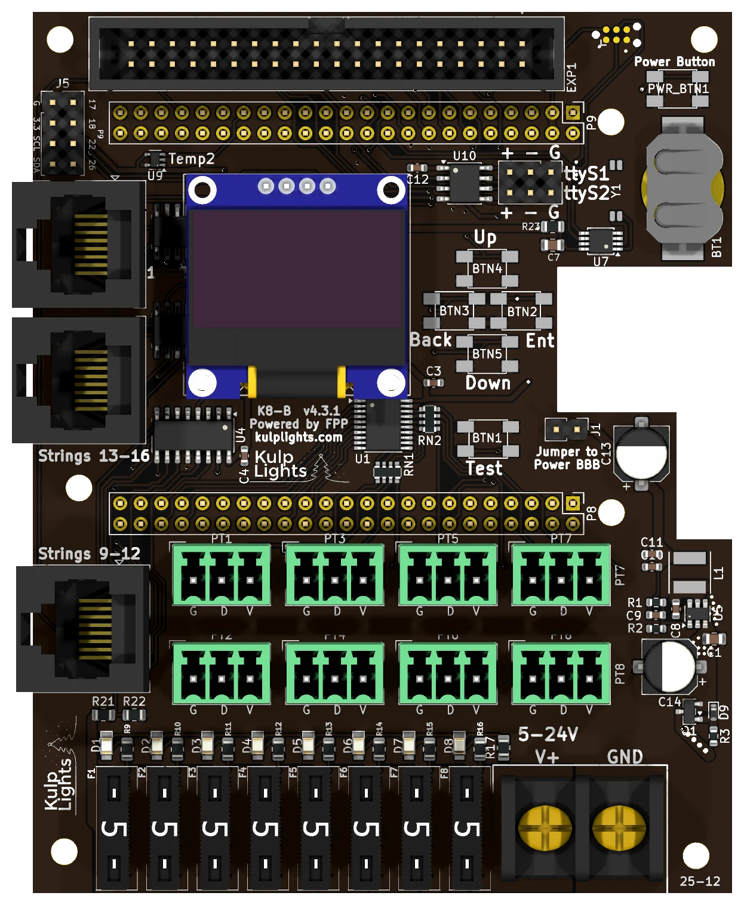

# K8-B

A BeagleBone Black pixel controller: 8 fused pixel ports, 3 differential ports and an expansion
port for 16 more strings: 36 strings in all.

{ .board loading=lazy }

<small>An early K8-B (v4.0) with a BeagleBone Black fitted. The current board differs in small
details; the [board map](#board-map) below shows it.</small>

This page describes revision **v4.3.1** (printed on the board as `K8-B v4.3.1`). All the v4.x
boards work the same way: the changes between them were mostly different clock and temperature
chips, used as parts shortages allowed.

!!! warning "How the K8-B differs from the PocketBeagle 2 boards"
    - **It needs a BeagleBone Black** (or a compatible BeagleBone). See
      [BeagleBone Black](../hardware/beaglebone-black.md).
    - **One power terminal, 5–18 V.** It powers the controller and all eight ports, so all of
      them run at the same voltage. **Don't use 24 V supplies.**
    - **Mini-blade fuses**, not eFuses: no per-port switching or current readings.
    - **Two DMX outputs on a 6-pin header**, not RJ45 jacks.
    - The differential ports are **send-only**. FPP drives this board with its **BBB48String**
      output: smart receivers work in v1, v2 or V4 mode. Falcon V5 receivers work in V4 mode,
      without status reports.

## Specifications

| | K8-B |
|---|---|
| Local pixel ports | 8 (PT1–PT8), 3-pin 3.5 mm pluggable, plugs included |
| Port protection | 5 A mini-blade fuse per port, with a fuse-OK LED |
| Differential ports | 3 × RJ45 = 12 strings (9–20), send-only |
| Expansion port | 40-pin (2×20) header, 16 strings (21–36), for a Falcon F16v3 expansion board |
| Total strings | 36 |
| Power input | 1 terminal, **5–18 V DC**, powers the controller and all 8 ports |
| DMX / serial | 2, RS-485 transmit, on a 2×3 header (`ttyS1`, `ttyS2`) |
| Audio | none built in. Use a USB sound card. |
| Ethernet & USB | the BeagleBone's own |
| Display & buttons | 128×64 OLED, Up / Down / Back / Enter / Test, Power |
| Real-time clock | yes, CR1220 backup cell |
| Temperature sensors | 2 (`Temp1`, `Temp2`) |
| Size | 86.4 × 108.9 mm (3.40 × 4.29 in), 7 mounting holes, 3.2 mm |
| FPP output | BBB48String |
| Requires | BeagleBone Black or compatible, FPP 9.5 or later |

## Board map

{ .board loading=lazy }

The BeagleBone sits under the upper part of the board, with its Ethernet jack in the notch in the
right-hand edge.

### Power terminal

The K8-B has **one** power terminal, on the bottom edge to the right of the fuses, marked **V+**
(left screw) and **GND** (right screw). It powers the BeagleBone and all of the logic, and every
pixel port. FPP shows its voltage as **VIN**.

- Because every port shares this supply, **all eight local strings must be the same voltage**:
  5 V or 12 V pixels. To mix voltages, put the other strings on differential receivers, which
  power their strings from their own supply.
- **18 V is the maximum.** A 24 V supply will damage the board. (Some boards are printed `5-24V`;
  use 18 V or less anyway.)
- The terminal is rated 30 A. With eight ports fused at 5 A, add up your real loads and keep the
  total under that. Use **10 or 12 AWG** wire for heavily loaded boards.

!!! danger "Check polarity before you power up"
    **V+ is the left screw** on the K8-B, the opposite of the K8-PB. The BeagleBone and the
    controller's logic are protected against a reversed supply, but **the pixel ports aren't**: a
    reversed supply goes straight through the fuses to every port and to any pixels connected.

See [Power](../hardware/power.md) for supply sizing and safety.

### Powering the BeagleBone: the "Power BBB" jumper

The jumper marked **Jumper to Power BBB**, to the right of the **Test** button, connects the
board's 5 V regulator to the BeagleBone. It is fitted at the factory, and the BeagleBone then runs
from the power terminal. Leave it fitted.

With the jumper removed, the BeagleBone isn't powered by the cape, and needs its own 5 V supply in
its barrel jack. That isn't recommended. **Never fit the jumper and plug a supply into the
BeagleBone's barrel jack at the same time.**

### Pixel ports and fuses

The eight pixel ports are in two rows above the fuses:

| | | | | |
|---|---|---|---|---|
| **Top row** | PT1 | PT3 | PT5 | PT7 |
| **Bottom row** | PT2 | PT4 | PT6 | PT8 |

Each port is **G D V** (ground, data, +V), as printed beneath it. PT1 is FPP port 1, and so on.
See [Pixel outputs](../hardware/pixel-outputs.md).

Each port has its own **5 A mini-blade fuse**, in a row along the bottom edge: **F1** on the left
for PT1, to **F8** for PT8. The small LED above each fuse **lights when the fuse is good** and
the board has power. An unlit LED means a blown or missing fuse. See
[Power → Fuses](../hardware/power.md).

### Differential ports

Three jacks on the left-hand edge, numbered **from the bottom up**:

| Position | Strings |
|---|---|
| top | `17-20` |
| middle | `13-16` |
| bottom, next to the pixel ports | `9-12` |

Each jack carries four strings. The ports are send-only. Any standard differential receiver works,
and smart receivers work in **v1, v2 or V4** mode (FPP drives this board with its **BBB48String**
output). Falcon V5 receivers also work, set to V4, but they can't send status back. See
[Differential ports](../hardware/differential.md).

### Expansion port (strings 21–36)

The 40-pin, 2×20 shrouded header along the top edge carries **16 more pixel data lines**. It is
compatible with **Falcon F16v3 expansion boards**, which turn the 16 lines into pixel ports with
their own power.

| Pin | Signal | BeagleBone pin | Pin | Signal | BeagleBone pin |
|---|---|---|---|---|---|
| 1 | — | — | 2 | +5 V | — |
| 3 | GND | — | 4 | +5 V | — |
| 5 | GND | — | 6 | String 21 | P8-07 |
| 7 | GND | — | 8 | String 22 | P8-08 |
| 9 | GND | — | 10 | String 23 | P8-09 |
| 11 | GND | — | 12 | String 24 | P8-16 |
| 13 | GND | — | 14 | String 25 | P8-34 |
| 15 | GND | — | 16 | String 26 | P8-36 |
| 17 | GND | — | 18 | String 27 | P8-38 |
| 19 | GND | — | 20 | String 28 | P8-37 |
| 21 | GND | — | 22 | String 29 | P9-12 |
| 23 | GND | — | 24 | String 30 | P9-14 |
| 25 | GND | — | 26 | String 31 | P9-16 |
| 27 | GND | — | 28 | String 32 | P9-15 |
| 29 | GND | — | 30 | — | — |
| 31 | **String 33** | P9-23 | 32 | String 34 | P8-11 |
| 33 | GND | — | 34 | String 35 | P8-12 |
| 35 | GND | — | 36 | String 36 | P8-15 |
| 37 | GND | — | 38 | GND | — |
| 39 | +5 V | — | 40 | +5 V | — |

Pin 1 is at the right-hand end of the header, on the outer (board-edge) row. String 33 is on pin
31, not pin 30: that is how the F16v3 expansion connector is laid out.

The data lines can also be used as **GPIO inputs**, the same way as on the
[K8-PB](k8-pb.md#using-the-expansion-lines-as-gpio): leave a string at 0 pixels and its pin is
free for FPP's *GPIO Inputs*, under the BeagleBone pin name. Wire buttons to switch the pin to GND
and use the pull-up mode.

!!! warning "Not for pixels directly"
    The data lines on this header come straight from the BeagleBone at **3.3 V**, with no
    buffering or protection. Always go through an expansion board, and never connect anything
    above 3.3 V.

### DMX

The two DMX outputs share one 2×3 header, to the left of the battery holder, marked `ttyS1` (top
row) and `ttyS2` (bottom row):

| Row | `+` (left) | `-` (middle) | `G` (right) |
|---|---|---|---|
| top: `ttyS1` | Data + | Data − | Ground |
| bottom: `ttyS2` | Data + | Data − | Ground |

Wire **+** to XLR pin 3, **−** to pin 2 and **G** to pin 1 (or to an RJ45 DMX connector). The
outputs are transmit-only and can also drive Renard, LOR or Pixelnet through a suitable adapter.
FPP calls the ports `ttyS1` and `ttyS2`. See [DMX / serial](../hardware/dmx.md).

### Other connectors

| Connector | Marking | Details |
|---|---|---|
| OLED | `GND VDD SCK SDA` | [Controls & display](../hardware/controls.md) |
| Buttons | `Up` `Down` `Back` `Ent`, `Test` | the four menu buttons, with a separate **Test** button below them. [Controls & display](../hardware/controls.md) |
| Power button | `Power Button` | top right corner. Shuts down or restarts the BeagleBone; see [Power button](../hardware/beaglebone-black.md#power-button). |
| GPIO / I²C | `G 3.3 SCL SDA`, `P9 17 18 22 26` | 2×4 header, top left corner: 3.3 V, GND, the I²C bus and four BeagleBone pins (P9-17, P9-18, P9-22, P9-26), for extra I²C sensors or buttons to ground. **3.3 V only.** |
| RTC battery | coin-cell holder, right edge | [Clock](../hardware/network-usb-rtc.md#real-time-clock-rtc) |

## FPP setup

When FPP detects the K8-B it sets itself up automatically. It enables the **K8-B** pixel-string
layout (FPP's **BBB48String** output, with all 36 strings: 100 pixels on each local port, none on
the rest), the voltage and temperature sensors, and two disabled DMX outputs on `ttyS1` and
`ttyS2`. Set the pixel counts and start channels from xLights or the FPP *Pixel Strings* page. See
[Configuring outputs](../software/outputs.md).

## Dimensions & mounting

- **86.36 × 108.86 mm** (3.40 × 4.29 in), 7 plated mounting holes, 3.2 mm, for **M3** (or #4)
  screws and standoffs: four in the corners, and three that line up with the BeagleBone's own
  holes.
- The BeagleBone hangs underneath the K8-B, so the standoffs in the corner holes must be tall
  enough to clear it and its connectors.
