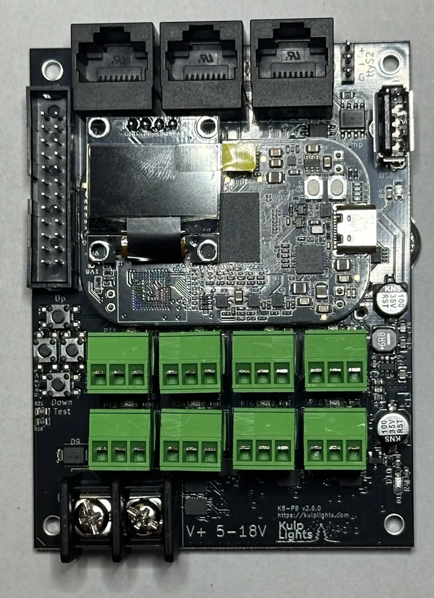
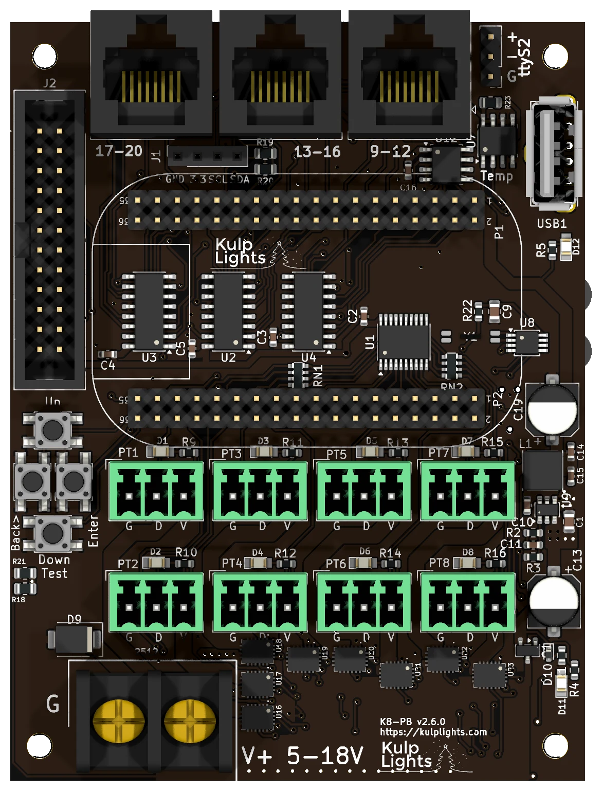

# K8-PB

A compact controller: 8 eFused pixel ports with per-port current monitoring, 3 differential ports
and an expansion port for 16 more strings: 36 strings in all, on a 74 × 97 mm board.

{ .board loading=lazy }

<small>K8-PB with a PocketBeagle 2 fitted.</small>

This page describes revision **v2.6.0** (printed on the board as `K8-PB v2.6.0`). The
PocketBeagle 2 K8-PBs are **v2.5** and **v2.6**; see [Board revisions](#board-revisions) for the
one difference.

!!! warning "How the K8-PB differs from the other boards"
    - **No Ethernet on the board.** Plug a **USB Ethernet adapter** or an FPP-supported
      **USB Wi-Fi adapter** into its USB-A port. You need one of them to set it up.
    - **One power terminal, 5–18 V.** It powers the controller and all eight ports, so all of
      them run at the same voltage. **Don't use 24 V supplies.**
    - **DMX is a 3-pin header**, not an RJ45 jack.
    - The **expansion port** drives 16 more strings through a Falcon F16v4-style expansion board.
    - The differential ports are **send-only**. FPP drives this board with its **BBB48String**
      output, which doesn't support Falcon V5 smart receivers (V4 and earlier work).

## Specifications

| | K8-PB |
|---|---|
| Local pixel ports | 8 (PT1–PT8), 3-pin 3.5 mm pluggable, plugs included |
| Port protection | eFuse per port, about 5.2 A |
| Power switching | per port (FPP-controlled) |
| Current monitoring | every local port |
| Differential ports | 3 × RJ45 = 12 strings (9–20), send-only |
| Expansion port | 24-pin (2×12) header, 16 strings (21–36), for a Falcon F16v4-style expansion board |
| Total strings | 36 |
| Power input | 1 terminal, **5–18 V DC**, powers the controller and all 8 ports |
| DMX / serial | 1, RS-485 transmit, 3-pin 2.54 mm header (`ttyS2`) |
| Audio | none built in. Use a USB sound card. |
| Ethernet | **none.** Use a USB Ethernet or Wi-Fi adapter. |
| USB-A | 1 |
| Display & buttons | 128×64 OLED, Up / Enter / Back / Down-Test |
| Real-time clock | yes, CR1220 backup cell |
| Temperature sensor | yes |
| Fan header | none |
| Size | 73.7 × 97.2 mm (2.90 × 3.83 in), 4 mounting holes, 3.2 mm |
| Requires | PocketBeagle 2. The PocketBeagle 2 K8-PB does **not** work with a PocketBeagle 1. |

## Board map

{ .board loading=lazy }

### Power terminal

The K8-PB has **one** power terminal, at the bottom left, marked **G** (left screw) and
**V+ 5-18V** (right screw). It powers the PocketBeagle 2, the USB port and all of the logic,
and every pixel port. FPP shows its voltage as **VIN**.

- Because every port shares this supply, **all eight local strings must be the same voltage**:
  5 V or 12 V pixels. To mix voltages, put the other strings on differential receivers, which
  power their strings from their own supply.
- **18 V is the maximum.** A 24 V supply will damage the board.
- The terminal is rated 32 A. With eight ports that can each draw up to about 5 A, add up your
  real loads and keep the total under that. Use **10 AWG** wire for heavily loaded boards.
- Two blue LEDs on the right-hand edge show power: the **lower** one lights when the terminal has
  power, and the **upper** one (beside the USB port) when the internal 5 V supply is running.

!!! danger "Check polarity before you power up"
    Unlike the K8, K16 and K32 boards, the K8-PB is **not protected against a reversed supply**.
    The controller's own logic is protected, but a supply wired backwards drives the input
    surge-protection diode, which is likely to burn out. It usually fails as a short, and the board
    then won't power up until it is repaired. Check that **V+** goes to the right-hand
    screw and **G** to the left before you switch on.

See [Power](../hardware/power.md) for supply sizing and safety.

### Pixel ports

The eight pixel ports are in two rows across the lower half of the board:

| | | | | |
|---|---|---|---|---|
| **Top row** | PT1 | PT3 | PT5 | PT7 |
| **Bottom row** | PT2 | PT4 | PT6 | PT8 |

Each port is **G D V** (ground, data, +V), as printed beneath it. PT1 is FPP port 1, and so on.
See [Pixel outputs](../hardware/pixel-outputs.md).

### eFuses and current monitoring

Every local port has its own eFuse, which trips at about **5.2 A**, and FPP reads every port's
current. As on the Max boards, FPP turns each port on and off as needed. When an eFuse trips,
FPP switches the port off and marks it with a red icon on **Status/Control → Port Status**.
Click the icon to turn the port back on once the fault is fixed. See
[Current monitoring](../software/current-monitoring.md).

### Differential ports

`17-20` · `13-16` · `9-12`, from left to right along the top edge.

Each jack carries four strings, numbered as printed below it. Note that the numbering runs
**right to left**: the jack nearest the USB port is `9-12`. The ports are send-only. Any
standard differential receiver works, and smart receivers work in **v1, v2 or V4** mode. See
[Differential ports](../hardware/differential.md).

### Expansion port (strings 21–36)

The 24-pin, 2×12 shrouded header on the left edge carries **16 more pixel data lines**. It is
compatible with **Falcon F16v4 expansion boards**, which turn the 16 lines into pixel ports with
their own power.

| Pin | Signal | Pin | Signal |
|---|---|---|---|
| 1 | GND | 2 | GND |
| 3 | +5 V | 4 | +5 V |
| 5 | String 21 | 6 | String 22 |
| 7 | String 23 | 8 | String 24 |
| 9 | String 25 | 10 | String 26 |
| 11 | String 27 | 12 | String 28 |
| 13 | String 29 | 14 | String 30 |
| 15 | String 31 | 16 | String 32 |
| 17 | String 33 | 18 | String 34 |
| 19 | String 35 | 20 | String 36 |
| 21 | — | 22 | GND |
| 23 | — | 24 | — |

Pin 1 is at the top of the header, on the outer (board-edge) row.

!!! warning "Not for pixels directly"
    The data lines on this header come straight from the PocketBeagle 2 at **3.3 V**, with no
    buffering or protection. Always go through an expansion board. Never wire pixels straight to
    the header.

### DMX

DMX is on the 3-pin, 2.54 mm header at the top right, above the USB port, marked `ttyS2`:

| Pin | Marking | Signal | DMX XLR pin |
|---|---|---|---|
| top | `+` | Data + | 3 |
| middle | `-` | Data − | 2 |
| bottom | `G` | Ground | 1 |

Make up a cable from a 3-pin socket to an XLR or RJ45 DMX connector, wired as above. The output
is transmit-only. FPP calls the port `ttyS2`. See [DMX / serial](../hardware/dmx.md).

### Other connectors

| Connector | Marking | Details |
|---|---|---|
| USB-A | — | 1 port, for the network adapter. [USB](../hardware/network-usb-rtc.md#usb-ports) |
| OLED | `GND 3.3V SCL SDA` | [Controls & display](../hardware/controls.md) |
| Buttons | `Up` `Enter` `Back>` `Down Test` | Down and Test share one button. [Controls & display](../hardware/controls.md#test-button) |
| RTC battery | coin-cell holder | [Clock](../hardware/network-usb-rtc.md#real-time-clock-rtc) |

## FPP setup

When FPP detects the K8-PB it sets itself up automatically. It enables the **K8-PB**
pixel-string layout (FPP's **BBB48String** output, with all 36 strings), the voltage and current
sensors, and a disabled DMX output on `ttyS2`. Set the pixel counts and start channels from
xLights or the FPP *Pixel Strings* page. See [Configuring outputs](../software/outputs.md).

For the first setup, plug in a USB Ethernet adapter and connect it to your network, or use a USB
Wi-Fi adapter and FPP's [Wi-Fi hotspot](../software/first-boot.md#no-ethernet-use-the-wi-fi-hotspot).

## Board revisions

The revision is printed on the board next to the model name. FPP also shows it as the
**Hardware Version** under *Help → About → Cape Info*.

| Revision | Changes |
|---|---|
| **v2.5** | First PocketBeagle 2 version. **Port 2's enable is wired always-on**, so FPP can't switch port 2 off. Its eFuse still trips and FPP still warns, but the port retries about every half second instead of staying off, and keeps tripping until the fault is fixed. Everything else works normally. This batch was sold at a discount as the [K8-PB "Almost"](https://kulplights.com/product/k8-pb-almost/). |
| **v2.6** | Port 2 fixed: all eight ports switch and stay off when tripped. |

Older K8-PBs made for the original PocketBeagle (PocketBeagle 1) aren't covered by this manual.

## Dimensions & mounting

- **73.66 × 97.16 mm** (2.90 × 3.83 in), 4 plated mounting holes, 3.2 mm, for **M3** (or #4)
  screws and standoffs.
- Use nylon or metal standoffs at least 6 mm (¼ in) tall, so nothing on the underside touches the
  enclosure.
