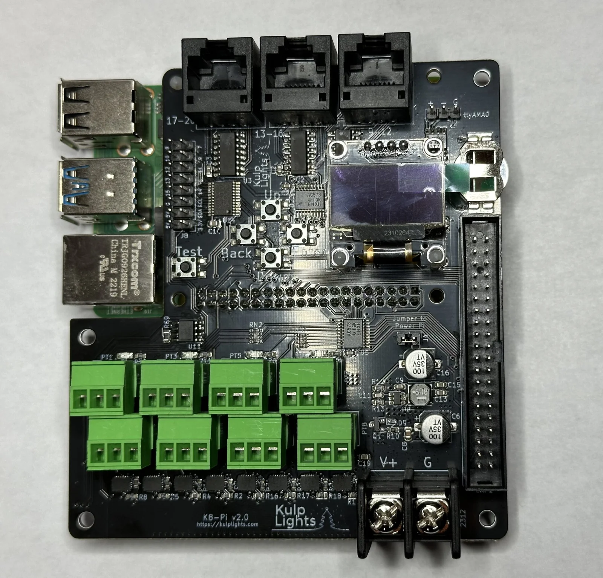
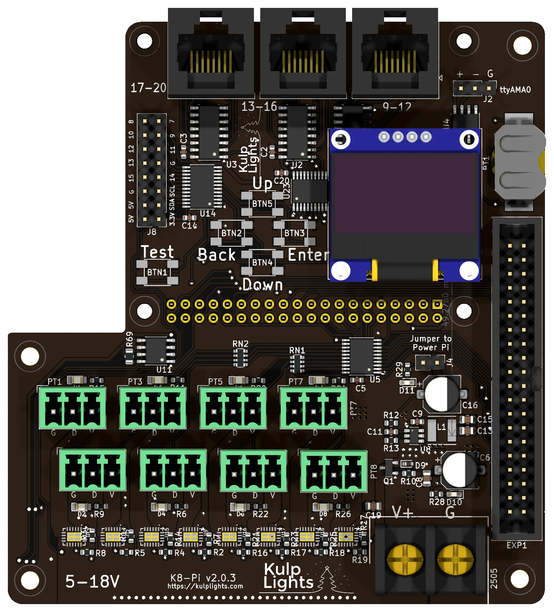

# K8-Pi

A Raspberry Pi pixel controller: 8 eFused pixel ports with per-port current monitoring,
3 differential ports and an expansion port for 16 more strings: 36 strings in all.

{ .board loading=lazy }

<small>K8-Pi (v2.0) on a Raspberry Pi 4.</small>

This page describes revision **v2.0.3** (printed on the board as `K8-Pi v2.0.3`). See
[Board revisions](#board-revisions) for the earlier boards, including the v1.0 with fuses.

!!! warning "How the K8-Pi differs from the other boards"
    - **It needs a Raspberry Pi** 3 B+, 4 or 5. See [Raspberry Pi](../hardware/raspberry-pi.md).
    - **One power terminal, 5–18 V.** It powers the Pi and all eight ports, so all of them run at
      the same voltage. **Don't use 24 V supplies.**
    - **One DMX output on a 3-pin header**, not an RJ45 jack.
    - The differential ports are **send-only**, and smart receivers work in **v1 or v2** mode only.

## Specifications

| | K8-Pi |
|---|---|
| Local pixel ports | 8 (PT1–PT8), 3-pin 3.5 mm pluggable, plugs included |
| Port protection | eFuse per port, about 5.2 A, latching |
| Power switching | per port (FPP-controlled) |
| Current monitoring | every local port |
| Differential ports | 3 × RJ45 = 12 strings (9–20), send-only |
| Expansion port | 40-pin (2×20) header, 16 strings (21–36), for a Falcon F16v3 expansion board |
| Total strings | 36 |
| Pixels per string | up to 1600; about 800 at 40 fps |
| Power input | 1 terminal, **5–18 V DC**, powers the Pi and all 8 ports |
| DMX / serial | 1, RS-485 transmit, 3-pin 2.54 mm header (`ttyAMA0`) |
| Audio | the Pi's own |
| Ethernet & USB | the Pi's own |
| Display & buttons | 128×64 OLED, Up / Down / Back / Enter / Test |
| Real-time clock | yes, CR1220 backup cell |
| Temperature sensor | yes |
| Size | 97.5 × 105.7 mm (3.84 × 4.16 in), 4 mounting holes for the Pi + 4 for the enclosure |
| FPP output | DPIPixels |
| Requires | Raspberry Pi 3 B+, 4 or 5, FPP 10 or later |

## Board map

{ .board loading=lazy }

The Pi sits under the upper part of the board, with its USB and Ethernet ports in the cut-out at
the top left.

### Power terminal

The K8-Pi has **one** power terminal, at the bottom right, marked **V+** (left screw) and **G**
(right screw). It powers the Pi and all of the logic, and every pixel port. FPP shows its voltage as
**VIN**.

- Because every port shares this supply, **all eight local strings must be the same voltage**:
  5 V or 12 V pixels. To mix voltages, put the other strings on differential receivers, which
  power their strings from their own supply.
- **18 V is the maximum.** A 24 V supply will damage the board.
- With a **5 V** supply, turn its output up to about **5.3 V** so the Pi gets a full 5 V; see
  [Raspberry Pi → Powering](../hardware/raspberry-pi.md#powering).
- Two blue LEDs show power: one near the terminal lights when the terminal has power, and one beside
  the **Jumper to Power Pi** when the Pi's 5 V supply is on.

!!! danger "Check polarity before you power up"
    The Pi and the controller's logic are protected against a reversed supply, but **the pixel ports
    aren't**: a reversed supply reaches the eFuses and the ports directly and can damage them. Check
    that **V+** goes to the left screw before you switch on.

See [Power](../hardware/power.md) for supply sizing and safety.

### Powering the Pi: the "Power Pi" jumper

The jumper marked **Jumper to Power Pi**, above the power terminal, connects the board's 5 V
regulator to the Pi. It is fitted at the factory, and the Pi then runs from the power terminal.

You can instead remove the jumper and power the Pi from its own USB power supply; the board's logic
then runs from the Pi, and the ports still need the power terminal. **Never fit the jumper and plug
in the Pi's own power supply at the same time.**

### Pixel ports

The eight pixel ports are in two rows across the lower half of the board:

| | | | | |
|---|---|---|---|---|
| **Top row** | PT1 | PT3 | PT5 | PT7 |
| **Bottom row** | PT2 | PT4 | PT6 | PT8 |

Each port is **G D V** (ground, data, +V), as printed beneath it. PT1 is FPP port 1, and so on.
Each string can have up to **1600 pixels**; the longest string sets the frame rate, about 40 fps at
800 pixels. See [Pixel outputs](../hardware/pixel-outputs.md) and
[Raspberry Pi → Pixel outputs](../hardware/raspberry-pi.md#pixel-outputs-on-a-pi).

### eFuses and current monitoring

Every local port has its own eFuse, which trips at about **5.2 A**, and FPP reads every port's
current. FPP turns each port on and off as needed. When an eFuse trips, FPP switches the port off
and marks it with a red icon on **Status/Control → Port Status**. Click the icon to turn the port
back on once the fault is fixed. The LED by each port lights when the port has power. See
[Current monitoring](../software/current-monitoring.md).

### Differential ports

`17-20` · `13-16` · `9-12`, from left to right along the top edge.

Each jack carries four strings, numbered as printed beside it. The ports are send-only. Any standard
differential receiver works, and smart receivers work in **v1 or v2** mode. See
[Differential ports](../hardware/differential.md).

### Expansion port (strings 21–36)

The 40-pin, 2×20 shrouded header on the right-hand edge carries **16 more pixel strings**. It is
compatible with **Falcon F16v3 expansion boards**, which turn them into pixel ports with their own
power.

The expansion strings share their data lines with ports 1–16: FPP sends both sets of data down the
same lines, and **latch** signals on pins 2 and 4 tell the K8-Pi and the expansion board which set
is theirs. That's how the F16v3 expansion connector is designed. Because of the sharing, the
expansion lines **can't be used as GPIO inputs**.

| Pin | Signal | Pin | Signal |
|---|---|---|---|
| 1 | — | 2 | latch |
| 3 | GND | 4 | latch |
| 5 | GND | 6 | String 21 |
| 7 | GND | 8 | String 22 |
| 9 | GND | 10 | String 23 |
| 11 | GND | 12 | String 24 |
| 13 | GND | 14 | String 25 |
| 15 | GND | 16 | String 26 |
| 17 | GND | 18 | String 27 |
| 19 | GND | 20 | String 28 |
| 21 | GND | 22 | String 29 |
| 23 | GND | 24 | String 30 |
| 25 | GND | 26 | String 31 |
| 27 | GND | 28 | String 32 |
| 29 | GND | 30 | — |
| 31 | String 33 | 32 | String 34 |
| 33 | GND | 34 | String 35 |
| 35 | GND | 36 | String 36 |
| 37 | GND | 38 | GND |
| 39 | +5 V | 40 | +5 V |

!!! warning "Not for pixels directly"
    The data lines on this header come straight from the Pi at **3.3 V**, with no buffering or
    protection. Always go through an expansion board.

### DMX

DMX is on the 3-pin, 2.54 mm header at the top right, marked `ttyAMA0`:

| `+` (left) | `-` (middle) | `G` (right) |
|---|---|---|
| Data + | Data − | Ground |

Wire **+** to XLR pin 3, **−** to pin 2 and **G** to pin 1 (or to an RJ45 DMX connector). The output
is transmit-only and can also drive Renard, LOR or Pixelnet through a suitable adapter. FPP calls the
port `ttyAMA0`. See [DMX / serial](../hardware/dmx.md).

### Other connectors

| Connector | Marking | Details |
|---|---|---|
| OLED | `GND VDD SCK SDA` | [Controls & display](../hardware/controls.md) |
| Buttons | `Up` `Down` `Back` `Enter`, `Test` | the four menu buttons in a diamond, with a separate **Test** button to their left. [Controls & display](../hardware/controls.md) |
| GPIO / I²C | `3.3V 5V SDA SCL GND`, `7`–`15` | 2×8 header, top left: power, the I²C bus and nine spare lines on the button I/O expander, which FPP lists as `GPIO-7` to `GPIO-15`. Like the [Exp header](../hardware/expansion.md) lines they are 3.3 V, pull up weakly and can only sink current: use them for switches to ground. |
| RTC battery | coin-cell holder, top right | [Clock](../hardware/network-usb-rtc.md#real-time-clock-rtc) |

## FPP setup

When FPP detects the K8-Pi it sets itself up automatically. It enables the **K8-Pi** pixel-string
layout (FPP's **DPIPixels** output, with 100 pixels on each local and differential string and none
on the expansion strings), the voltage, current and temperature sensors, and a disabled DMX output
on `ttyAMA0`. Set the pixel counts and start channels from xLights or the FPP *Pixel Strings* page.
See [Configuring outputs](../software/outputs.md).

On a **Pi 5**, use FPP 10.1 or later and keep the cape EEPROM up to date (*Help → About → Cape
Info*), so the K8-Pi's clock is used instead of the Pi 5's own.

## Board revisions

The revision is printed on the board next to the name.

| Revision | Changes |
|---|---|
| **v1.0** | **Mini-blade fuses** (5 A) instead of eFuses: no per-port switching or current readings. Everything else works the same. |
| **v2.0**, **v2.0.1** | eFuses with per-port switching and current readings. These eFuses **retry automatically** after a trip; FPP still switches a faulted port off and warns. |
| **v2.0.2**, **v2.0.3** | The eFuses **latch off** after a trip until FPP turns the port back on. v2.0.3 adds the `5-18V` marking. |

## Dimensions & mounting

- **97.54 × 105.66 mm** (3.84 × 4.16 in), L-shaped, with a cut-out for the Pi's USB and Ethernet
  ports.
- **4 × 2.7 mm holes** (M2.5) match the Pi's mounting holes: fix the K8-Pi to the Pi with M2.5
  standoffs.
- **4 × 3.2 mm plated holes** (M3) at the corners for mounting in an enclosure, on standoffs tall
  enough to clear the Pi underneath.
