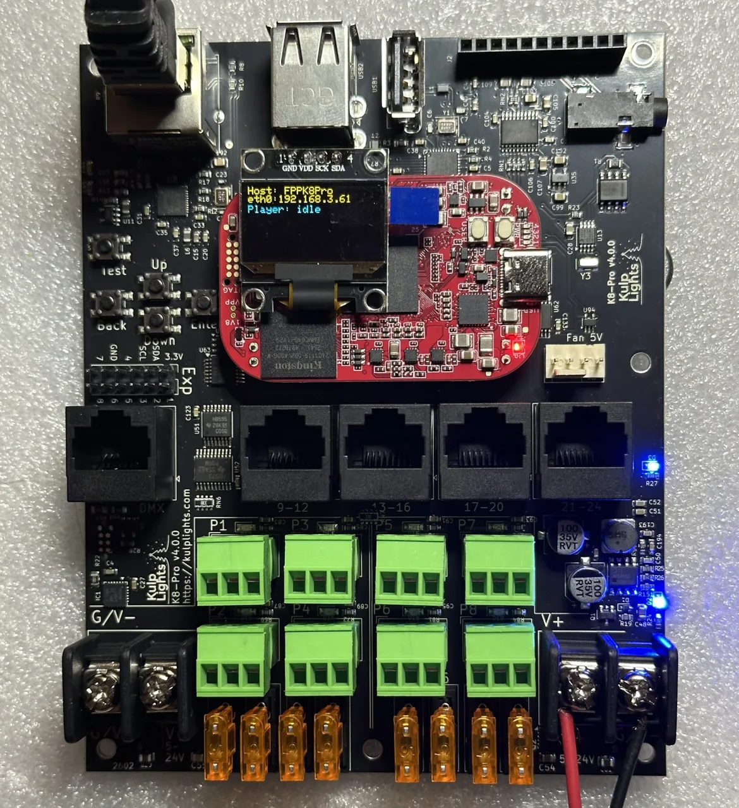
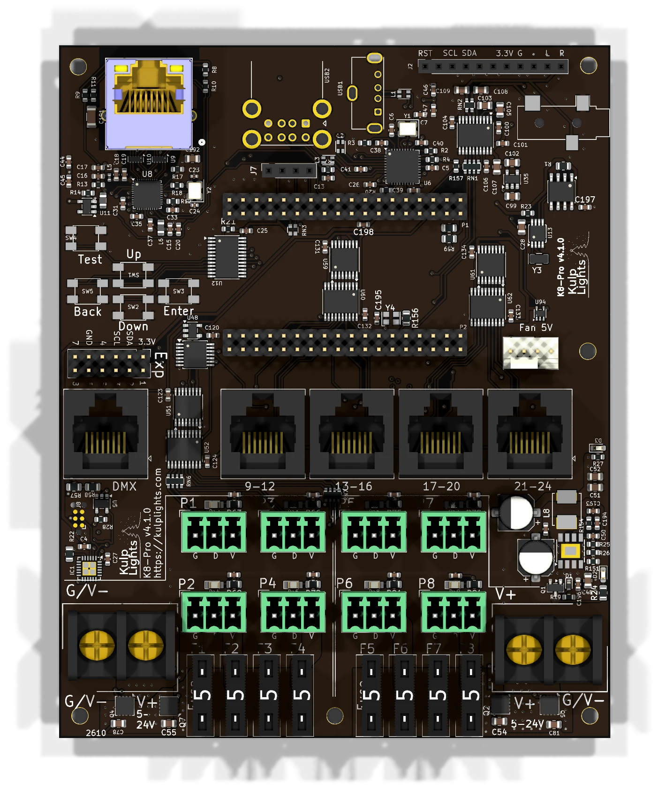

# K8-Pro

8 fused pixel ports, 4 two-way differential ports, audio and DMX.

{ .board loading=lazy }

<small>K8-Pro with a PocketBeagle 2 fitted. Photos may show an earlier board revision.</small>

This page describes revision **v4.1.0** (printed on the board as `K8-Pro v4.1.0`). Differences in earlier revisions are listed under [Board revisions](#board-revisions).

## Specifications

| | K8-Pro |
|---|---|
| Local pixel ports | 8 (P1–P8), 3-pin 3.5 mm pluggable, plugs included |
| Port protection | 5 A mini-blade fuse per port |
| Power switching | per bank of 4 (FPP-controlled) |
| Current monitoring | from Falcon V5 receivers only |
| Differential ports | 4 × RJ45 = 16 strings (9–24), two-way (pair 1/2) |
| Total strings | 24 |
| Power inputs | 2 terminals rated 30 A, 5–24 V DC, one bank of 4 ports each |
| DMX / serial | 1 (`DMX`), RS-485 transmit |
| Audio | PCM5102A DAC, 3.5 mm line out, FM transmitter socket |
| Ethernet | 1 × Gigabit (USB-attached) |
| USB-A | 3 |
| Display & buttons | 128×64 OLED, Up / Down / Enter / Back / Test |
| Real-time clock | yes, CR1220 backup cell |
| Fan header | 5 V 4-pin PWM, temperature-controlled; speed monitoring on v4.1 and later |
| Expansion header | 2×6: I²C + 8 GPIO (Exp.1–Exp.8) |
| Size | 103.0 × 129.4 mm (4.06 × 5.09 in), 6 mounting holes, 3.0 mm |
| Requires | PocketBeagle 2 (not PocketBeagle 1), FPP 9.0 or later |

## Board map

{ .board loading=lazy }

### Power terminals

| Terminal | Feeds | FPP reading | Also powers the controller? |
|---|---|---|---|
| **Left** (bottom edge) | P1–P4 | VIN1 | no |
| **Right** (bottom edge) | P5–P8 | VIN2 | **yes** |

The blue LED beside the **right** terminal lights when it has power. **The right terminal must
be powered for the controller to boot.**

See [Power](../hardware/power.md) for supply sizing, wire size and safety.

### Pixel ports

The eight pixel ports are in two rows across the lower part of the board:

| | | | | |
|---|---|---|---|---|
| **Top row** | P1 | P3 | P5 | P7 |
| **Bottom row** | P2 | P4 | P6 | P8 |

Each port is **G D V** (ground, data, +V), as printed beside it. See [Pixel outputs](../hardware/pixel-outputs.md).

### Fuses

Every local port has a **5 A mini-blade fuse** next to it. If a port's green LED is dark while
the rest of its bank is lit, check that port's fuse first. **Never fit a fuse larger
than 5 A.** See [Power → Fuses](../hardware/power.md#mini-blade-fuses-k16-k32-and-the-pro-boards).

On the K8-Pro all eight fuses sit in one row along the bottom edge, between the two power terminals.

### Bank switching

Each bank of four ports has an electronic power switch that FPP controls, so FPP can turn
pixel power off when nothing is playing. See [Power → Bank switching](../hardware/power.md#bank-switching-pro-boards).

### Differential ports

`9-12` · `13-16` · `17-20` · `21-24`

Each jack carries four strings, numbered as printed above it. They are **two-way**: Falcon V5 smart receivers report their eFuse status and current back over pair 1/2. Other receivers work as send-only.
See [Differential ports](../hardware/differential.md).

### Other connectors

| Connector | Marking | Details |
|---|---|---|
| Ethernet | (RJ45 with LEDs) | [Network](../hardware/network-usb-rtc.md#ethernet) |
| DMX | `DMX` | [DMX / serial](../hardware/dmx.md) |
| USB-A | — | 3 ports, [USB](../hardware/network-usb-rtc.md#usb-ports) |
| OLED | `GND 3.3V SCL SDA` | [Controls & display](../hardware/controls.md) |
| Audio out | 3.5 mm jack | [Audio](../hardware/audio.md) |
| FM transmitter | `RST SCL SDA 3.3V G L R` | [Audio](../hardware/audio.md#fm-transmitter-socket) |
| Fan | `Fan 5V` | [Fan](../hardware/expansion.md#fan) |
| Expansion | `Exp` | [Expansion header](../hardware/expansion.md) |
| RTC battery | coin-cell holder (underside) | [Clock](../hardware/network-usb-rtc.md#real-time-clock-rtc) |

## FPP setup

When FPP detects the K8-Pro it sets itself up automatically. It enables the
**K8-Pro** pixel-string layout, the sensors (input voltages, temperature), the audio output
and a disabled DMX output. Out of the box each local port is set to 50 WS2811 pixels at 50 % brightness.
Set the real counts and start channels from xLights or the FPP *Pixel Strings* page.
See [Configuring outputs](../software/outputs.md).

## Board revisions

The revision is printed on the board next to the model name. FPP also shows it as the
**Hardware Version** under *Help → About → Cape Info*.

| Revision | Changes |
|---|---|
| **v4.0** | Fused ports with bank switching. Fan speed control. |
| **v4.1** | Adds **fan speed monitoring**. |

## Dimensions & mounting

- **103.05 × 129.39 mm** (4.06 × 5.09 in), 6 plated mounting holes, 3.0 mm, for **M2.5** (or #4) screws and standoffs.
- The mounting holes are connected to ground.
- Use nylon or metal standoffs at least 6 mm (¼ in) tall, so nothing on the underside touches the
  enclosure.
- Mounting drawing: [PDF](https://kulplights.com/wp-content/uploads/2025/12/K8-Max.pdf). It is shared by the K8-Pro and K8-Max, which have the same outline and holes.
