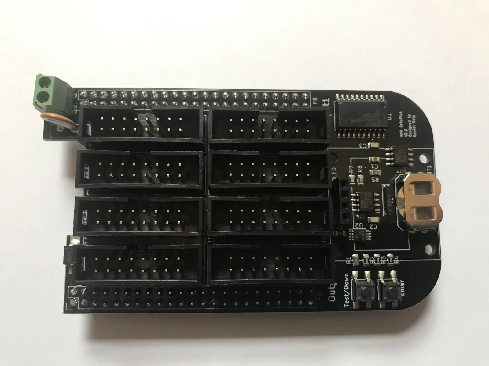
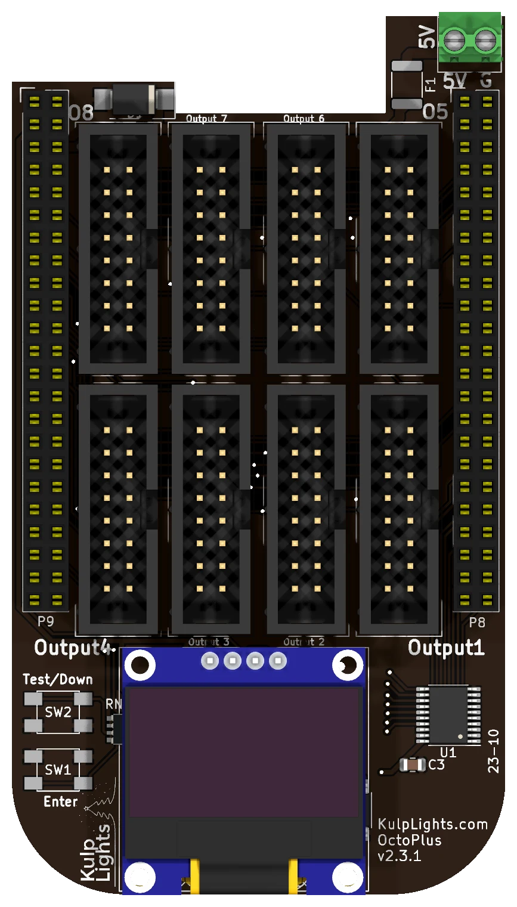

# OctoPlus

Eight HUB75 outputs for LED panel matrices on a BeagleBone Black: an updated version of the classic
"Octoscroller" cape, with a clock, a temperature sensor, an OLED and buttons.

{ .board loading=lazy }

<small>An early OctoPlus (v2.2), without the OLED fitted. The [board map](#board-map) below shows
the current board.</small>

This page describes revision **v2.3.1** (printed on the board as `OctoPlus v2.3.1`). See
[Board revisions](#board-revisions) for the earlier boards.

!!! warning "How the OctoPlus differs from the other boards"
    - **It needs a BeagleBone Black** (or a compatible BeagleBone). See
      [BeagleBone Black](../hardware/beaglebone-black.md).
    - **5 V only.** The terminal powers the BeagleBone and the cape. The panels need their own 5 V
      supply.
    - **No E line**, so 1/32-scan panels (such as 64×64 1/32) don't work. 1/16-scan and lower do.
    - **No mounting holes.** The cape is held by its headers on the BeagleBone; mount the
      BeagleBone.

## Specifications

| | OctoPlus |
|---|---|
| LED panel outputs | 8 × HUB75 (Output 1–8), no E line |
| Panels | P10 (32×16, 1/4 or 1/8 scan) and P5 (64×32, 1/8 or 1/16 scan), and other 1/16-scan or lower panels |
| Power input | **5 V DC only**, 2-pin 3.5 mm screw terminal |
| DMX / serial | none |
| Audio | none built in. Use a USB sound card. |
| Ethernet & USB | the BeagleBone's own |
| Display & buttons | 128×64 OLED, Test-Down / Enter |
| Real-time clock | yes, CR1220 backup cell |
| Temperature sensor | yes |
| Size | 55.4 × 98.6 mm (2.18 × 3.88 in), no mounting holes |
| FPP output | LED Panels (BeagleBone, Octoscroller v2 wiring) |
| Requires | BeagleBone Black or compatible, FPP 9.5 or later |

## Board map

{ .board loading=lazy }

Shown with the BeagleBone's Ethernet jack at the top, in the notch beside the power terminal.

### Power

The power terminal is on the tab at the top-right corner, marked **5V** (left screw) and **G**
(right screw).

- It powers the BeagleBone and the cape. Use a regulated 5 V supply rated at least 2 A, more if
  you plug anything into the BeagleBone's USB port.
- **The panels are not powered through the OctoPlus.** Run each panel's power from your 5 V panel
  supply. You can feed the OctoPlus from the same supply.
- There are no power LEDs. When the board is running, the OLED shows status.

!!! danger "5 V only"
    The OctoPlus has **no voltage regulator**. A 12 V or 24 V supply, or a reversed one, makes the
    protection clamp conduct and trip the resettable fuse, and can damage the board.

### Panel outputs

The eight outputs are in two rows of four between the BeagleBone's headers. With the Ethernet jack
at the top:

| | | | | |
|---|---|---|---|---|
| **Top row** | Output 8 | Output 7 | Output 6 | Output 5 |
| **Bottom row** | Output 4 | Output 3 | Output 2 | Output 1 |

Each is a standard **HUB75** connector, except that pin 8 is ground instead of E:

| Pin | Signal | Pin | Signal |
|---|---|---|---|
| 1 | R1 | 2 | G1 |
| 3 | B1 | 4 | GND |
| 5 | R2 | 6 | G2 |
| 7 | B2 | 8 | GND (no E) |
| 9 | A | 10 | B |
| 11 | C | 12 | D |
| 13 | CLK | 14 | LAT |
| 15 | OE | 16 | GND |

- Use the ribbon cables that come with your panels. The red stripe goes to pin 1 (marked on the
  header's shroud).
- FPP allows up to 16 panels per output. The refresh rate depends on the longest chain and on the
  colour depth; see [Capacity & refresh rate](#capacity-refresh-rate).
- On a **SanCloud BeagleBone Enhanced**, Output 5 doesn't work properly.

### Other connectors

| Connector | Marking | Details |
|---|---|---|
| OLED | `GND VDD SCK SDA` | bottom centre. [Controls & display](../hardware/controls.md) |
| Buttons | `Test/Down`, `Enter` | bottom left corner. [Controls & display](../hardware/controls.md) |
| RTC battery | coin-cell holder **under the OLED** | unplug the OLED to change the cell. [Clock](../hardware/network-usb-rtc.md#real-time-clock-rtc) |

The OctoPlus has no **Power** button. Use FPP's **Shutdown**, then switch off the supply.

## Capacity & refresh rate

How many panels you can run depends on how long each chain is and on the colour depth. The table
gives the full-frame refresh rate in Hz for **64×32 1/16-scan panels** with all eight outputs in
use, measured on an OctoPlus at FPP's default brightness (10). **Bold** values are 60 Hz or more.
*Italic* values are under 60 Hz, where flicker starts to show on camera and to some viewers.

| Panels per output | Total panels | 12-bit | 10-bit | 8-bit | 6-bit |
|---:|---:|---:|---:|---:|---:|
| 1 | 8 | **111** | **132** | **212** | **257** |
| 2 | 16 | **79** | **95** | **138** | **177** |
| 3 | 24 | *59.9* | **73** | **99** | **130** |
| 4 | 32 | *48* | *58* | **74** | **96** |
| 5 | 40 | *40* | *48* | **60** | **78** |
| 6 | 48 | *34* | *41* | *50* | **65** |
| 8 | 64 | *26* | *30* | *38* | *49* |
| 10 | 80 | *20* | *24* | *30* | *39* |
| 12 | 96 | *17* | *21* | *26* | *34* |
| 16 | 128 | *13* | *16* | *19* | *26* |

- **Rule of thumb at 60 Hz** with 64×32 panels: **2–3 panels per output at 12-bit colour**, or
  5 per output at 8-bit (40 panels).
- **Smaller panels go further.** A 32×16 P10 panel holds a quarter of the pixels of a 64×32, so
  a chain of P10s refreshes about as fast as a chain of a quarter as many 64×32s.
- **Refresh depends on the longest chain.** Spread the panels evenly across the outputs.
- **A single chain on Output 1 runs up to twice as fast**, because Output 1 shares its I/O bank with
  the panel control lines. Adding a second output costs most of that gain; going from 2 to 8
  outputs costs only another 10–15 %.
- **These are worst-case figures**, measured with random pixel data. Frames with flat or solid
  areas refresh faster: a solid fill ran 44 % faster at 3 panels per output, 8-bit.
- **1/8-scan outdoor panels** refresh about the same from 4 panels per output up, and faster on
  shorter chains (158 Hz at 1 panel per output, 12-bit).
- Lowering the colour depth is the easiest way to win back refresh on long chains. Unlike the
  PocketScroller v3, a lower brightness setting lowers the refresh rate a little on the OctoPlus.

## FPP setup

When FPP detects the OctoPlus it sets up an **LED Panels** output (*Input/Output Setup → Channel
Outputs → LED Panels*) with the OctoPlus wiring, starting with one 32×16 1/8-scan panel on
Output 1. Change it to match your panels:

1. Set the **panel size and scan** (e.g. 32×16 1/8, 64×32 1/16).
2. Set the **layout**: how many panels wide and high.
3. In the grid, assign each panel to an **output** and a **position in the chain**, and set its
   orientation.
4. Set **colour depth** and **brightness**, then save. FPP restarts the output.

See [LED panel matrices](https://manual.falconplayer.com/054-channel-outputs/#led-panel-matrices) in
the FPP manual for every field.

## Board revisions

The revision is printed on the board next to the name. Every revision uses the same FPP setup.

| Revision | Changes |
|---|---|
| **v2.2x** | The early boards. The panel lines come straight from the BeagleBone. |
| **v2.3** | Adds a 5 V buffer for the panels' clock, latch, OE and row-select lines, for more reliable panel driving. |
| **v2.3.1** | Current board. |

## Dimensions & mounting

- **55.37 × 98.55 mm** (2.18 × 3.88 in), with a notch for the BeagleBone's Ethernet jack, a tab for
  the power terminal, and rounded corners at the far end.
- **No mounting holes.** The OctoPlus is held by its headers on the BeagleBone, so mount the
  BeagleBone by its own holes.
