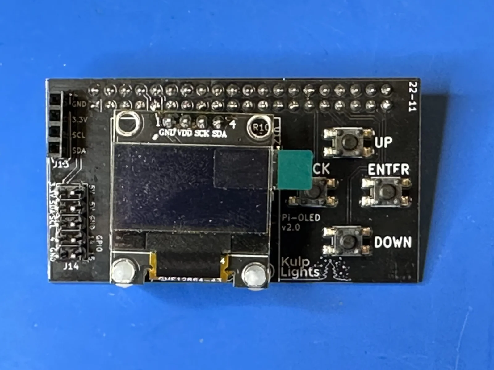
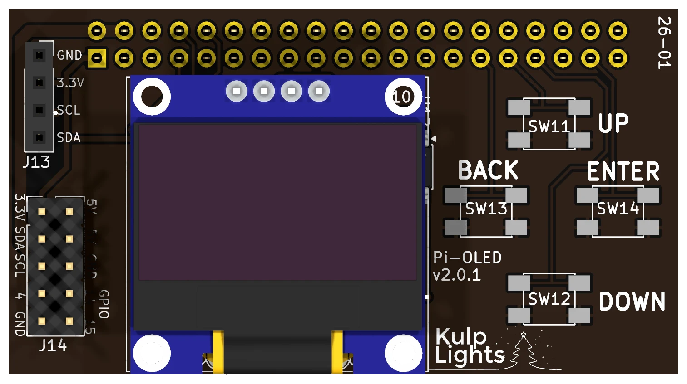
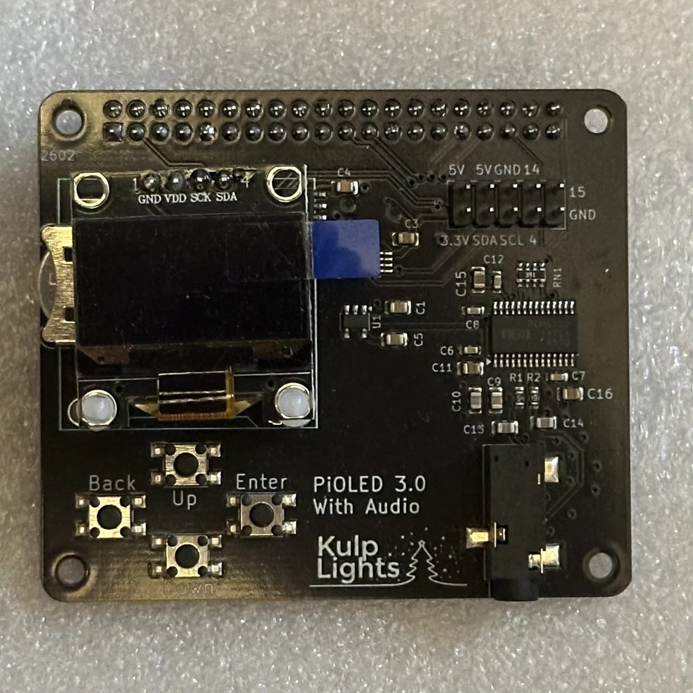
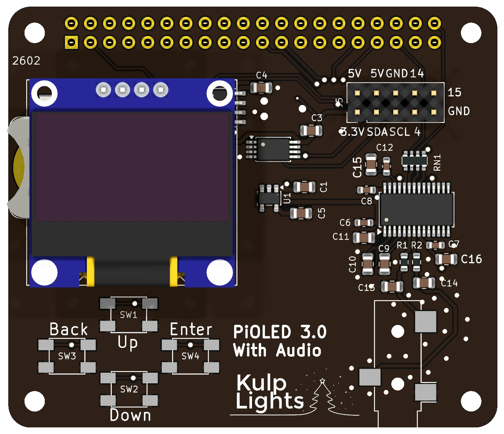

# Pi-OLED

An add-on for a Raspberry Pi running FPP: an OLED status display, four menu buttons, a real-time
clock and a temperature sensor. It has **no outputs** of its own. It comes in two versions:

- **Pi-OLED 2.0** ("basic"): a narrow board held by the Pi's header.
- **PiOLED 3.0 With Audio**: a full-size Pi hat that adds a high-quality **audio output**.

Use it on a Pi that drives its lights over the network or USB, or plays the show as a player or
master: it gives the Pi the same display, menus and buttons as the Kulp controllers.

!!! warning "Not with an output hat"
    The Pi-OLED uses GPIO pins that the Kulp Pi controllers also use. Fit it to a Pi **without**
    another hat.

## Specifications

| | Pi-OLED 2.0 | PiOLED 3.0 With Audio |
|---|---|---|
| Display | 128×64 OLED, blue/yellow, fitted | same |
| Buttons | Up / Down / Back / Enter | same |
| Real-time clock | yes, CR1220 cell included | same |
| Temperature sensor | yes | yes |
| Audio | — | stereo DAC, 3.5 mm line out |
| Headers | 1×4 I²C socket; 2×5 Pi pins 1–10 | 2×5 Pi pins 1–10 |
| Outputs | none | none |
| Power | from the Pi | from the Pi |
| Size | 62.0 × 33.9 mm (2.44 × 1.34 in), no mounting holes | 65 × 56 mm (2.56 × 2.20 in), 4 holes on the Pi's pattern |
| Raspberry Pi | 3 B+, 4, 5, Zero 2 W | 3 B+, 4, 5 |
| FPP | 9.5 or later | 10.1 or later |

## Pi-OLED 2.0

{ .board loading=lazy }

<small>Pi-OLED v2.0. The current board is printed `Pi-OLED v2.0.1`.</small>

{ .board loading=lazy }

- **Fitting:** disconnect power, then press its socket onto the Pi's 40-pin header, with the board
  lying over the Pi. It has no mounting holes; the header holds it.
- **Buttons:** in a diamond at the right: **UP** at the top, **BACK** at the left, **ENTER** at the
  right and **DOWN** at the bottom. See [Controls & display](../hardware/controls.md).
- **Clock:** the CR1220 cell sits under the display: unplug the display to change it.
- **Headers** at the left:

| Header | Marking | Details |
|---|---|---|
| I²C socket | `J13`: `GND 3.3V SCL SDA` | 1×4 socket on the I²C bus, for an extra I²C sensor or device. |
| Pi pins 1–10 | `J14`: `3.3V SDA SCL 4 GND`, `5V 5V GND GPIO 14 15` | 2×5 header that repeats the first ten pins of the Pi's header: 3.3 V, 5 V, GND, the I²C bus and GPIO 4, 14 and 15. Add-ons that plug onto those ten pins, such as some clock modules, work here. |

## PiOLED 3.0 With Audio

{ .board loading=lazy }

<small>PiOLED 3.0 With Audio.</small>

{ .board loading=lazy }

- **Fitting:** a standard Pi hat. Fit it on M2.5 standoffs in the Pi's four mounting holes, as in
  [Fitting the hat](../hardware/raspberry-pi.md#fitting-the-hat).
- **Audio:** a **PCM5122** stereo DAC drives the **3.5 mm jack** at the bottom right. It is **line
  level** (tip = left, ring = right, sleeve = ground), for an amplifier, powered speakers or an FM
  transmitter, and sounds much better than the Pi's own audio. It also gives the **Pi 5**, which has
  no audio jack, an audio output. FPP selects it automatically as the **KulpLightsHIFI** sound card.
- **Buttons:** in a diamond at the bottom left: **Up** at the top, **Back** at the left, **Enter** at
  the right and **Down** at the bottom.
- **Clock:** the CR1220 cell holder is on the left edge, partly under the display.
- **Header:** the 2×5 header at the top right repeats the first ten pins of the Pi's header (3.3 V,
  5 V, GND, the I²C bus and GPIO 4, 14 and 15), as on the Pi-OLED 2.0.
- **Pi 5:** use **FPP 10.1 or later**, so FPP uses the PiOLED's clock instead of the Pi 5's own.

## FPP setup

When FPP detects either board it sets up the display, the buttons, the clock and the temperature
sensor automatically, and on the PiOLED 3.0 the audio output.

## Board revisions

| Board | Revision | Changes |
|---|---|---|
| Pi-OLED | **v1.1 – v1.3** | No real-time clock. The buttons use different Pi pins; FPP sets them up from the board's EEPROM. |
| Pi-OLED | **v2.0** | Adds the clock and its battery. |
| Pi-OLED | **v2.0.1** | A different temperature-sensor chip. Works the same. |
| PiOLED | **3.0 With Audio** | Full-size hat with the audio output. |
