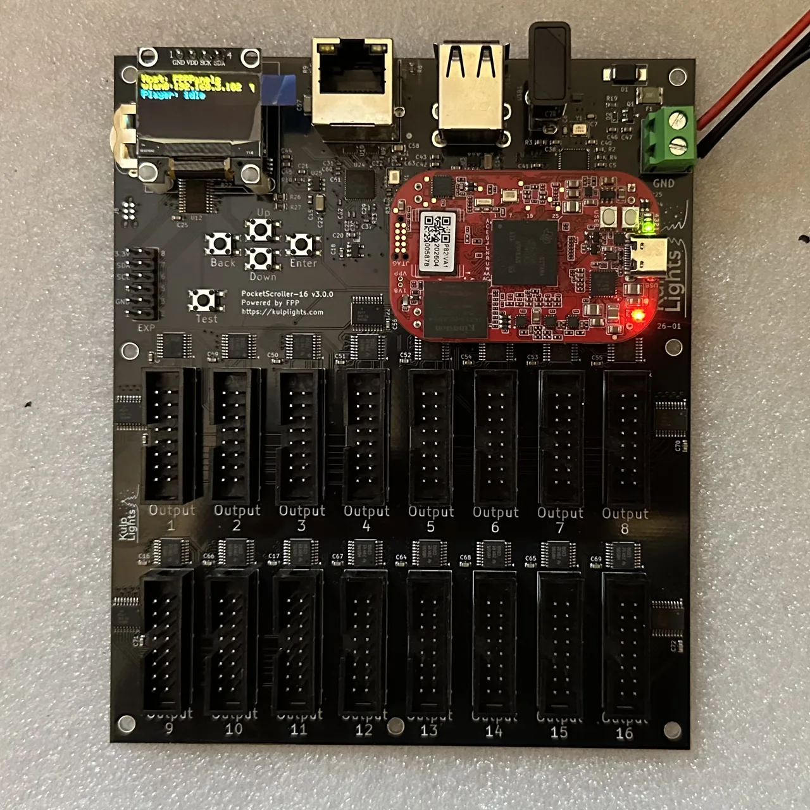
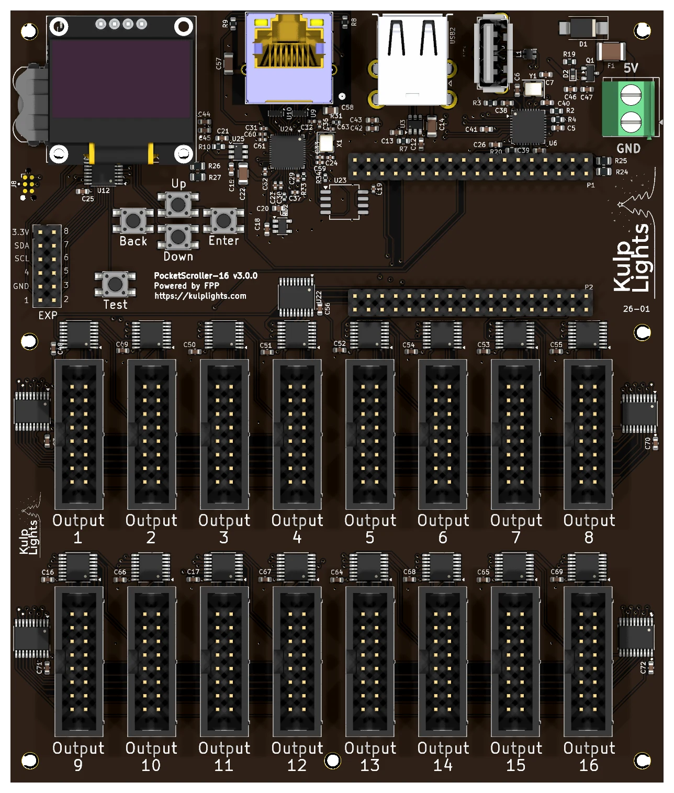

# PocketScroller-16

Sixteen HUB75 outputs for large LED panel matrices from a PocketBeagle 2. It's the bigger sibling of
the [PocketScroller v3](pocketscroller-v3.md), with the same power input, controls and expansion
header, and twice the outputs.

{ .board loading=lazy }

<small>PocketScroller-16 with a PocketBeagle 2 fitted.</small>

This page covers board revision **v3.0.0** (printed on the board as `PocketScroller-16 v3.0.0`).
FPP calls it **PocketScroller-16**.

## Specifications

| | PocketScroller-16 |
|---|---|
| Panel outputs | 16 × HUB75 (2×8 shrouded header), with E line for 1/32-scan panels |
| Capacity | 96 64×32 panels at 12-bit colour and 60 Hz (6 per output); see [Capacity](#capacity-refresh-rate) |
| Signal level | 5 V |
| Power input | **5 V DC only**, 2-pin 5.08 mm screw terminal |
| Input protection | 3 A resettable fuse, over-voltage clamp, reverse-polarity protection |
| Panel power | **not supplied.** Panels need their own 5 V supply. |
| Ethernet | 1 × Gigabit (USB-attached) |
| USB-A | 3 |
| Display & buttons | 128×64 OLED, Up / Down / Enter / Back / Test |
| Real-time clock | yes, CR1220 backup cell |
| Expansion header | 2×6: I²C + 8 GPIO (Exp.1–Exp.8) |
| Audio, DMX, pixel ports | none |
| Size | 121.95 × 144.21 mm (4.80 × 5.68 in), 7 mounting holes, 3.0 mm |
| Requires | PocketBeagle 2 (not PocketBeagle 1), FPP 10.0 or later |

## Board map

{ .board loading=lazy }

### Power

!!! danger "5 V only"
    Like the PocketScroller v3, the PocketScroller-16 has **no voltage regulator**. Connect a
    regulated **5 V** supply to the terminal marked **5V** / **GND** (top-right corner). A 12 V or
    24 V supply makes the protection clamp conduct and trip the resettable fuse, and can damage
    the board.

- The terminal powers the PocketBeagle 2, the panel drivers, Ethernet and the USB ports, not the
  panels. The board draws very little, but use a **5 V supply rated 5 A or more**: it handles ripple
  and spikes better.
- **Power every panel from your 5 V panel supply.** You can feed the PocketScroller-16 from the same
  supply.
- There are no power LEDs. When the board is running, the OLED shows status.
- FPP shows the input voltage as **VIN**.

### Panel outputs

The outputs are in two rows of eight: **Output 1–8** across the upper row and **Output 9–16** across
the lower row, left to right.

Each is marked **Output *n*** below its connector, and each is a standard **HUB75**
connector. The pinout is the same as on the
[PocketScroller v3](pocketscroller-v3.md#panel-outputs).

- Use the ribbon cables that come with your panels. The red stripe goes to pin 1 (marked on the
  header's shroud).
- Spread the panels evenly across the outputs. The refresh rate depends on the longest chain
  (see [Capacity & refresh rate](#capacity-refresh-rate)).

### Other connectors

| Connector | Marking | Details |
|---|---|---|
| Ethernet | (RJ45 with LEDs) | [Network](../hardware/network-usb-rtc.md#ethernet) |
| USB-A | — | 3 ports, [USB](../hardware/network-usb-rtc.md#usb-ports) |
| OLED | `GND 3.3V SCL SDA` | [Controls & display](../hardware/controls.md) |
| Expansion | `EXP` | [Expansion header](../hardware/expansion.md) (PocketScroller pinout) |
| RTC battery | coin-cell holder, top-left, behind the OLED | [Clock](../hardware/network-usb-rtc.md#real-time-clock-rtc) |

## Capacity & refresh rate

How many panels you can run depends on how long each chain is and on the colour depth. The
table gives the full-frame refresh rate in Hz for **64×32 panels** at FPP's default
brightness (10). **Bold** values are 60 Hz or more. *Italic* values are under 60 Hz, where flicker
starts to show on camera and to some viewers.

| Panels per output | Total panels | 12-bit | 10-bit | 8-bit | PWM panels (fps) |
|---:|---:|---:|---:|---:|---:|
| 1 | 16 | **174** | **185** | **199** | **306** |
| 2 | 32 | **138** | **152** | **171** | **153** |
| 3 | 48 | **102** | **115** | **130** | **102** |
| 4 | 64 | **83** | **94** | **108** | **76** |
| 5 | 80 | **69** | **78** | **91** | **61** |
| 6 | 96 | **60** | **68** | **80** | **51** |
| 8 | 128 | *50* | *58* | **70** | *38* |
| 10 | 160 | *43* | *51* | **62** | *31* |
| 12 | 192 | *37* | *44* | *54* | *26* |
| 16 | 256 | *29* | *35* | *43* | *19* |

- **Rule of thumb at 60 Hz:** up to **6 panels per output at 12-bit colour**
  (96 panels), or 10 per output at 8-bit (160 panels).
- **Refresh depends only on the longest chain.** Every output is clocked whether or not a panel is
  attached, so using fewer outputs doesn't make it faster. Spread the panels evenly across all
  16 outputs.
- **1/8-scan outdoor panels** refresh within a few percent of these 1/16-scan figures. Panels with
  shift-register row drivers ("ABC-shift" addressing, found on some outdoor 1/8 panels) are 7–16 %
  slower.
- Lowering colour depth is the easiest way to win back refresh on long chains. Lowering the brightness
  setting raises refresh slightly (about 9 % at brightness 8).
- The brightest bit plane is split into up to four pulses per frame, so the flicker a viewer actually
  sees runs 2–4× faster than the full-frame figure.

### PWM panels

Panels with **PWM driver chips** (FM6363C, FM6353, FM6373) run their own 16-bit greyscale, so they
don't flicker as chains get longer. Chain length limits only how many **new frames per second** reach
the panels: the last column of the table. Bold values there meet a 40 fps sequence, which works out
to up to **7 panels per output** (112 panels). Select the panel's driver chip under
**Panel Type** in FPP's LED Panels settings.

## FPP setup

When FPP detects the PocketScroller-16 it sets up an **LED Panels** output (*Input/Output Setup →
Channel Outputs → LED Panels*) with the PocketScroller wiring and a starting layout of 2×2 64×32
panels at low brightness, using all 16 outputs. Set up your panels as described for the
[PocketScroller v3](pocketscroller-v3.md#fpp-setup).

See [LED panel matrices](https://manual.falconplayer.com/054-channel-outputs/#led-panel-matrices) in
the FPP manual for every field.

## Dimensions & mounting

- **121.95 × 144.21 mm** (4.80 × 5.68 in), 7 plated mounting holes, 3.0 mm, for **M2.5** (or #4) screws and standoffs.
- Mounting drawing: [PDF](https://kulplights.com/wp-content/uploads/2026/07/PS-16.pdf).
