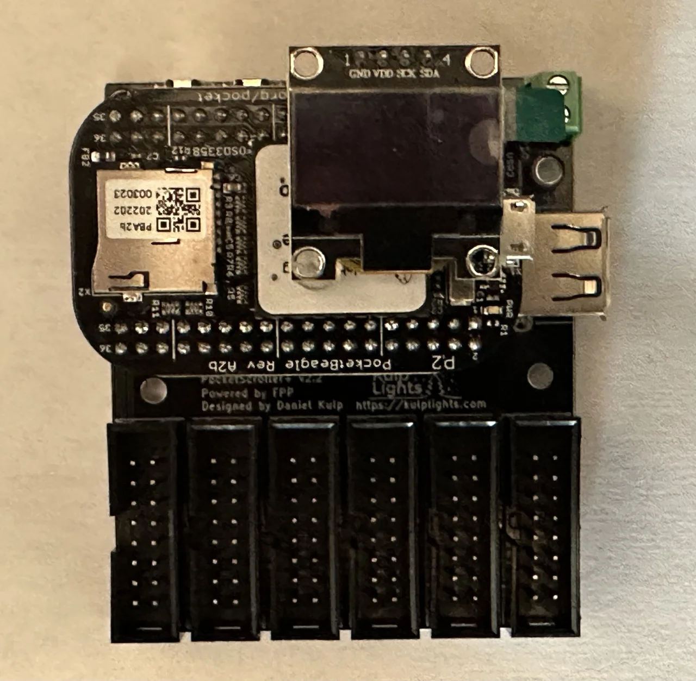
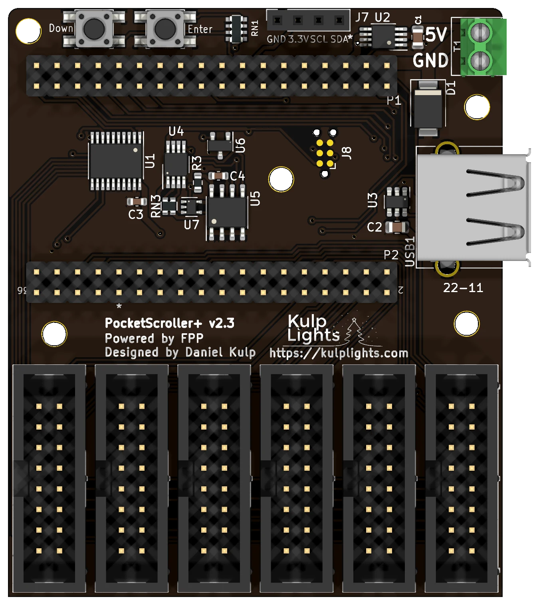

# PocketScroller v2

Six HUB75 outputs for LED panel matrices, on a small board that works with either PocketBeagle.

{ .board loading=lazy }

<small>PocketScroller v2 (v2.2) shown with an original PocketBeagle (PocketBeagle 1) fitted.</small>

This page covers the PocketScroller v2, printed on the board as `PocketScroller+ v2.x` (the current
revision is v2.3). Like the K4-PB and K40D-PB, it works with **both** the PocketBeagle 2 and the original
PocketBeagle 1.

!!! warning "How the PocketScroller v2 differs from the other boards"
    - **No Ethernet on the board.** Plug a **USB Ethernet adapter** or an FPP-supported
      **USB Wi-Fi adapter** into its USB-A port. You need one of them to set it up.
    - **The USB-A port covers the PocketBeagle 2's SD card slot.** To change the SD card you
      have to unplug the PocketBeagle 2. Either use a **PocketBeagle 2 Industrial**, which runs FPP
      from its built-in eMMC (recommended), or fit the
      [PB2 microSD extender](https://kulplights.com/product/microsd-extension-card/), which clears
      the USB port.
    - **The OLED shares pins with output 6.** If you use all six outputs, the OLED shows
      information while the board boots and then turns off once FPP starts. Leave output 6 free
      if you can.
    - **No real-time clock.** The board gets the time from the network (NTP).
    - **5 V only**, like the other PocketScrollers.

!!! danger "PocketBeagle 1: never connect its USB port to a computer"
    With an original **PocketBeagle 1** fitted, don't power or set up the PocketScroller v2 through
    the PocketBeagle's own USB port (USB tethering). It can **permanently damage** the board. With a
    **PocketBeagle 2**, [USB tethering](../hardware/network-usb-rtc.md#usb-tethering) is safe.

## Specifications

| | PocketScroller v2 |
|---|---|
| Panel outputs | 6 × HUB75 (2×8 shrouded header), no E line |
| Panel types | 1/4, 1/8 and 1/16 scan (for example P10 1/4 or 1/8, P5 1/8 or 1/16). **Not 1/32 scan.** |
| Capacity | see [Capacity & refresh rate](#capacity-refresh-rate) |
| Signal level | 3.3 V data from the PocketBeagle; control lines buffered to 5 V |
| Power input | **5 V DC only**, 2-pin 3.5 mm screw terminal |
| Panel power | **not supplied.** Panels need their own 5 V supply. |
| Ethernet | **none.** Use a USB Ethernet or Wi-Fi adapter. |
| USB-A | 1 |
| Display & buttons | 128×64 OLED (off when output 6 is in use), Down-Test / Enter |
| Real-time clock | none |
| Temperature sensor | yes |
| Expansion header | none |
| Size | 60.96 × 72.52 mm (2.40 × 2.86 in), 5 mounting holes, 3.0 mm |
| Requires | PocketBeagle 2 (FPP 9.5 or later, **FPP 10 or later strongly recommended**) or PocketBeagle 1 |

## Board map

{ .board loading=lazy }

### Power

!!! danger "5 V only"
    The PocketScroller v2 has **no voltage regulator**. Connect a regulated **5 V** supply to the
    terminal at the top right, marked **5V** (upper screw) and **GND** (lower screw). A 12 V or
    24 V supply will damage the board and the PocketBeagle.

- The terminal powers the PocketBeagle, the output buffer and the USB port. The board itself draws
  very little.
- **The panels are not powered through the PocketScroller.** Run each panel's power from your 5 V
  panel supply. You can feed the PocketScroller from the same supply.
- There are no power LEDs. When the board is running, the OLED shows status (as long as output 6
  is free).

### Panel outputs

The six HUB75 outputs are along the bottom edge, **Output 1** on the left to **Output 6** on the
right. They aren't numbered on the board. Connect each chain of panels with a 16-pin ribbon cable
to the panel's **input** connector.

!!! note "Output 6 and the OLED"
    The OLED's I²C lines share pins with output 6. While output 6 is unused, FPP keeps the OLED
    running. When you configure panels on output 6, FPP takes the pins for the panels and the OLED
    goes dark after boot. If you need fewer than six outputs, use outputs 1–5.

Set the panels up in FPP under *Input/Output Setup → Channel Outputs → LED Panels*. See
[LED panel matrices](https://manual.falconplayer.com/054-channel-outputs/#led-panel-matrices) in the
FPP manual.

### Buttons and OLED

The two buttons at the top left are marked **Down** (left) and **Enter** (right). The left button
is also **Test**: on the status page it starts and cycles the test patterns; in menus it moves
down. See [Controls & display](../hardware/controls.md).

The OLED plugs into the 4-pin socket marked `GND 3.3V SCL SDA`.

### Other connectors

| Connector | Details |
|---|---|
| USB-A | 1 port, for the network adapter. It sits over the PocketBeagle 2's SD card slot; the [PB2 microSD extender](https://kulplights.com/product/microsd-extension-card/) clears it. [USB](../hardware/network-usb-rtc.md#usb-ports) |
| PocketBeagle | sockets `P1` (upper) and `P2` (lower). See [PocketBeagle 2](../hardware/pocketbeagle2.md). |

## Capacity & refresh rate

How many panels you can run depends on how long each chain is and on the colour depth. The
tables give the full-frame refresh rate in Hz for **64×32, 1/16-scan panels** at FPP's default
brightness (10), with all six outputs in use. **Bold** values are 60 Hz or more. *Italic* values are
under 60 Hz, where flicker starts to show on camera and to some viewers.

=== "PocketBeagle 2"

    | Panels per output | Total panels | 12-bit | 10-bit | 8-bit |
    |---:|---:|---:|---:|---:|
    | 1 | 6 | **112** | **134** | **202** |
    | 2 | 12 | **72** | **86** | **118** |
    | 3 | 18 | *51* | **62** | **80** |
    | 4 | 24 | *40* | *48* | **60** |
    | 5 | 30 | *32* | *39* | *48* |
    | 6 | 36 | *27* | *32* | *40* |
    | 8 | 48 | *20* | *24* | *30* |
    | 10 | 60 | *16* | *19* | *24* |
    | 12 | 72 | *14* | *16* | *20* |
    | 16 | 96 | *10* | *12* | *15* |

    **Rule of thumb at 60 Hz:** up to **2 panels per output at 12-bit colour** (12 panels), or
    4 per output at 8-bit (24 panels).

=== "PocketBeagle 1"

    | Panels per output | Total panels | 12-bit | 10-bit | 8-bit |
    |---:|---:|---:|---:|---:|
    | 1 | 6 | **114** | **135** | **220** |
    | 2 | 12 | **82** | **98** | **145** |
    | 3 | 18 | **63** | **76** | **106** |
    | 4 | 24 | *50* | **61** | **79** |
    | 5 | 30 | *42* | *50* | **64** |
    | 6 | 36 | *36* | *43* | *53* |
    | 8 | 48 | *27* | *32* | *40* |
    | 10 | 60 | *22* | *26* | *32* |
    | 12 | 72 | *18* | *22* | *27* |
    | 16 | 96 | *14* | *16* | *20* |

    **Rule of thumb at 60 Hz:** up to **3 panels per output at 12-bit colour** (18 panels), or
    5 per output at 8-bit (30 panels).

- **These are measured, worst-case figures**, with random pixel data on every panel. Flat colours
  and large solid areas refresh faster, by up to about 40 %.
- **The PocketBeagle 1 is faster on longer chains.** Past 2 panels per output the PocketScroller v2
  runs about 25 % slower on a PocketBeagle 2. If you need the most panels at a high refresh rate,
  the [PocketScroller v3](pocketscroller-v3.md) or [PocketScroller-16](pocketscroller-16.md) is a
  better fit on a PocketBeagle 2.
- **Number of outputs:** on a PocketBeagle 2, one output refreshes at the same rate as all six, so
  spread the panels evenly. On a PocketBeagle 1, a single output is 25–35 % faster than six, and
  from three outputs up the rate doesn't change.
- **1/8-scan outdoor panels** refresh at the same rate or a little faster than these 1/16-scan
  figures. The gain is largest on short chains and fades to nothing by about 8 panels per output.
- Lowering colour depth is the easiest way to win back refresh. Unlike the v3 and -16, **lowering
  the brightness setting makes the PocketScroller v2 slightly slower**, because it adds off-time.

## FPP setup

When FPP detects the PocketScroller v2 it offers the **PocketScroller** wiring for LED panels. Add
an LED Panels output and your panel layout under *Input/Output Setup → Channel Outputs → LED Panels*.

For the first setup, plug a USB Ethernet adapter into the USB-A port and connect it to your network,
or use a USB Wi-Fi adapter and FPP's
[Wi-Fi hotspot](../software/first-boot.md#no-ethernet-use-the-wi-fi-hotspot). Because the board has
no clock, set up NTP under *Settings → Time* so schedules run at the right time.

## Dimensions & mounting

- **60.96 × 72.52 mm** (2.40 × 2.86 in), 5 plated mounting holes, 3.0 mm, for **M2.5** (or #4)
  screws and standoffs.
- Use nylon or metal standoffs at least 6 mm (¼ in) tall, so nothing on the underside touches the
  enclosure.
