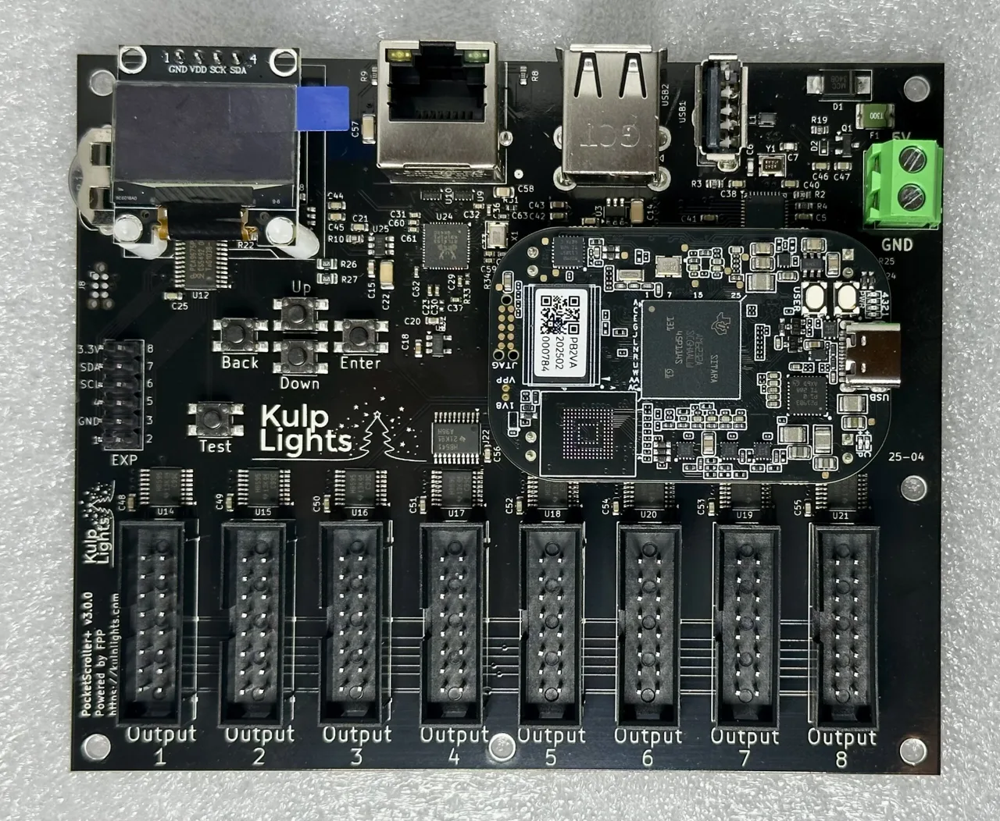
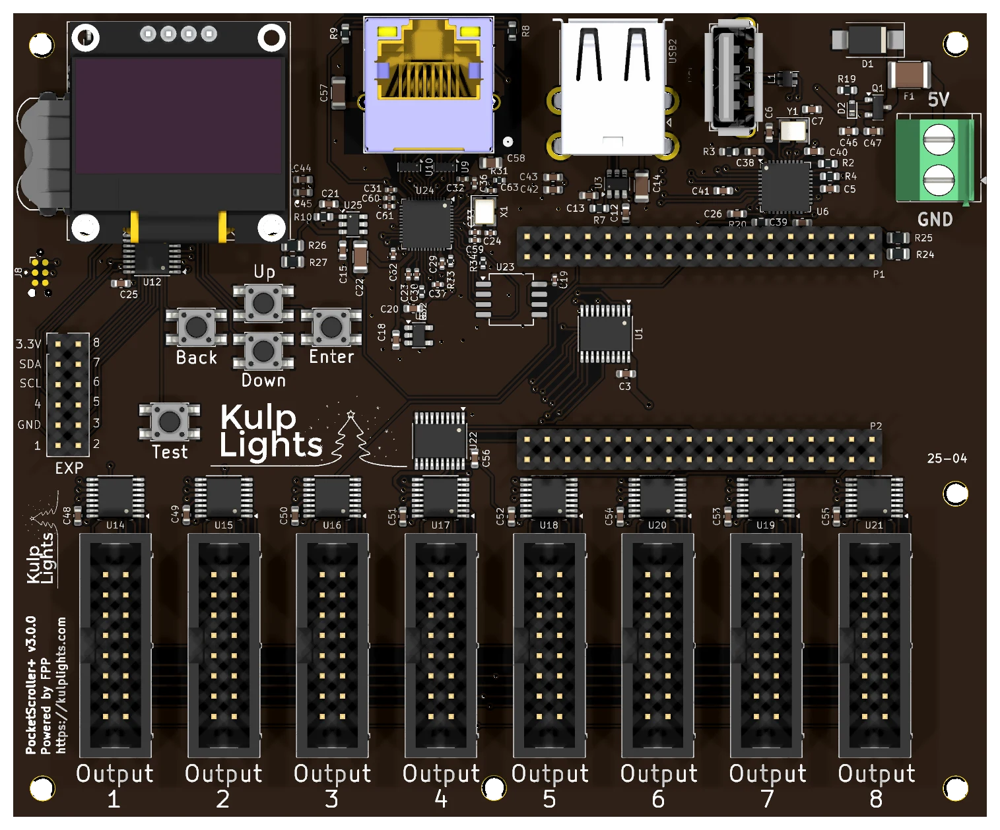

# PocketScroller v3

Eight HUB75 outputs for driving LED panel matrices from a PocketBeagle 2.

{ .board loading=lazy }

<small>PocketScroller v3 with a PocketBeagle 2 fitted.</small>

This page covers board revision **v3.0.0**. The board is sold as the PocketScroller v3, but printed
on it as `PocketScroller+ v3.0.0`.
FPP calls it **PocketScroller**.

## Specifications

| | PocketScroller v3 |
|---|---|
| Panel outputs | 8 × HUB75 (2×8 shrouded header), with E line for 1/32-scan panels |
| Capacity | about 80 64×32 panels at 12-bit colour and 60 Hz (10 per output); see [Capacity](#capacity-refresh-rate) |
| Signal level | 5 V |
| Power input | **5 V DC only**, 2-pin 5.08 mm screw terminal |
| Input protection | 3 A resettable fuse, over-voltage clamp, reverse-polarity protection |
| Panel power | **not supplied.** Panels need their own 5 V supply. |
| Ethernet | 1 × Gigabit (USB-attached) |
| USB-A | 3 |
| Display & buttons | 128×64 OLED, Up / Down / Enter / Back / Test |
| Real-time clock | yes, CR1220 backup cell |
| Expansion header | 2×6: I²C + 8 GPIO (Exp.1–Exp.8) |
| Audio, DMX, pixel ports | none |
| Size | 121.95 × 100.70 mm (4.80 × 3.96 in), 6 mounting holes, 3.0 mm |
| Requires | PocketBeagle 2 (not PocketBeagle 1), FPP 9.0 or later |

## Board map

{ .board loading=lazy }

### Power

!!! danger "5 V only"
    The PocketScroller v3 has **no voltage regulator**. Connect a regulated **5 V** supply to the
    terminal marked **5V** / **GND** (top-right corner). A 12 V or 24 V supply makes the
    protection clamp conduct and trip the resettable fuse, and can damage the board.

- The terminal powers the PocketBeagle 2, the panel drivers, Ethernet and the USB ports. The board
  draws very little, but use a **5 V supply rated 5 A or more**: it handles ripple and spikes better.
- **The panels are not powered through the PocketScroller.** Run each panel's power from your 5 V panel
  supply. You can feed the PocketScroller from the same supply.
- There are no power LEDs. When the board is running, the OLED shows status.
- FPP shows the input voltage as **VIN**.

### Panel outputs

The eight outputs run along the bottom edge, marked **Output 1** to **Output 8** from left to right.
Each is a standard **HUB75** connector:

| Pin | Signal | Pin | Signal |
|---|---|---|---|
| 1 | R1 | 2 | G1 |
| 3 | B1 | 4 | GND |
| 5 | R2 | 6 | G2 |
| 7 | B2 | 8 | E |
| 9 | A | 10 | B |
| 11 | C | 12 | D |
| 13 | CLK | 14 | LAT |
| 15 | OE | 16 | GND |

- Use the ribbon cables that come with your panels. The red stripe goes to pin 1 (marked on the
  header's shroud).
- Chain panels from each output's *input* connector to the next panel's input, following the arrows on
  the panels.
- Spread the panels evenly across all eight outputs. The refresh rate depends on the longest chain
  (see [Capacity & refresh rate](#capacity-refresh-rate)).

### Other connectors

| Connector | Marking | Details |
|---|---|---|
| Ethernet | (RJ45 with LEDs) | [Network](../hardware/network-usb-rtc.md#ethernet) |
| USB-A | — | 3 ports, [USB](../hardware/network-usb-rtc.md#usb-ports) |
| OLED | `GND 3.3V SCL SDA` | [Controls & display](../hardware/controls.md) |
| Expansion | `EXP` | [Expansion header](../hardware/expansion.md) (PocketScroller pinout) |
| RTC battery | coin-cell holder, top-left | [Clock](../hardware/network-usb-rtc.md#real-time-clock-rtc) |

## Capacity & refresh rate

How many panels you can run depends on how long each chain is and on the colour depth. The
table gives the full-frame refresh rate in Hz for **64×32 panels** at FPP's default
brightness (10). **Bold** values are 60 Hz or more. *Italic* values are under 60 Hz, where flicker
starts to show on camera and to some viewers.

| Panels per output | Total panels | 12-bit | 10-bit | 8-bit | PWM panels (fps) |
|---:|---:|---:|---:|---:|---:|
| 1 | 8 | **192** | **200** | **210** | **545** |
| 2 | 16 | **166** | **179** | **194** | **272** |
| 3 | 24 | **143** | **157** | **174** | **182** |
| 4 | 32 | **128** | **143** | **162** | **136** |
| 5 | 40 | **110** | **124** | **143** | **109** |
| 6 | 48 | **96** | **108** | **126** | **91** |
| 8 | 64 | **75** | **86** | **100** | **68** |
| 10 | 80 | **60** | **69** | **81** | **54** |
| 12 | 96 | *54* | **62** | **73** | **45** |
| 16 | 128 | *45* | *53* | **64** | *34* |

- **Rule of thumb at 60 Hz:** up to **10 panels per output at 12-bit colour**
  (80 panels), or 16 per output at 8-bit (128 panels).
- **Refresh depends only on the longest chain.** Every output is clocked whether or not a panel is
  attached, so using fewer outputs doesn't make it faster. Spread the panels evenly across all
  8 outputs.
- **1/8-scan outdoor panels** refresh within a few percent of these 1/16-scan figures. Panels with
  shift-register row drivers ("ABC-shift" addressing, found on some outdoor 1/8 panels) are 7–16 %
  slower.
- Lowering colour depth is the easiest way to win back refresh on long chains. Lowering the brightness
  setting raises refresh slightly (about 9 % at brightness 8).
- The brightest bit plane is split into up to four pulses per frame, so the flicker a viewer actually
  sees runs 2–4× faster than the full-frame figure.

!!! note "Estimated figures"
    These numbers come from FPP's refresh estimator for the 8-output firmware. On the
    PocketScroller-16 the same estimator matched hardware measurements to within 0.5 %, but the
    8-output timing hasn't been measured on a board yet.

### PWM panels

Panels with **PWM driver chips** (FM6363C, FM6353, FM6373) run their own 16-bit greyscale, so they
don't flicker as chains get longer. Chain length limits only how many **new frames per second** reach
the panels: the last column of the table. Bold values there meet a 40 fps sequence, which works out
to up to **12 panels per output** (96 panels). Select the panel's driver chip under
**Panel Type** in FPP's LED Panels settings.

## FPP setup

When FPP detects the PocketScroller it sets up an **LED Panels** output (*Input/Output Setup →
Channel Outputs → LED Panels*) with the **PocketScroller v3** wiring. The starting layout is a
2×2 block of 64×32 panels at low brightness. Change it to match your panels:

1. Set the **panel size and scan** (e.g. 64×32 1/16, 64×64 1/32).
2. Set the **layout**: how many panels wide and high.
3. In the grid, assign each panel to an **output** and a **position in the chain**, and set its
   orientation.
4. Set **colour depth** and **brightness**, then save. FPP restarts the output.

See [LED panel matrices](https://manual.falconplayer.com/054-channel-outputs/#led-panel-matrices) in
the FPP manual for every field.

## Dimensions & mounting

- **121.95 × 100.70 mm** (4.80 × 3.96 in), 6 plated mounting holes, 3.0 mm, for **M2.5** (or #4) screws and standoffs.
- Mounting drawing: [PDF](https://kulplights.com/wp-content/uploads/2025/05/PocketScrollerV3.pdf) · [SVG](https://kulplights.com/wp-content/uploads/2025/05/PocketScrollerV3.svg).

