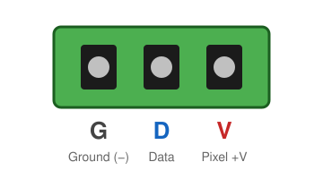

# Pixel outputs

The local pixel ports are labelled **P1**, **P2**, … on the board (**PT1**, **PT2**, … on the K8-PB and K4-PB). Each is a
**3-pin, 3.5 mm pluggable (Phoenix-style) connector**, and the plugs come with the board. The
plug pulls straight off the board, so you can wire your pigtails at the bench and plug them in
on site. Spare plugs, in screw or spring-clamp ("Advanced") styles, are sold as
[pixel connectors](https://kulplights.com/product/pixel-connectors/).

{ width="360" }

| Pin | Silk | Signal |
|---|---|---|
| 1 | **G** | Ground (−) |
| 2 | **D** | Data |
| 3 | **V** | Pixel power (+), fused, from that port's bank |

The letters **G D V** are printed next to every port. Check them against your pigtail
colours before you power up. **Pixel colour codes vary by manufacturer**, and a
reversed string is usually destroyed at once.

## Wiring a pigtail

1. Strip about 6 mm (¼ in) of each wire. Tin the strands or fit a ferrule.
2. Loosen the three screws on the plug and insert the wires: ground in **G**, data in **D**,
   and +V in **V**.
3. Tighten each screw firmly and tug-test each wire.
4. With the power **off**, push the plug fully onto its port.

!!! tip "Wire size"
    The plugs take wire up to **16 AWG** (1.5 mm²). Use 16 or 18 AWG pigtails for strings that
    draw several amps.

## Data signal

- The data output is **5 V logic** on every board, whatever the pixel voltage. It works
  directly with WS2811/WS2812-family pixels at 5, 12 and 24 V.
- Each data line has a series resistor at the controller. For long first runs (more than
  about 5 m / 15 ft to the first pixel), use a null pixel or a differential receiver
  instead of a long bare data lead.

## How many pixels per port?

FPP drives up to **800 pixels per port at 40 frames per second** on these boards, on the local
ports and on each differential string. Plan power injection for anything over a few hundred
pixels. A long string needs power at both ends or along its length, not just from the controller.

!!! note "Smart receivers use some of the 800"
    When a differential port runs **smart receivers**, the smart-receiver protocol uses part of
    that port's pixel time. v2 and V4 cost only a few pixels, but **V5 leaves about 725**, and
    v1 loses more with each receiver. See
    [Pixel budget with smart receivers](differential.md#pixel-budget-with-smart-receivers).
    Receivers in dumb mode cost nothing.

## Port numbering

FPP's port numbers match the silk: **P1** is FPP port 1, and so on. The differential
ports continue the numbering after the local ports. On a K16, for example, the RJ45
marked `17-20` carries FPP ports 17, 18, 19 and 20.

Each board page has a map showing where each port is on the board.

## Port LEDs

Each local port has a small green LED next to it:

| LED | Meaning |
|---|---|
| **On** | The port has power. The bank is powered, and the fuse is intact (eFuse not tripped). |
| **Off**, rest of bank on | Blown fuse (K16/K32/Pro), tripped or disabled eFuse (Max) |
| **Off**, whole bank off | No power on that bank's terminal, or the bank is switched off (Pro/Max) |

The LED shows **power**, not data. To check data, run a [test pattern](controls.md#test-button).
