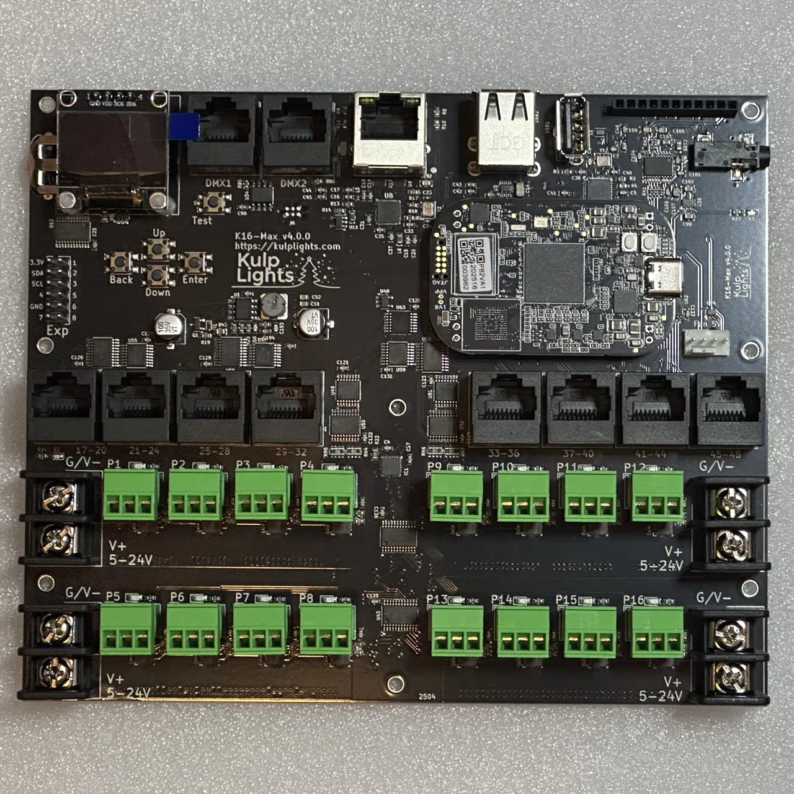
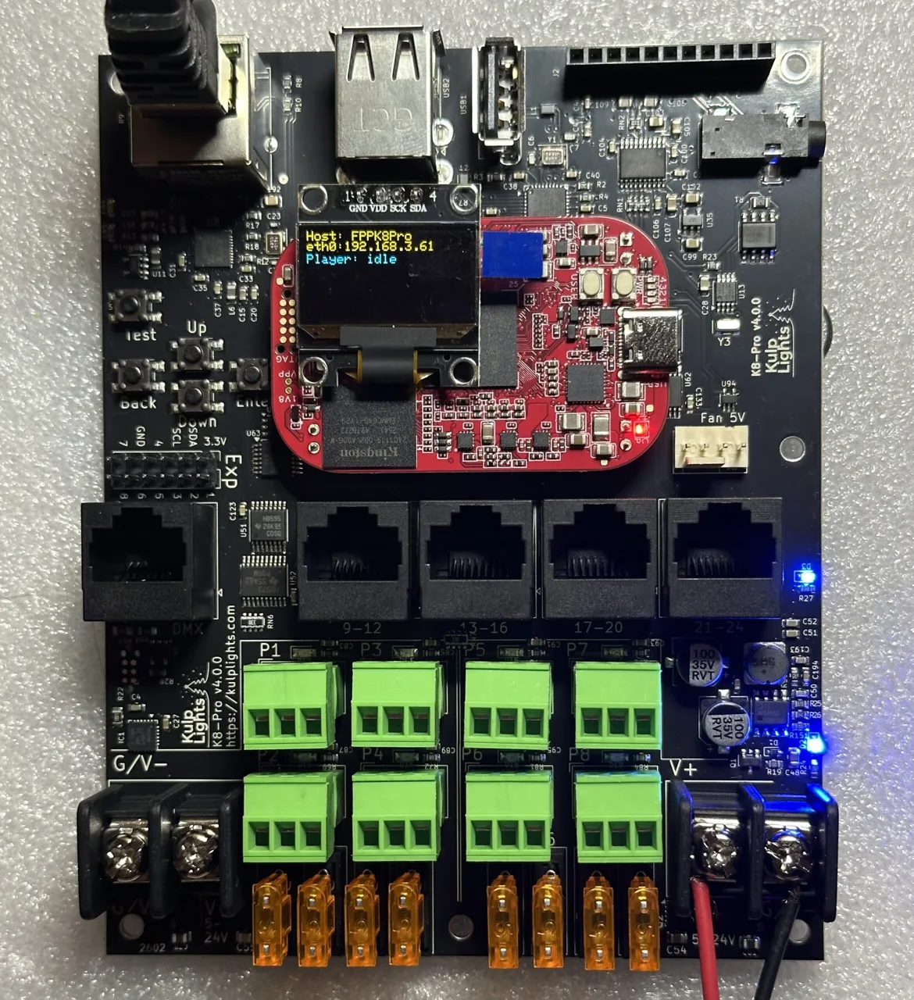

# PocketBeagle 2

Every board in this manual is a **cape** for the **BeagleBoard PocketBeagle 2** (PB2). The PB2 is
a small computer that runs FPP, and the cape adds the power, outputs and connectors.

!!! danger "PocketBeagle 2 only"
    These capes **do not work with the original PocketBeagle (PocketBeagle 1)**. The two look
    alike, but the PocketBeagle 2 has a different processor and pinout. The exceptions are the
    [K4-PB](../boards/k4-pb.md) and the [PocketScroller v2](../boards/pocketscroller-v2.md),
    which work with either.

## Regular or Industrial

Kulp Lights sells the boards with or without a PB2 already fitted:

| | PocketBeagle 2 | PocketBeagle 2 Industrial |
|---|---|---|
| Board colour | **black** | **red** |
| Memory | 512 MB | 1 GB |
| Storage | microSD card | **64 GB eMMC with FPP pre-installed**, microSD optional |
| Temperature range | commercial | −40 to 85 °C |
| Notes | the usual choice | eMMC is about twice as fast as an SD card. Recommended for outdoor or heavily loaded shows. |

## Fitting the PocketBeagle 2

<figure markdown>
{ .board loading=lazy }
<figcaption>Regular PocketBeagle 2 (black) on a K16-Max</figcaption>
</figure>

<figure markdown>
{ .board loading=lazy }
<figcaption>PocketBeagle 2 Industrial (red) on a K8-Pro, under the OLED</figcaption>
</figure>

The PocketBeagle 2 fits the same way round on **every** board in this manual: its **USB-C connector
faces the right-hand edge** of the board, the edge opposite the buttons and the Exp header. Its
**P1** header goes into the cape socket marked **P1** (the one nearer the Ethernet and USB
connectors; on the K8-PB, the upper one), and **P2** into **P2**.

If your board came without a PB2 fitted:

1. **Disconnect all power.**
2. On the K8 boards the OLED sits over the PocketBeagle. Unplug it from its 4-pin socket first,
   removing its standoff screws if fitted.
3. Hold the PB2 with its USB-C connector toward the right-hand edge, and line its pins up with both
   sockets.
4. Press it down evenly, rocking gently end to end, until it is fully seated. Don't press on the
   processor.
5. Refit the OLED.

!!! warning "Orientation"
    A PB2 plugged in backwards, or shifted by a row, can be damaged at power-up. Before you power
    on, check that the USB-C faces the right-hand edge and that no pins are left over at either end.

## Storage: SD card or eMMC

- **Regular PB2:** FPP runs from a **microSD card**. Use a good-quality card of 16–32 GB
  (A1/A2, U3). Cheap or counterfeit cards are the most common cause of strange problems. You
  can buy a card with FPP already installed, or write the PocketBeagle 2 image yourself. See
  [Getting the FPP software](https://manual.falconplayer.com/006-quickstart/#getting-the-fpp-software).
- **PB2 Industrial:** FPP is pre-installed on the internal **eMMC**, so no SD card is needed.
- A [microSD extender](https://kulplights.com/product-category/accessories/) lets you reach the
  card slot when the board is in an enclosure.

### SD card in a PB2 Industrial

A PB2 Industrial always starts from its eMMC, but the bootloader there **checks for a valid SD card
first and boots from the card if it finds one**. So:

- **Don't leave an old FPP card in the slot** of an Industrial board. It will boot the card, not
  the eMMC.
- To run a different FPP version or a clean install for a while, just insert a card with FPP on it.
  Take the card out to go back to the eMMC.

### Re-flashing the eMMC

To put a fresh copy of FPP on the eMMC, for example to start clean or to recover a broken
install:

1. Write the PocketBeagle 2 FPP image to an SD card. See
   [Getting the FPP software](https://manual.falconplayer.com/006-quickstart/#getting-the-fpp-software).
2. Insert the card and power up. The board boots from the card.
3. In FPP, go to **Status/Control → FPP Settings → Storage**. Under **Flash FPP to Another Device**,
   find the eMMC (`/dev/mmcblk0`) and choose:
    - **Create** for a clean install. Your media, sequences and settings are left behind.
    - **Copy** to bring your media, sequences and settings along.
4. Wait for it to finish. This can take a while. Then power off, **remove the SD card**, and power
   up again from the eMMC.

!!! note "If the board won't boot at all"
    If the eMMC's bootloader is damaged, the board can't find the SD card on its own. Hold the
    PocketBeagle 2's **second button** while you apply power to force it to boot from the SD
    card, then re-flash as above. This is very rarely needed.

You don't need to re-flash to update FPP. FPP and OS updates work in place on the eMMC; see
[Updating](../software/updating.md). Re-flashing is only for a clean start or recovery.

## Powering

The PB2 is powered **from the cape**, through its power terminal (see [Power](power.md)).

!!! note "USB-C"
    Don't use the PB2's USB-C port to power the controller. USB-C can't power the cape's Ethernet,
    USB ports or outputs, and the PB2 does **not support USB tethering** for setup. Use Ethernet
    for first setup.
